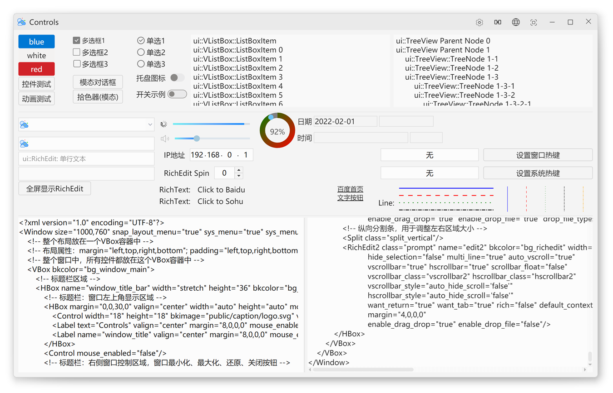

English | [简体中文](README.md)

> Last synced: 2026-10-29

# nim_duilib

[nim_duilib](https://github.com/rhett-lee/nim_duilib) is a cross-platform desktop UI library based on **C++20**, derived from the classic duilib (evolved through NIM_Duilib_Framework): XML describes the UI structure and styles, C++ implements the business logic, and Skia does the rendering. The same UI code can be built for Windows, Linux, macOS and FreeBSD, which suits desktop clients that need native capabilities (tray, web controls, system notifications, DPI awareness) without rewriting the UI for every platform.

- Language standard: C++20 on `main` and `develop`; C++17 on the `develop-cpp17` branch (Windows VS2017/VS2019 only)
- Supported platforms: Windows 7/10/11 (x86/x64/arm64; Windows 7 uses CEF 109), Linux x64, macOS x64/arm64, FreeBSD x64
- Version: see [duilib/duilib_version.h](duilib/duilib_version.h); release packages on GitHub Releases; change history in [CHANGELOG.en.md](CHANGELOG.en.md)
- License: [MIT](LICENSE)


## Positioning and Scope

Confirming up front what the library covers, and what still needs extra work, avoids rework after the technology choice.

**Positioning**: a C++ UI library for desktop clients. It fits desktop applications that need deep UI customization while covering Windows/Linux/macOS, and projects migrating from duilib / NIM_Duilib_Framework. It provides the *UI layer*: windows, layouts, controls, rendering, resources and events; networking, storage and business logic remain in your own code or third-party libraries.

**Scope** (the points that matter most when getting started):

- **Rendering**: Skia is the required backend for vector drawing, text and animation. The build script prepares and compiles it automatically from the [version manifest](cmake/third_party_versions.json), so no manual build is needed; if that step fails it is usually a network or toolchain issue, and `doctor` points out which item is missing.
- **Development workflow**: XML + C++ is the primary approach; the repository ships no visual designer. The `.claude` AI skills can help generate UI code.
- **Platform-specific features**: WebView2 is Windows only; "independent DPI settings" is Windows only; system window shadows are Windows/macOS only.
- **CEF**: enabled by default on Windows/Linux/macOS; not supported on FreeBSD or MinGW. Version 156 is the default (requires Windows 10+); to run web controls on Windows 7, build with `--cef-version 109`.
- **Animation**: GIF/APNG/WebP/Lottie work out of the box; PAG is disabled by default and can only be enabled on Windows with the MSVC solution (libpag must be compiled yourself).
- **SDL3**: off by default on Windows (enable with `--sdl`), mandatory on Linux/macOS/FreeBSD for window management and input.
- **Runtime library**: static runtime (/MT, /MTd) is the Windows default; add `--md` for the dynamic runtime (/MD, /MDd).
- **DLL mode**: with `--dll` on Windows MSVC the library is built as a dynamic library, producing `bin/duilib.dll` (`bin/duilib_d.dll` for Debug) with the import library at `lib/<arch>/<Config>/duilib.lib`. It suits dynamic loading, smaller executables, or sharing one library between several programs; a program can use either the static library or the DLL, and the DLL must be shipped with it.

## Key Features

The following capabilities cover the most common desktop client needs; most of them can be verified directly in the example programs.

- **XML-driven layout**: UI structure and business logic are separated, so adjusting a layout or re-skinning only requires editing XML instead of reorganizing C++ code.
- **Rich controls and containers**: basic controls, virtual lists, trees, menus, property grids, tab pages and more, plus support for custom controls and custom containers.
- **Skia windowless rendering**: most controls do not depend on native window handles, and the backend can draw on CPU or GPU, keeping complex UIs smooth.
- **Event driven**: callbacks can be bound in C++, or event handlers configured directly in XML, keeping interaction logic centralized and readable.
- **Image formats**: SVG/PNG/GIF/JPG/BMP/APNG/WEBP/ICO.
- **Animation formats**: GIF, APNG, WEBP, Lottie JSON, PAG (off by default).
- **Multi-language, dynamic skinning, light/dark themes and accent colors**: strings and colors are managed centrally, and switching language or theme needs no restart.
- **Window shadows**: rounded and square shadows, plus system shadows on Windows and macOS.
- **DPI awareness**: Unaware, SystemAware, PerMonitorAware and PerMonitorAware_V2 (Windows).
- **Web controls**: CEF (Windows/Linux/macOS) and WebView2 (Windows only).

## UI Preview

The screenshot below shows `examples/controls` at runtime, giving a quick view of how the common controls look by default. Fonts, colors and images all come from the XML skin resources under `bin/resources`; replacing those resources produces a completely different visual style, which is also the basis for dynamic skinning.



Screenshots and descriptions of the other examples (basic, render, layout, ListCtrl, TreeView, CEF, ...) are in [docs/Examples.en.md](docs/Examples.en.md).

## Requirements

The build has two parts: you provide the compiler and basic tools, while third-party source dependencies (Skia/SDL3/CEF) are fetched, compiled and cached by `build.py` according to the [version manifest](cmake/third_party_versions.json), into directories next to the repository. Prebuilt libraries therefore do not need to be installed locally; however, when system development packages are missing, the CMake configure step fails immediately, so install what the error message asks for.

### Languages and Compilers

| Platform | Architecture | Compiler | Notes |
| :--- | :--- | :--- | :--- |
| Windows | x86 / x64 / arm64 | Visual Studio 2022 (v143), Visual Studio 2026 (v145), MSYS2 / MinGW-w64 (gcc or clang) | Supports Windows 7 and later; for VS2017/2019 use the `develop-cpp17` branch |
| Linux | x64 | gcc 10+, clang 12+ | arm64: see "pending confirmation" below |
| macOS | x64 / arm64 | Xcode 16+ (AppleClang; the CEF wrapper uses C++20) | Build host needs macOS 14.5+; binaries target macOS 13.0 (CEF 156 deployment target) |
| FreeBSD | x64 | system clang | |

Windows 7 compatibility comes from the library configuration ([duilib/duilib_config.h](duilib/duilib_config.h) targets Windows 7+ by default) plus CEF 109; CEF 156 requires Windows 10 or later.

### Build Tools

| Tool | Requirement | Purpose and notes |
| :--- | :--- | :--- |
| CMake | 3.24+ | Generates build files; the root project uses CMakePresets |
| Python | 3.8+ | Runs `build/build.py`; the Skia build scripts additionally require `python3` on PATH |
| Git | any recent version | Fetches Skia/SDL3 sources and CEF archives |
| Ninja | build backend | Windows uses the copy bundled with Visual Studio |
| macOS extras | `brew install cmake ninja`, and build `gn` from source | The Skia build needs `gn` |
| FreeBSD extras | `sudo pkg install git unzip python3 cmake ninja gn llvm fontconfig freetype2` | Installs the toolchain and font dependencies in one go |

### Linux System Dependencies

Linux also needs distribution-provided development packages for X11, fonts, OpenGL/EGL, DBus/ibus and so on. Package names differ between distributions, and a wrong or missing package usually shows up at the CMake stage as `Could not find X11`, `Could not find Freetype` or `Could not find Fontconfig`. Per-distribution install commands, the required package list and verification steps are in a separate document: [build/linux-dependencies.en.md](build/linux-dependencies.en.md). The commands come from the repository's build documentation and cover Ubuntu, Debian, Fedora, openSUSE, OpenEuler, OpenKylin, UbuntuKylin, Zhongke Fangde and UnionTech UOS; apart from Ubuntu they have not been tested one by one, and the document states the verification scope.

### Platform Verification Status

The table records only results for which evidence exists in the repository; combinations without a verification record are never described as "supported".

| Platform / arch | Verification environment | Status |
| :--- | :--- | :--- |
| Windows 7 x64 | manual test on physical hardware (CEF 109) | verified |
| Windows 10/11 x64 | VS 2022 17.14 (MSVC 14.44), VS 2026, CMake 4.3, Python 3.14; MSYS2, llvm-mingw and x86 also tested | verified |
| Windows arm64 | VS 2022 cross toolchain; build, DLL mode and packaging | build/packaging verified; no arm64 machine available, so startup not verified |
| macOS x64 | AppleClang 21, CMake 4.0.2, Python 3.13 | verified |
| macOS arm64 | Apple Silicon physical machine | verified |
| Linux x64 | VMware virtual machine, CMake 3.31, gcc (clang also tested) | verified; distributions other than Ubuntu pending confirmation |
| FreeBSD x64 | FreeBSD virtual machine, system clang | verified |

Items still marked **pending confirmation**: Linux arm64, actual verification on Linux distributions other than Ubuntu, and the minimum macOS version. Detailed cases, commands and results are in [build/test-matrix.md](build/test-matrix.md) (Chinese).

## Quick Start

The steps below assume the compilers and build tools from the tables above are installed and GitHub is reachable. The first build compiles Skia from source and downloads the CEF runtime, which takes from a dozen minutes to an hour; dependencies are cached next to the repository (change the location with `--deps-root`), so later incremental builds no longer download or compile them.

### Why Always `python3 build/build.py`

The repository no longer ships a separate build script per platform, and the documentation always writes `python3 build/build.py`. There are three reasons: the Skia build scripts call `python3` directly, so a missing `python3` fails before Skia starts compiling and `python` cannot substitute for it; common macOS/Linux environments only provide `python3`, so a command written with `python` ends in "command not found"; and with a single command the documentation only needs one set of commands, new users need not decide which script to use, and parameters, subcommands and output paths are identical on every platform, keeping the learning cost minimal. `build.py` detects the platform and compiler, selects the generator, prepares dependencies, and provides the subcommands `doctor` (environment check), `deps` (dependencies only), `test` (unit tests), `pack` (packaging) and `clean` (cleanup).

On Windows, if there is no `python3` command, replace the leading `python3` with `py -3`, or with the `python` that points to Python 3 in your environment (check the version with `--version` first); these two forms apply to Windows only, and every other command in this document uses `python3`. Note that they only change how `build.py` is launched: the Skia build stage still requires `python3` on PATH, otherwise it aborts with an error before compiling Skia.

### Windows (verified: Windows 10/11 x64 + VS 2022/VS 2026)

Prerequisites: Visual Studio 2022 or 2026 with the "Desktop development with C++" workload, Git and Python 3.

```bat
git clone https://github.com/rhett-lee/nim_duilib.git
cd nim_duilib
python3 build/build.py doctor
python3 build/build.py
bin\basic.exe
```

- `doctor` only checks the environment and does not modify the repository. It prints a summary of compiler, CMake, Python and dependency directories; if something is missing or too old it gives a hint, so fix the environment first.
- The first build prepares dependencies and then compiles. On success the log ends with `[OK] build finished`; on failure it ends with `[ERROR] build failed` and points to the compiler output above.
- Output: example programs in `bin\` (same name for Debug/Release), static libraries in `lib\x64\Release`, build tree in `out\x64\Release`. If `bin\basic.exe` opens its window, the toolchain, dependencies and runtime resources are all in place.
- To check only that the library compiles: `python3 build/build.py build --no-examples --target duilib`.
- To skip the CEF examples for now: `python3 build/build.py --cmake-arg=-DDUILIB_ENABLE_CEF=OFF` (the other examples still build).
- Debug build: `python3 build/build.py --config Debug`. One invocation builds one configuration; run it twice for both.

### Linux / macOS / FreeBSD

Prerequisites: the compiler, CMake, Ninja, Git and Python 3 as described above; on Linux also install the system development packages listed in [build/linux-dependencies.en.md](build/linux-dependencies.en.md).

```bash
git clone https://github.com/rhett-lee/nim_duilib.git
cd nim_duilib
python3 build/build.py doctor
python3 build/build.py
./bin/basic            # on macOS: open bin/basic.app
```

- On macOS, `basic` is built as `bin/basic.app` by default; the example C++ code needs no changes.
- A successful build looks the same as on Windows: the log ends with `[OK] build finished`, and `bin/basic` (or `bin/basic.app`) starts.
- If the CMake configure step cannot find X11 or font packages, install them as described in [build/linux-dependencies.en.md](build/linux-dependencies.en.md); if the Skia build cannot find `gn`/`ninja`/`clang`, install the corresponding build tools.

### Using the Visual Studio Solution

If your team wants to debug in the Visual Studio IDE, the solutions still work, but they do not prepare dependencies automatically, so run dependency preparation once first:

```bat
python3 build/build.py deps
```

Then open `build/examples.sln` and build (use `build/examples_no_cef.sln` when CEF is not needed). Debug output from the solution carries a `_d` suffix (such as `basic_d.exe`), which differs from the `bin\basic.exe` produced by `build.py`; the intermediate directories are independent as well (the solution uses `build/build_temp`, the command-line entry uses `out/<arch>/<Config>`).

### DLL Mode (Windows MSVC only)

The default build produces a static library. To turn the UI library into a dynamically loaded component, shrink the main executable, or share one library between several programs, use `--dll` on Windows MSVC:

```bat
python3 build/build.py --dll --config Release
```

- `--dll` implicitly enables `--md` (/MD, /MDd) and switches Skia to the matching `.md`/`.mdd` variants; `deps` prepares them automatically, with no manual step.
- Expected output: `bin/duilib.dll` (`bin/duilib_d.dll` for Debug, `duilib32*.dll` on x86) plus the import library `lib/<arch>/<Config>/duilib.lib`; example programs link only the import library. The success log also ends with `[OK] build finished`.
- Release packaging must ship `bin/duilib*.dll` together with the executable; the typical symptom of a missing DLL is "duilib.dll not found" at program startup.
- This mode supports Windows + MSVC only; Linux/macOS/FreeBSD still build static libraries. `--dll` does not enable SDL as a side effect; add `--sdl` when needed.
- When packaging, `pack.py` collects `bin/duilib*.dll` automatically and appends `-dll` to the package name; switching between DLL and static mode cleans the build directory automatically so old artifacts are never mixed in.

## Directory Layout

Understanding the layout helps locate sources and documents quickly; the generated directories (`out/`, `lib/`, `dist/`) can be deleted at any time and restored by rebuilding.

| Directory | Description |
| :--- | :--- |
| `duilib/` | Library sources, split by module: `Core`, `Control`, `Box`, `Layout`, `Render`, `RenderSkia`, `Image`, `Animation`, `CEFControl`, `WebView2`, `Utils`, `third_party` |
| `examples/` | Several ready-to-run examples covering basic windows, control demos, rendering, layouts and WebView; the list is in [docs/Examples.en.md](docs/Examples.en.md) |
| `bin/` | Output directory for example programs, including the `resources/` skins and language resources and the CEF runtime (after building) |
| `docs/` | Documents and screenshots for controls, layouts, events and deployment; index in [docs/Summary.en.md](docs/Summary.en.md) |
| `build/` | Unified build entry `build.py`, packaging and release scripts, VS solutions, [build reference](build/build-reference.en.md), [Linux system dependencies](build/linux-dependencies.en.md) |
| `cmake/` | Shared CMake modules and the third-party version manifest |
| `msvc/` | Windows manifest files and shared VS project settings (such as the libpag switch) |
| `packaging/` | SDK integration layer (CMake package and MSVC props/targets) |
| `licenses/` | License files of third-party components |
| `out/<arch>/<Config>` | Build tree (generated) |
| `lib/<arch>/<Config>` | Library output (generated) |
| `dist/<version>` | Release packages (generated by `pack`) |
| `.claude/` | AI skill definitions and registration scripts |

## Common Build and Run Commands

All commands run from the repository root, and one invocation builds one architecture plus one configuration; run twice for Debug and Release. Windows and Unix use the same `python3 build/build.py` command.

| Goal | Command |
| :--- | :--- |
| Environment check | `python3 build/build.py doctor` |
| Build Release (library + examples) | `python3 build/build.py` |
| Build Debug | `python3 build/build.py --config Debug` |
| Prepare dependencies only (Skia/SDL3/CEF) | `python3 build/build.py deps` |
| Library only | `python3 build/build.py build --no-examples --target duilib` |
| Run unit tests | `python3 build/build.py test` |
| Build an SDK package | `python3 build/build.py pack --with-cef` (add `--with-examples` for examples) |
| Clean the build tree | `python3 build/build.py clean` (`clean --deps` cleans dependencies too) |
| Enable SDL3 (Windows) | `python3 build/build.py --sdl` |
| Dynamic runtime | `python3 build/build.py --md` |
| DLL mode (Windows MSVC only) | `python3 build/build.py --dll` (implicit `--md`; output `bin/duilib*.dll` + `lib/<arch>/<Config>/duilib.lib` import library) |
| Select architecture | `python3 build/build.py --arch arm64` |
| Use CEF 109 (Windows 7) | `python3 build/build.py --cef-version 109` |
| Offline build | `python3 build/build.py --offline` |
| Full parameter reference | [build/build-reference.en.md](build/build-reference.en.md) |

## Advanced Usage

The following paths cover deeper development scenarios; consult them as needed. Newcomers get smoother results by finishing "Quick Start" first.

- **Writing your first window**: [examples/basic](examples/basic) is the minimal project; the step-by-step tutorial is in [docs/Getting-Started.en.md](docs/Getting-Started.en.md). The tutorial uses the VS solution as its example, so take `python3 build/build.py deps` as the dependency-preparation command and this document's "Quick Start" as the build entry.
- **UI development documents**: [Windows](docs/Window.en.md), [containers/layouts](docs/Box.en.md), [controls](docs/Control.en.md), [menus](docs/Menu.en.md), [global styles](docs/Global.en.md), [events](docs/Events.en.md), [XML nodes](docs/XmlNode.en.md), [XML events](docs/XmlEvents.en.md).
- **Building and releasing**: full parameters in [build/build-reference.en.md](build/build-reference.en.md); dependency directories and release packaging in [build/README.en.md](build/README.en.md).
- **Built-in dialogs and notifications**: [MessageBoxWnd](docs/MessageBox.en.md), [ToastWnd](docs/Toast.en.md), [SystemNotification](docs/SystemNotification.en.md).
- **Web controls**: [CEF control](docs/CEF.en.md), [WebView2 example](examples/WebView2); running CEF examples requires the runtime under `bin/libcef_win/<arch>`.
- **SDK integration**: [docs/Deployment.en.md](docs/Deployment.en.md), [cmake/README.en.md](cmake/README.en.md) (CMake package integration and troubleshooting).
- **macOS App Bundle**: [build/macos-app-bundle.en.md](build/macos-app-bundle.en.md).
- **Enabling PAG**: Windows + the MSVC solution only. Set `LibPagEnabled` to `1` in [msvc/PropertySheets/LibPagSettings.props](msvc/PropertySheets/LibPagSettings.props) and build libpag as described in [libpag-build.md](duilib/third_party/libpag/windows/libpag-build.md) (Chinese); CMake builds do not include PAG.
- **AI-assisted development**: the repository ships three configurations—Claude, WorkBuddy and TRAE—with the same skill content, only loaded differently: Claude uses `.claude/skills/` with a registration script, WorkBuddy uses `.workbuddy/skills/nim-duilib/`, and TRAE uses `.trae/skills/nim-duilib/`; the three guides are [CLAUDE.md](CLAUDE.md) (Chinese), [WORKBUDDY.md](WORKBUDDY.md) (Chinese) and [TRAE.md](TRAE.md) (Chinese). For Claude, first run `.claude/register.bat` (Windows) or `bash .claude/register.sh` (Linux/macOS) to register the skills, then run `/nim-init` in any project; WorkBuddy and TRAE project-level skills need no registration script and trigger by intent. Start with `/nim-duilib-create-window`, `/nim-duilib-xml-layout`, `/nim-duilib-add-control`, `/nim-duilib-event-handler`, `/nim-duilib-theme` and `/nim-duilib-resource-pack`; the reference manual is [.claude/docs/nim-duilib-llm-reference.md](.claude/docs/nim-duilib-llm-reference.md) (Chinese).
- **Change history**: [CHANGELOG.en.md](CHANGELOG.en.md).

## FAQ

The table lists the most common symptoms and their fixes; for anything else, the output of `doctor` and the troubleshooting section of [build/build-reference.en.md](build/build-reference.en.md) usually pinpoint the failing step.

| Symptom | Fix |
| :--- | :--- |
| First build is very slow / fails while downloading | The first build compiles Skia and downloads CEF; with an existing cache or local archive use `--offline` or `--cef-archive <file>` |
| `doctor` reports that Visual Studio is missing | Install the C++ desktop workload of VS 2022 or 2026; when several versions coexist, select one explicitly with `--vs-version 17` (or `18`) |
| CMake version too old | Upgrade to 3.24+ |
| `python3` command not found | Install Python 3 and make sure `python3` is on PATH; see "Why Always `python3 build/build.py`" for the Windows special case |
| `bin/` still holds old examples after switching Debug/Release | `build.py` removes the examples of the other configuration automatically; when invoking CMake by hand, clean `bin/` yourself |
| CEF examples do not run | Check that `bin/libcef_win/<arch>` (on Linux `bin/libcef_linux`) contains the runtime; package with `pack --with-cef`, and keep the CEF version used for building and packaging identical |
| No text on Linux | Install fontconfig and a CJK font, see [build/linux-dependencies.en.md](build/linux-dependencies.en.md) |
| WebView2 example fails to start | Check that `bin/WebView2Loader.dll` was generated; see the FAQ in [cmake/README.en.md](cmake/README.en.md) |
| Other build problems | [build/build-reference.en.md §10 Troubleshooting](build/build-reference.en.md) |

## License and Contributing

- **License**: this project uses the MIT license, see [LICENSE](LICENSE). Keep the copyright notice and license text when distributing derived programs.
- **Third-party components**: overview in [THIRD-PARTY-NOTICES.en.md](THIRD-PARTY-NOTICES.en.md), per-component licenses in [licenses/](licenses); SDK packages contain `LICENSES/`, which must be kept when the SDK is distributed.
- **Feedback and contributions**: through GitHub issues/PRs; the repository provides a [bug report](.github/ISSUE_TEMPLATE/bug_report.md) (Chinese), a [feature request](.github/ISSUE_TEMPLATE/feature_request.md) (Chinese) and a [PR template](.github/pull_request_template.md) (Chinese). Before submitting, run `python3 build/build.py test` and make sure at least one platform builds Release successfully.
- **Current development plan**: enrich controls and features; keep testing and improving the SDL3-based cross-platform window engine (X11/XWayland is fairly stable, pure Wayland has more issues); fix defects.

## Differences from Upstream duilib / NIM_Duilib_Framework

This project systematically reworked NIM_Duilib_Framework: code split by functional module, XML parsing replaced with pugixml, the base library dependency removed, Skia and SDL3 integrated, the layout system rewritten, and 50+ controls/containers added. As a result, APIs, XML attributes and control behavior may differ from upstream, and upstream documentation cannot be used as documentation for this project; when migrating from upstream, check the list first.

The complete list of differences (a dozen overall improvements, twenty-odd feature refinements, 50+ new controls/containers, performance optimizations, example programs and documentation) and links to the upstream projects are in [docs/Differences.en.md](docs/Differences.en.md). Control attributes and usage are documented in [docs/Control.en.md](docs/Control.en.md).
