English | [简体中文](Examples.md)

> Last synced: 2026-11-27

## Sample Programs

The `examples` directory contains 23 ready-to-build samples covering everything from a first window and common controls to rich text, themes, multi-language, multi-threading, and CEF/WebView2 browsers. Every sample can serve as the starting point for a new project: run it first to see the result, then follow the code entry links to read the implementation.

> New here? Complete the build steps in [Quick Start (Windows + Visual Studio)](Getting-Started.en.md) or [Quick Start (CMake)](Getting-Started-CMake.en.md) first. All samples are written to the `bin` directory at the repository root after building, and can be run directly.

### Choose a sample by goal

| What you want to do | Recommended samples |
| :--- | :--- |
| Create your first window and understand the app skeleton | [basic](#1-examplesbasic) |
| See common controls, message boxes, and Toast at a glance | [controls](#3-examplescontrols) |
| Learn lists, tables, trees, and virtual lists | [ListBox](#5-exampleslistbox), [ListCtrl](#6-exampleslistctrl), [TreeView](#10-examplestreeview), [VirtualListBox](#11-examplesvirtuallistbox) |
| Learn layouts, drag-and-drop, and panel containers | [layout](#15-exampleslayout), [MoveControl](#7-examplesmovecontrol), [panel](#23-examplespanel) |
| Build a notepad or rich-text editor | [RichEdit](#9-examplesrichedit) |
| Themes, multi-language, and DPI adaptation | [ColorTheme](#22-examplescolortheme), [MultiLang](#12-examplesmultilang), [DpiAware](#13-examplesdpiaware) |
| Learn multithreading and timers | [threads](#14-examplesthreads) |
| Color picker, child windows, XML preview | [ColorPicker](#2-examplescolorpicker), [ChildWindow](#20-exampleschildwindow), [XmlPreview](#21-examplesxmlpreview) |
| Embed a browser | [cef](#16-examplescef), [CefBrowser](#17-examplescefbrowser), [WebView2](#18-exampleswebview2), [WebView2Browser](#19-exampleswebview2browser) |
| Build a complete chat interface | [chat](#4-exampleschat) |

## 1. examples/basic
**The minimal window skeleton.** A window sample you can use directly as the starting point for a new project: standard title bar, minimize/maximize/restore/close buttons, and theme/language switch buttons, all implemented with C++ plus XML skins.    
**Best for**: your first contact with nim_duilib, or understanding the minimum set of files a runnable app needs.    
**Code entry**: [MainThread.cpp](../examples/basic/MainThread.cpp), [MainForm.cpp](../examples/basic/MainForm.cpp); **UI resources**: `bin/resources/themes/default/basic/basic.xml`; **Related docs**: [Getting-Started.en.md](Getting-Started.en.md), [Window.en.md](Window.en.md).    
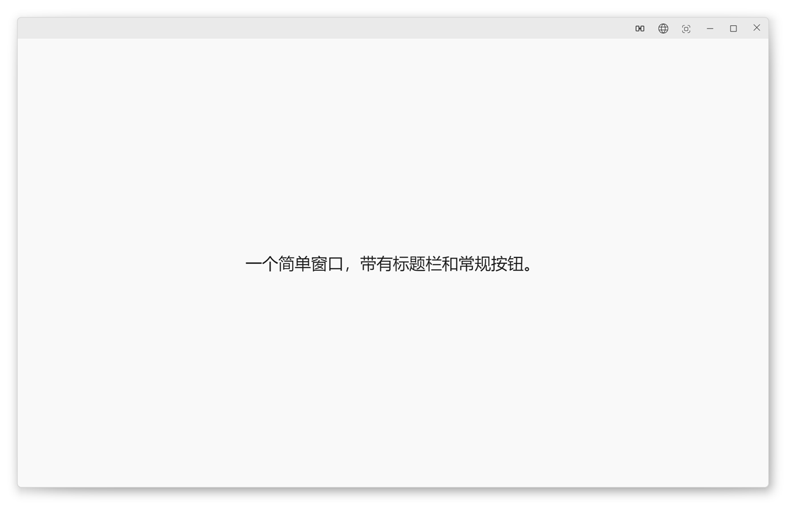

## 2. examples/ColorPicker
**A complete color picker integration.** The main window shows the current color swatch, `#AARRGGBB`, and R/G/B/A components. Click "Open Palette" to show the true-color picker; dragging previews the color through `AttachSelectColor`, "OK" returns the final color through `AttachWindowClose`, "Cancel" or Esc discards it, and the event log records each callback.    
**Best for**: choosing colors in an app, or learning independent windows, modal interaction, and live preview callbacks.    
**Code entry**: [MainThread.cpp](../examples/ColorPicker/MainThread.cpp), [MainForm.cpp](../examples/ColorPicker/MainForm.cpp); **UI resources**: `bin/resources/themes/default/color_picker_demo/ColorPickerDemo.xml` (demo window) and `bin/resources/themes/default/public/color/color_picker.xml` (the picker is a separate window whose skin folder is `public`); **Related docs**: the ColorPicker section in [Control.en.md](Control.en.md).    
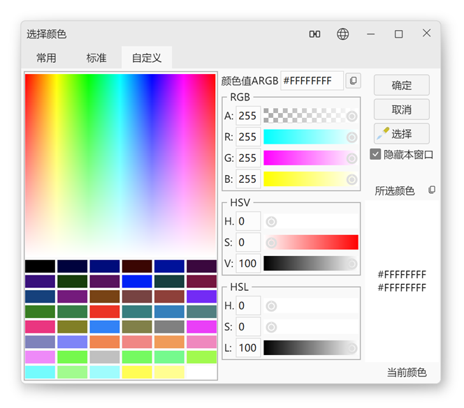    
(Left: demo main window; right: color picker)

## 3. examples/controls
**A control gallery.** Common control styles and interactions are shown in one window: buttons, check boxes, combo boxes, progress bars, sliders, dates, menus, message boxes, Toast, tree grids, and more. The directory also splits the XML by control (for example `message_box_test.xml`, `toast_test.xml`, `tree_grid.xml`), so you can copy what you need into your own project.    
**Best for**: quickly checking which controls the framework provides, how they look, and which XML drives them.    
**Code entry**: [MainThread.cpp](../examples/controls/MainThread.cpp), [ControlForm.cpp](../examples/controls/ControlForm.cpp); **UI resources**: `bin/resources/themes/default/controls/controls.xml`; **Related docs**: [Control.en.md](Control.en.md), [MessageBox.en.md](MessageBox.en.md), [Toast.en.md](Toast.en.md).    
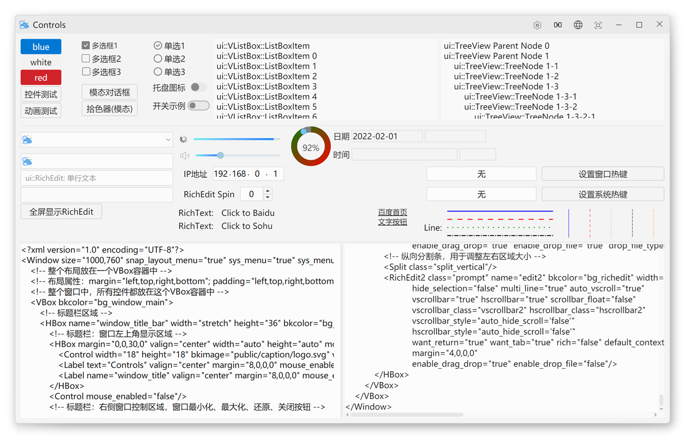

## 4. examples/chat
**A complete chat application.** Start from the login window, then enter the chat main window where navigation, conversations, messages, the input area, and message interactions are all connected — a practical reference for organizing a complex UI.    
**Best for**: IM/customer-support style interfaces, or multi-panel layouts with coordinated events.    
**Highlights**:
- Log in and enter the chat UI; theme and language switches take effect immediately;
- Conversations/contacts/favorites navigation, unread badges, search filtering, and per-conversation history;
- Text, image, quoted, and recalled messages, plus sending/delivered/read states and failure retry;
- Double-click to copy, context menus, a "new messages" hint while browsing history, and avatar style switching;
- Resizable window with adaptive layout; unconnected buttons give Toast feedback.

**Code entry**: [MainThread.cpp](../examples/chat/MainThread.cpp), [LoginForm.cpp](../examples/chat/LoginForm.cpp), [ChatForm.cpp](../examples/chat/ChatForm.cpp); **UI resources**: `bin/resources/themes/default/chat/wechat.xml`, `login.xml`, `menu_settings.xml`, `chat_message_menu.xml`, `chat_image_menu.xml`; **Related docs**: [Box.en.md](Box.en.md), [Control.en.md](Control.en.md), [Menu.en.md](Menu.en.md).    
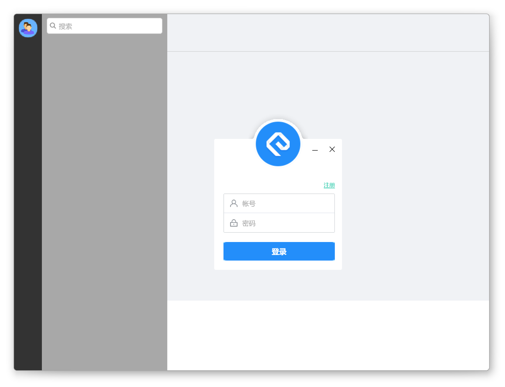

## 5. examples/ListBox
**The ListBox family.** The status bar shows the current container type, item count, and selected count, with a multi-select toggle. The event log shows Select/UnSelect/SelChanged/Click/DoubleClick/RClick/Return and keyboard events. Items support icons, progress bars, and individual deletion. Change the container tag in `list_box.xml` (`VListBox` / `HListBox` / `VTileListBox` / `HTileListBox`) to switch layouts without touching C++ code.    
**Best for**: learning the layout differences, selection modes, and event arguments of the ListBox family.    
**Code entry**: [MainThread.cpp](../examples/ListBox/MainThread.cpp), [ListBoxForm.cpp](../examples/ListBox/ListBoxForm.cpp); **UI resources**: `bin/resources/themes/default/list_box/list_box.xml`, `list_box/item.xml`; **Related docs**: [Control.en.md](Control.en.md).    
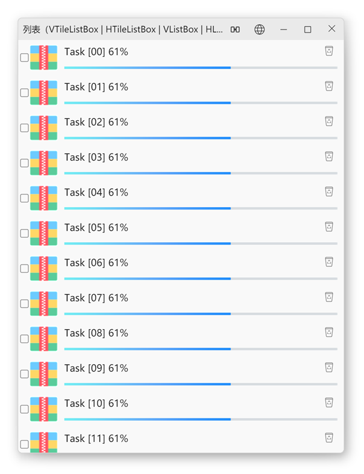

## 6. examples/ListCtrl
**Table/report control.** Demonstrates how ListCtrl organizes columns, headers, items, and sub-items. The directory also contains `loading*.xml` loading-state samples, making it a good base for data lists, task lists, and file lists.    
**Best for**: table or report views, or loading placeholders for large lists.    
**Code entry**: [MainThread.cpp](../examples/ListCtrl/MainThread.cpp), [MainForm.cpp](../examples/ListCtrl/MainForm.cpp); **UI resources**: `bin/resources/themes/default/list_ctrl/list_ctrl.xml`; **Related docs**: [Control.en.md](Control.en.md).    
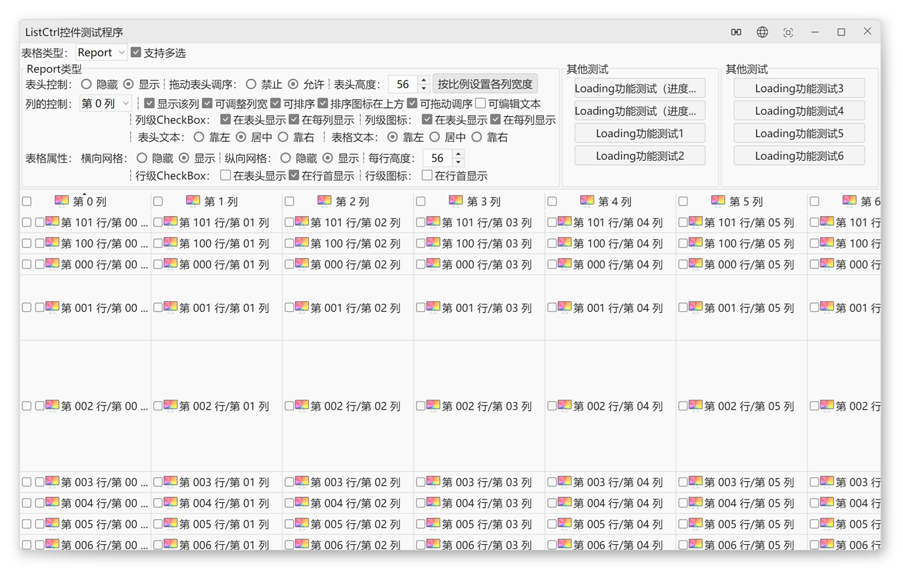

## 7. examples/MoveControl
**Drag and drop across containers.** Uses the `drag_out_id` and `drop_in_id` properties of Box to move controls between containers. App icons are SVG vectors and stay sharp at any scale; the "favorite apps" state is stored in the sample's AppDb (an in-memory mock database).    
**Best for**: desktop icon organizers, kanban boards, and draggable panels.    
**Code entry**: [MainThread.cpp](../examples/MoveControl/MainThread.cpp), [MoveControlForm.cpp](../examples/MoveControl/MoveControlForm.cpp); **UI resources**: `bin/resources/themes/default/move_control/main.xml`, `move_control/app_item.xml`; **Related docs**: [Control.en.md](Control.en.md), [XmlNode.en.md](XmlNode.en.md).    
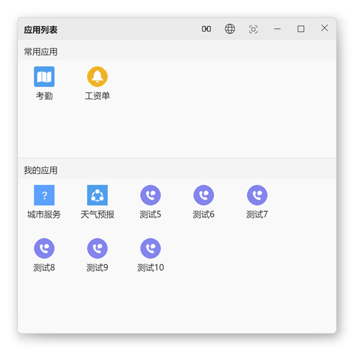

## 8. examples/render
**Rendering engine and control gallery.** Demonstrates the Skia rendering interfaces while showing controls, containers, and window shadows across multiple pages. Besides `render.xml`, the `page_*.xml` files provide page-by-page examples.    
**Best for**: learning custom drawing and rendering interfaces, or browsing control effects page by page.    
**Code entry**: [MainThread.cpp](../examples/render/MainThread.cpp), [RenderForm.cpp](../examples/render/RenderForm.cpp); **UI resources**: `bin/resources/themes/default/render/render.xml`, `render/page_*.xml`; **Related docs**: [Control.en.md](Control.en.md), [WindowShadow.en.md](WindowShadow.en.md).    
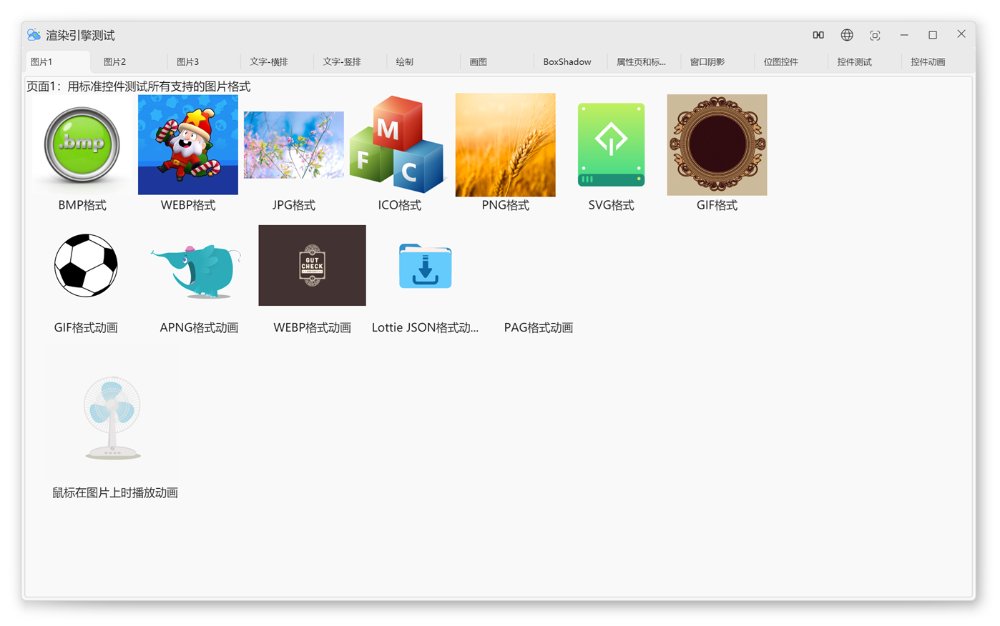
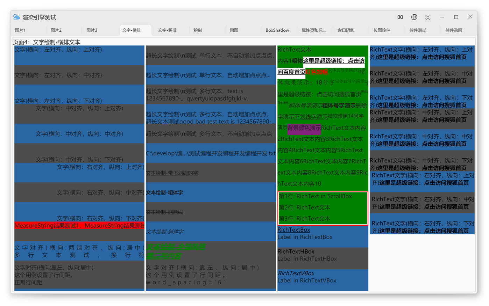
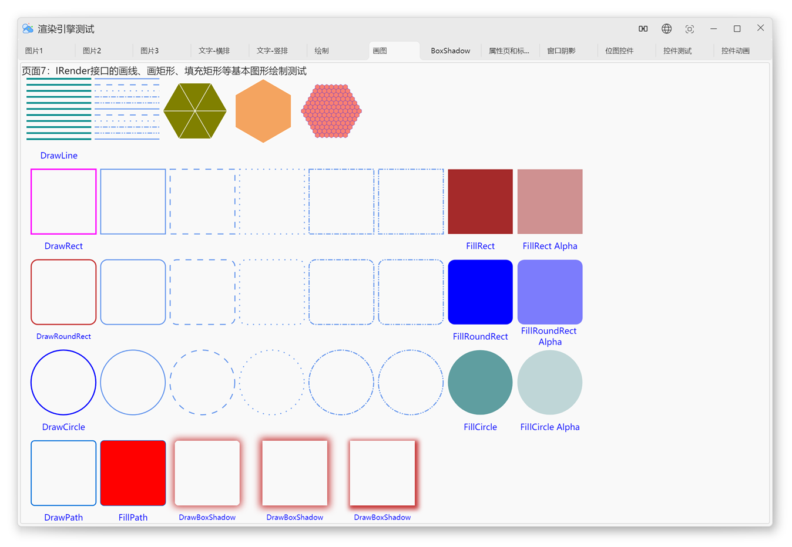
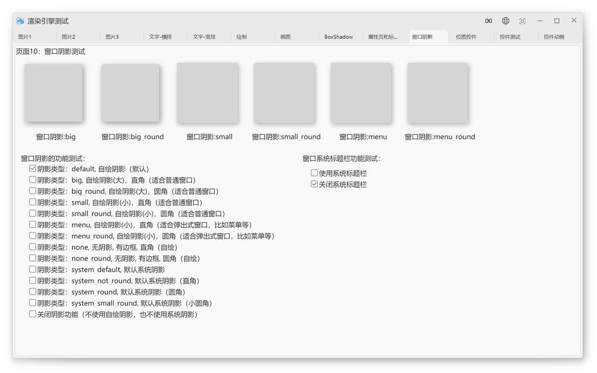

## 9. examples/RichEdit
**A simple notepad.** Covers common rich-text editing features: new, open (TXT/RTF), save, find/replace, font and size, bold/italic/underline/strikethrough, text color, zoom, word wrap, rich-text mode and line spacing, copy/cut/paste/undo/redo/select all, and drag-and-drop opening of `.txt`/`.rtf` files. The status bar shows cursor position, character count, zoom, edit mode, and encoding; window and editor settings are saved on exit.    
**Best for**: text editing, rich-text display, or coordinating RichEdit with menus and toolbars.    
**Shortcuts**: Ctrl+N new, Ctrl+O open, Ctrl+S save, Ctrl+Shift+S save as, Ctrl+F find, Ctrl+H replace, F3 find next, Ctrl+0 reset zoom, Ctrl+wheel zoom.    
**Code entry**: [MainThread.cpp](../examples/RichEdit/MainThread.cpp), [MainForm.cpp](../examples/RichEdit/MainForm.cpp), [FindForm.cpp](../examples/RichEdit/FindForm.cpp), [ReplaceForm.cpp](../examples/RichEdit/ReplaceForm.cpp); **UI resources**: `bin/resources/themes/default/rich_edit/rich_edit.xml`, `find.xml`, `replace.xml`; **Related docs**: [Control.en.md](Control.en.md).    
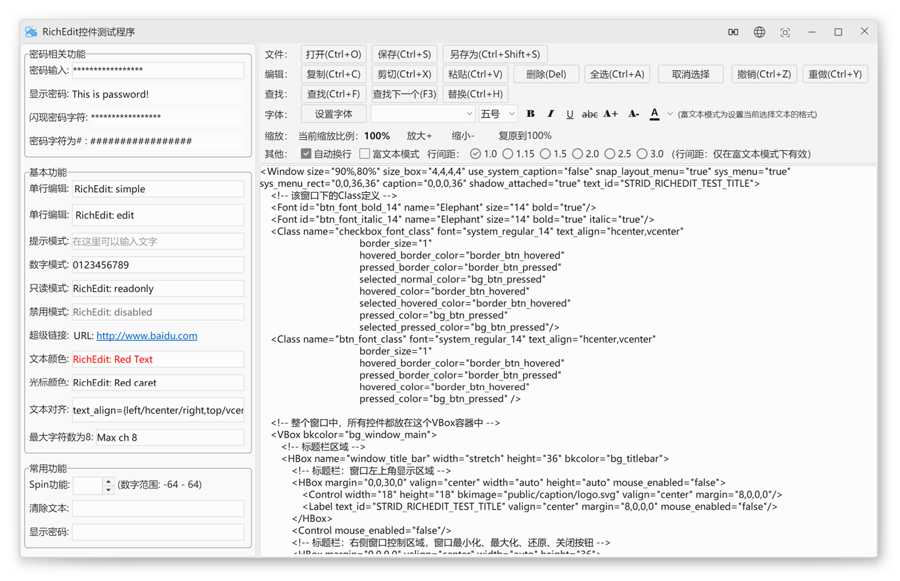

## 10. examples/TreeView
**An Explorer-style file browser.** A directory tree on the left and a file list on the right, with list/icon/large-icon views, column sorting, back/forward/up navigation, address-bar path entry, and name filtering within the current folder. The status bar shows the current path, item statistics, and view/sort mode.    
**Best for**: directory-tree plus file-list interfaces, or TreeView/list coordination.    
**Code entry**: [MainThread.cpp](../examples/TreeView/MainThread.cpp), [MainForm.cpp](../examples/TreeView/MainForm.cpp); **UI resources**: `bin/resources/themes/default/tree_view/tree_view.xml`, `tree_view/tree_node.xml`; **Related docs**: [Control.en.md](Control.en.md).    
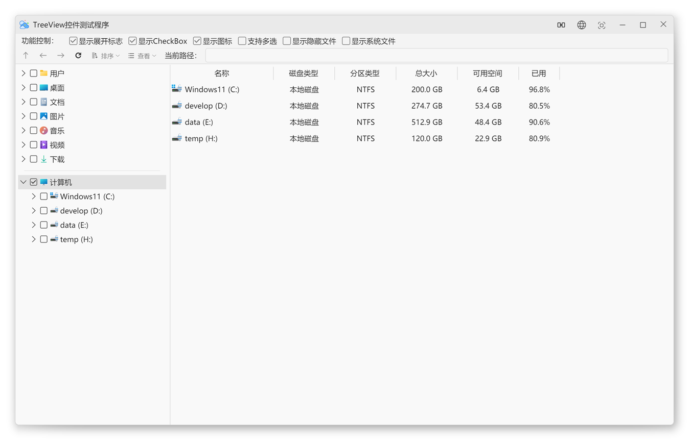

## 11. examples/VirtualListBox
**Virtual list.** Demonstrates a ListBox backed by a virtual table: only visible items are created, making it suitable for large data sets; the sample shows the data source, item template, and scrolling organization.    
**Best for**: large lists where memory and creation cost matter.    
**Code entry**: [MainThread.cpp](../examples/VirtualListBox/MainThread.cpp), [MainForm.cpp](../examples/VirtualListBox/MainForm.cpp); **UI resources**: `bin/resources/themes/default/virtual_list_box/main.xml`, `virtual_list_box/item.xml`; **Related docs**: [Control.en.md](Control.en.md).    
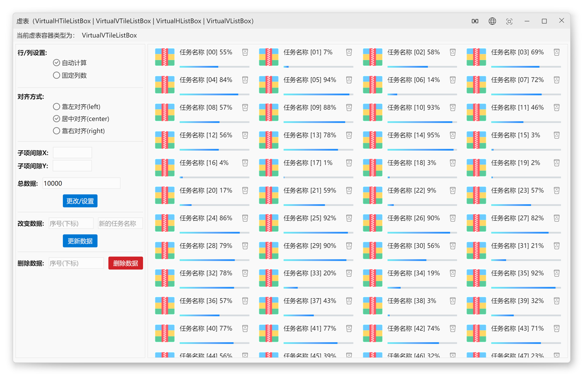

## 12. examples/MultiLang
**Multi-language switching.** Shows the current language name and language file, plus three ways to render the same text (Label, RichText control, and the `rich_text` property of Label). Click the language button in the title bar to switch instantly; all window text refreshes immediately.    
**Best for**: internationalization, or learning how `text_id` and language resources are organized.    
**Code entry**: [MainThread.cpp](../examples/MultiLang/MainThread.cpp), [MainForm.cpp](../examples/MultiLang/MainForm.cpp); **UI resources**: `bin/resources/themes/default/MultiLang/MultiLang.xml`; **Related docs**: [Global.en.md](Global.en.md).    
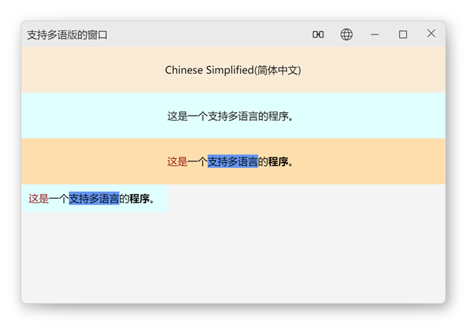

## 13. examples/DpiAware
**DPI adaptation.** Panels show the DPI awareness mode, primary-monitor and window scale percentages, and the window's physical pixels versus the content area's logical pixels. The right side uses the same image at 100%–300% (8 variants) to show how the framework picks the closest source. The bottom lets you enter 60–500 to change UI scale dynamically, or create another window for comparison.    
**Best for**: high-DPI screens, multiple monitors, or scalable UIs.    
**Code entry**: [MainThread.cpp](../examples/DpiAware/MainThread.cpp), [MainForm.cpp](../examples/DpiAware/MainForm.cpp); **UI resources**: `bin/resources/themes/default/dpi_aware/DpiAware.xml`; **Related docs**: DPI interfaces in [Window.en.md](Window.en.md).    
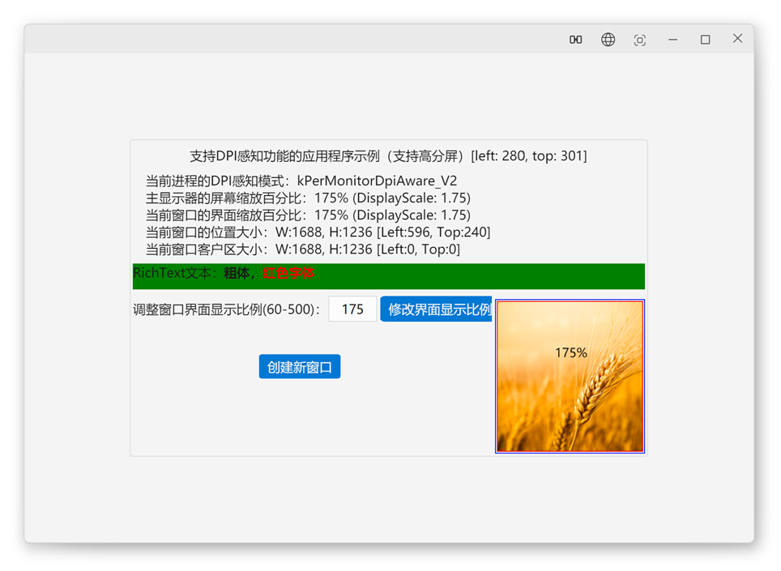

## 14. examples/threads
**Thread pool and timers.** Configure the thread-pool size and watch each worker's state, OS thread ID, and task count in real time. Supports immediate, delayed, repeated, and long-running tasks, concurrent speed-up verification, and task cancellation. Stopping the pool happens in the background without blocking the UI, and TimerManager add/stop/trigger observation is included.    
**Best for**: background work, thread pools, and timers in UI applications.    
**Code entry**: [MainThread.cpp](../examples/threads/MainThread.cpp), [MainForm.cpp](../examples/threads/MainForm.cpp), [WorkerThread.cpp](../examples/threads/WorkerThread.cpp); **UI resources**: `bin/resources/themes/default/threads/threads.xml`; **Related docs**: the thread library section in [Getting-Started.en.md](Getting-Started.en.md).    
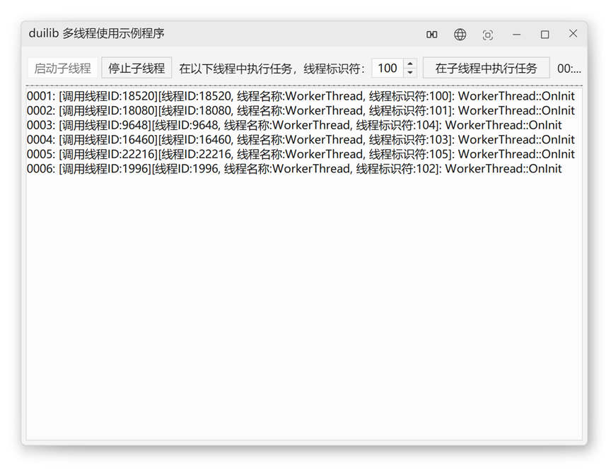

## 15. examples/layout
**The layout container gallery.** Demonstrates VBox/HBox, flow layouts, tile layouts, grid layouts, scroll containers, split bars, and more. The `page_*.xml` files in the same directory correspond to different layouts; edit the XML to compare effects.    
**Best for**: finding the right layout container, or understanding stretch, alignment, margins, and scrolling.    
**Code entry**: [MainThread.cpp](../examples/layout/MainThread.cpp), [MainForm.cpp](../examples/layout/MainForm.cpp); **UI resources**: `bin/resources/themes/default/layout/layout.xml`, `layout/page_*.xml`; **Related docs**: [Box.en.md](Box.en.md).    
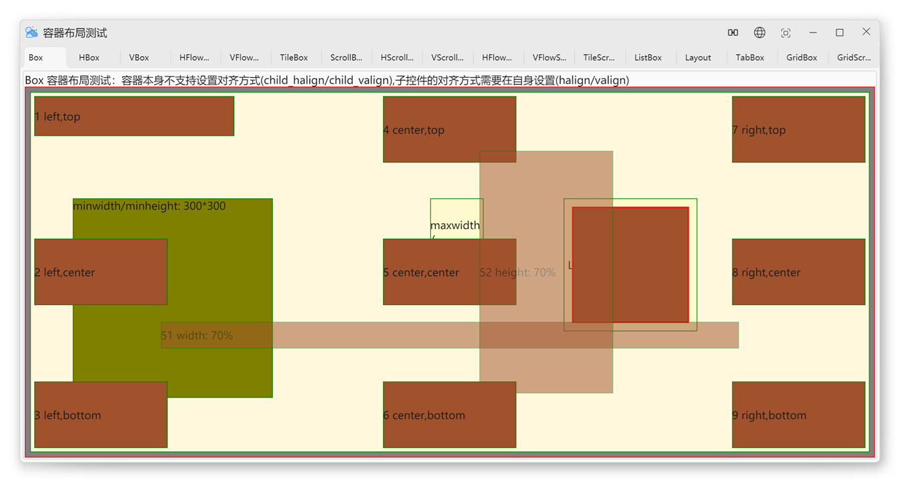

## 16. examples/cef
**CEF control and JS interop.** Embeds a CEF browser in a window and demonstrates two-way C++/JavaScript calls, page loading, and browser events — suitable for desktop apps that need embedded Chromium.    
**Code entry**: [MainThread.cpp](../examples/cef/MainThread.cpp), [CefForm.cpp](../examples/cef/CefForm.cpp); **UI resources**: `bin/resources/themes/default/cef/cef.xml`; **Related docs**: [CEF.en.md](CEF.en.md).    
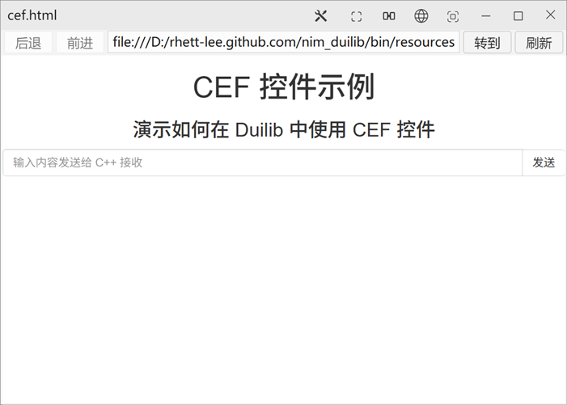

## 17. examples/CefBrowser
**A multi-tab CEF browser.** Multi-tab support, tab dragging, an address bar, and back/forward navigation provide a browser-app skeleton.    
**Code entry**: [MainThread.cpp](../examples/CefBrowser/MainThread.cpp), [BrowserForm.cpp](../examples/CefBrowser/browser/BrowserForm.cpp), [DragForm.cpp](../examples/CefBrowser/browser/DragForm.cpp); **UI resources**: `bin/resources/themes/default/cef_browser/cef_browser.xml`, `drag_form.xml`, `browser_box.xml`, `tab_item.xml`; **Related docs**: [CEF.en.md](CEF.en.md).    
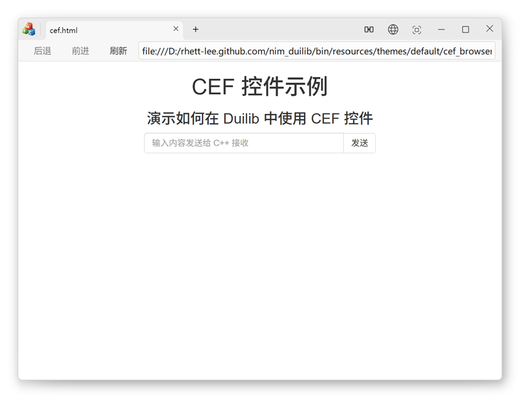

## 18. examples/WebView2
**WebView2 control.** Embeds web pages using the system Edge WebView2 runtime, demonstrating control creation, navigation, and basic interaction. Compared with CEF, it has a smaller deployment footprint and is a good fit for Windows apps.    
**Code entry**: [MainThread.cpp](../examples/WebView2/MainThread.cpp), [MainForm.cpp](../examples/WebView2/MainForm.cpp); **UI resources**: `bin/resources/themes/default/webview2/webview2.xml`; **Related docs**: the WebView2Control section in [Control.en.md](Control.en.md).    
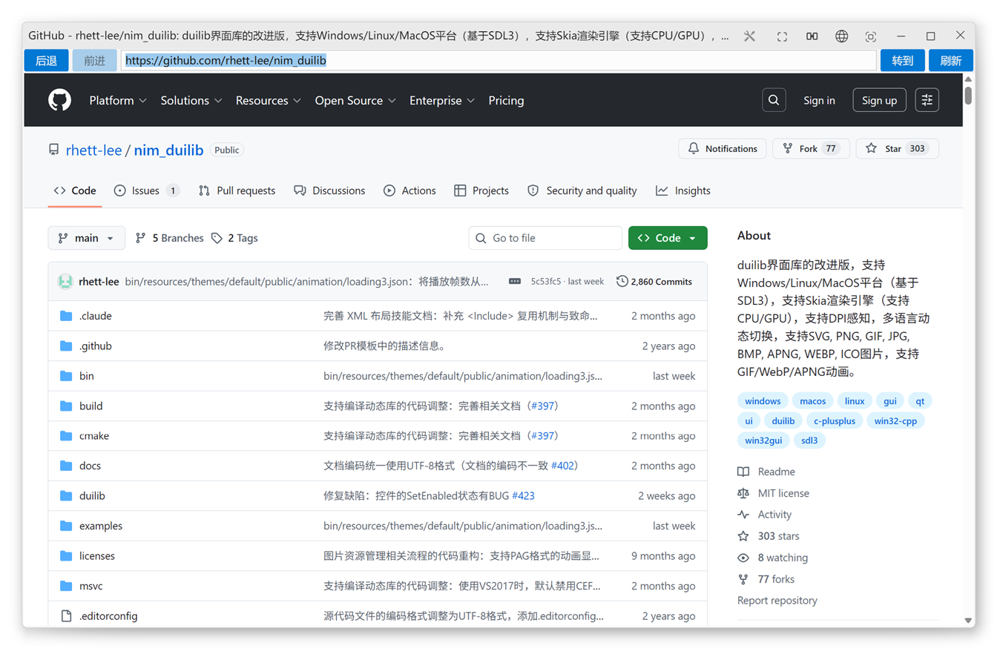

## 19. examples/WebView2Browser
**A multi-tab WebView2 browser.** Combines multi-tab browsing, tab dragging, an address bar, and navigation buttons — a lightweight browser UI for Windows apps.    
**Code entry**: [MainThread.cpp](../examples/WebView2Browser/MainThread.cpp), [BrowserForm.cpp](../examples/WebView2Browser/BrowserForm.cpp), [DragForm.cpp](../examples/WebView2Browser/DragForm.cpp); **UI resources**: `bin/resources/themes/default/webview2_browser/webview2_browser.xml`, `drag_form.xml`, `browser_box.xml`, `tab_item.xml`; **Related docs**: the WebView2Control section in [Control.en.md](Control.en.md).    
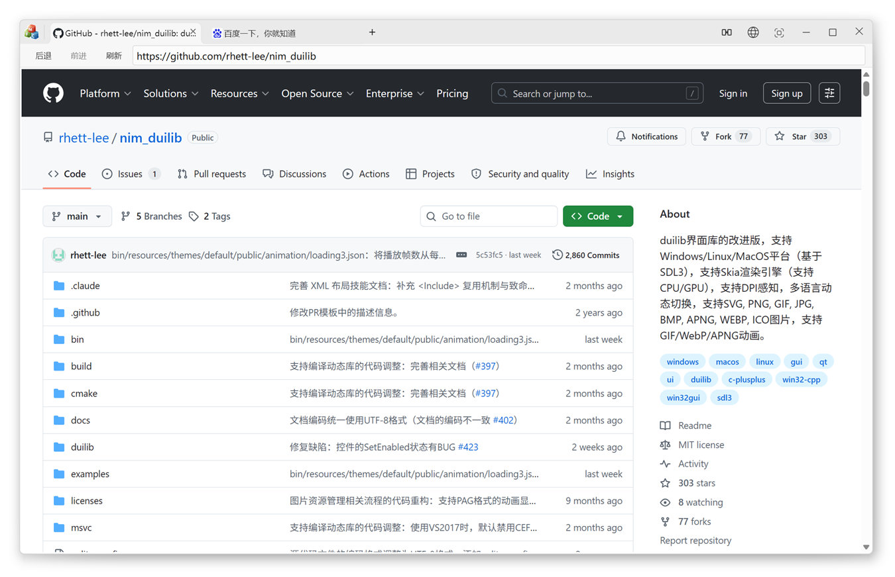

## 20. examples/ChildWindow
**Child window container.** Shows how ChildWindow embeds the content of another window into the current window's control tree, useful for multi-document interfaces and embedded panels.    
**Code entry**: [MainThread.cpp](../examples/ChildWindow/MainThread.cpp), [MainForm.cpp](../examples/ChildWindow/MainForm.cpp); **UI resources**: `bin/resources/themes/default/child_window/child_window.xml`, `child_window/child_window_item.xml`; **Related docs**: the ChildWindow section in [Control.en.md](Control.en.md).    
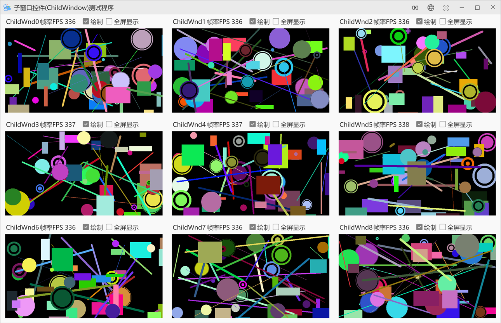

## 21. examples/XmlPreview
**Live XML UI preview.** Open an XML file or drop it into the preview area to see the result. Reload and clear are supported; the info card shows the full path, load state, and failure details (file, line, column). With "Auto refresh" enabled, file changes are detected every 1–60 seconds and previewed again.    
**Best for**: editing skin XML with instant feedback, or diagnosing XML load errors.    
**Code entry**: [MainThread.cpp](../examples/XmlPreview/MainThread.cpp), [MainForm.cpp](../examples/XmlPreview/MainForm.cpp); **UI resources**: `bin/resources/themes/default/xml_preview/xml_preview.xml`; **Related docs**: [XmlNode.en.md](XmlNode.en.md), [XmlEvents.en.md](XmlEvents.en.md), [XmlTools.en.md](XmlTools.en.md).    
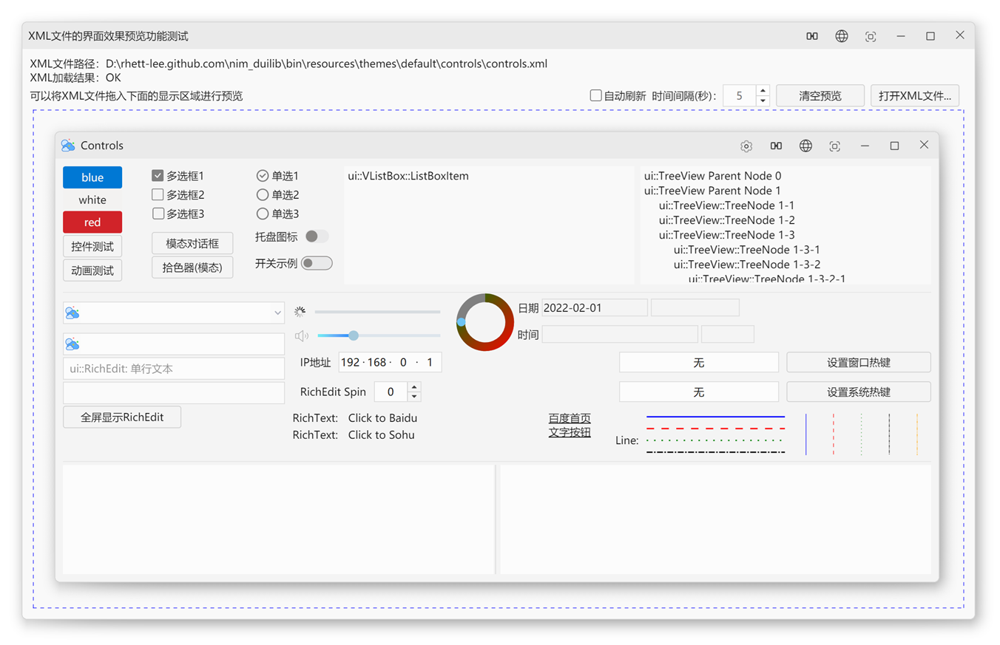

## 22. examples/ColorTheme
**Theme color preview and generation.** Demonstrates previewing, switching, and generating theme colors, plus a Flyout popup sample — a reference for custom themes and brand recoloring.    
**Best for**: dark/light themes, brand palettes, or theme generation tools.    
**Code entry**: [MainThread.cpp](../examples/ColorTheme/MainThread.cpp), [MainForm.cpp](../examples/ColorTheme/MainForm.cpp); **UI resources**: `bin/resources/themes/default/color_theme/color_theme.xml`, `color_theme/flyout_demo.xml`; **Related docs**: [Theme.en.md](Theme.en.md), [ThemeColor.en.md](ThemeColor.en.md).    
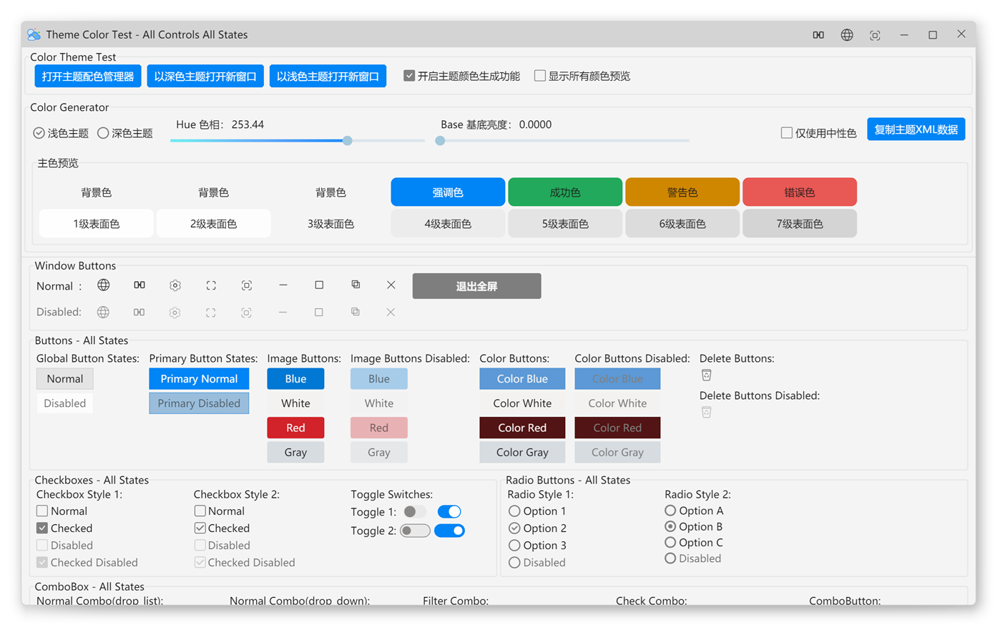

## 23. examples/panel
**Panel containers with title bars.** Demonstrates Panel/PanelHBox/PanelVBox: title bar styles, click-to-collapse/expand with animation, accordion groups, collapse hot zones, custom arrow state images, left-aligned arrows and title alignment, title bar slots, cancel-before-collapse events, and controlling panel state from C++.    
**Best for**: settings pages, collapsible groups, and sidebar sections.    
**Code entry**: [MainThread.cpp](../examples/panel/MainThread.cpp), [PanelForm.cpp](../examples/panel/PanelForm.cpp); **UI resources**: `bin/resources/themes/default/panel/panel.xml`; **Related docs**: the Panel/PanelHBox/PanelVBox section in [Box.en.md](Box.en.md).    
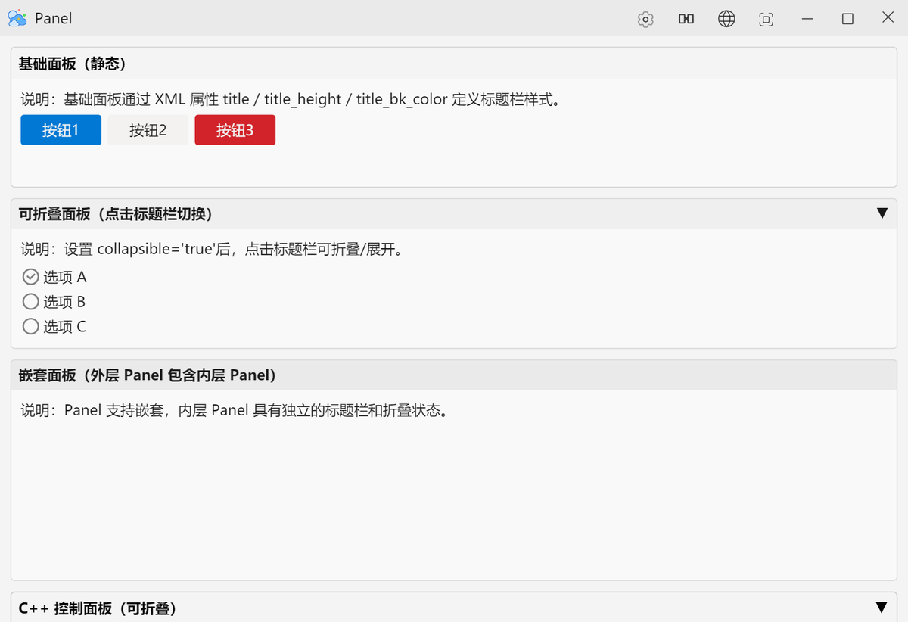
