English | [简体中文](Examples.md)

> Last synced: 2026-11-02

## Example Programs
The examples directory contains several example programs that you can reference to improve your own applications.

## 1. examples/basic
A basic window example program, with minimize, maximize, restore and close buttons.    
On macOS it is built as `bin/basic.app` without C++ changes; see
[build/macos-app-bundle.en.md](../build/macos-app-bundle.en.md) for configuration.    
Code entry: [MainThread.cpp](../examples/basic/MainThread.cpp), [MainForm.cpp](../examples/basic/MainForm.cpp); skin resources: `bin/resources/themes/default/basic/basic.xml`; related docs: [Getting-Started.en.md](Getting-Started.en.md), [Window.en.md](Window.en.md).    
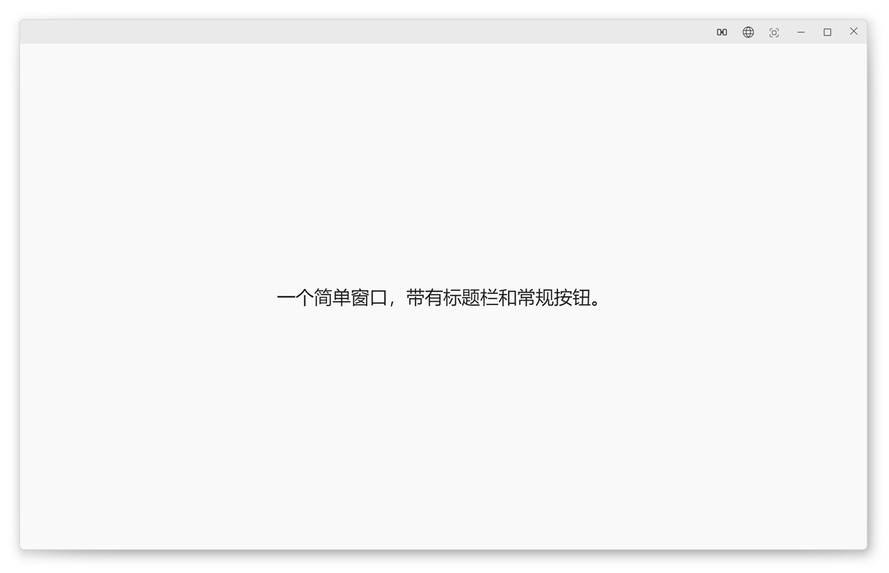

## 2. examples/ColorPicker
A program demonstrating how to use the color picker control: the main window shows the current color (swatch, #AARRGGBB and the R/G/B/A components); the "Open picker" button opens the real color picker, AttachSelectColor previews the color while dragging, and AttachWindowClose delivers the final color only on OK (Cancel or Esc discards it); an event log records every callback.    
Code entry: [MainThread.cpp](../examples/ColorPicker/MainThread.cpp), [MainForm.cpp](../examples/ColorPicker/MainForm.cpp); skin resources: `bin/resources/themes/default/color_picker_demo/ColorPickerDemo.xml` (demo window) and `bin/resources/themes/default/public/color/color_picker.xml` (the color picker itself is a standalone window whose skin folder is `public`); related docs: the ColorPicker section in [Control.en.md](Control.en.md).    
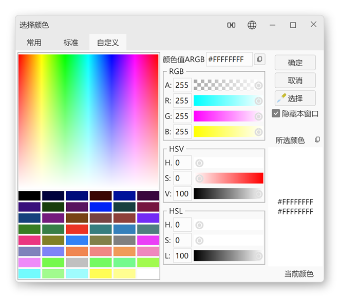

## 3. examples/controls
Examples of how to use the styles of some commonly used controls.    
Code entry: [MainThread.cpp](../examples/controls/MainThread.cpp), [ControlForm.cpp](../examples/controls/ControlForm.cpp); skin resources: `bin/resources/themes/default/controls/controls.xml` (the same folder also contains example XML files for individual controls, such as `message_box_test.xml`, `toast_test.xml`, and `tree_grid.xml`); related docs: [Control.en.md](Control.en.md), [MessageBox.en.md](MessageBox.en.md), [Toast.en.md](Toast.en.md).    
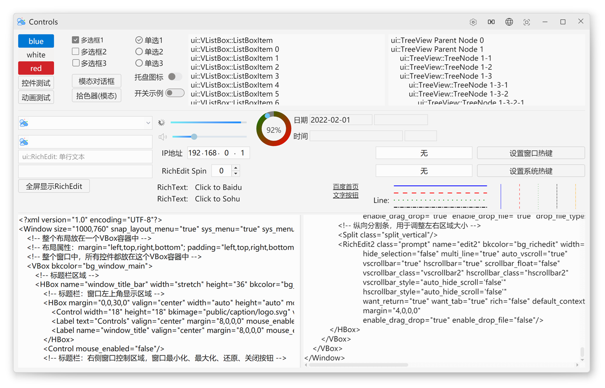

## 4. examples/chat
Includes a login window and a window example simulating a PC chat layout: after signing in the chat main window is shown (the program keeps running), and the main window has a title bar, a navigation rail, switchable conversation/contacts/favorites panels, a message area and an input area, supporting sending messages and simulated auto replies; the message area is rendered with the framework's ChatMessageList control. The settings button in the bottom-left corner pops up a menu (New Chat / Contacts / About This Demo / Sign Out), and "Sign Out" closes the main window and ends the program; press Enter in the input area to send and Ctrl+Enter for a new line; a sent message walks through "Sending / Delivered / Read", typing text starting with `/fail` simulates a failed send and clicking "Failed to send, click to retry" resends it; double-clicking a message copies its text, and right-clicking keeps the current selection (or selects that message when nothing is selected) before showing the Copy / Select All menu (Copy is grayed out when there is no selection); a message that arrives while you are reading history does not yank the view away, instead a "N new messages" pill appears at the bottom of the message area and clicking it jumps back to the latest message; tool buttons that are not wired up report back with a Toast message; conversations keep their own message history, so switching between them preserves each conversation's messages and delivery states; the red pill on a conversation row is the unread badge - it counts up when a message arrives for a conversation you are not looking at, and resets when you open it; clicking a friend in Contacts starts a chat (it switches to the existing conversation, or creates a new one and inserts it into the conversation list); typing in the search box above the conversation list filters the conversations and contacts by name / preview text, and shows "No matching results" when nothing matches; the theme and language buttons at the right end of the title bar open the framework built-in menus and take effect immediately (conversation names, preview texts, the title bar and the message timestamps are all rebuilt in the new language, so no text from the previous language is left behind); the window can be maximized / restored and resized by dragging its edges, and the layout adapts to any size, consistent with other examples such as examples/controls.    
Code entry: [MainThread.cpp](../examples/chat/MainThread.cpp), [LoginForm.cpp](../examples/chat/LoginForm.cpp), [ChatForm.cpp](../examples/chat/ChatForm.cpp); skin resources: `bin/resources/themes/default/chat/wechat.xml`, `bin/resources/themes/default/chat/login.xml`, `bin/resources/themes/default/chat/menu_settings.xml`; related docs: [Box.en.md](Box.en.md), [Control.en.md](Control.en.md), [Menu.en.md](Menu.en.md).    
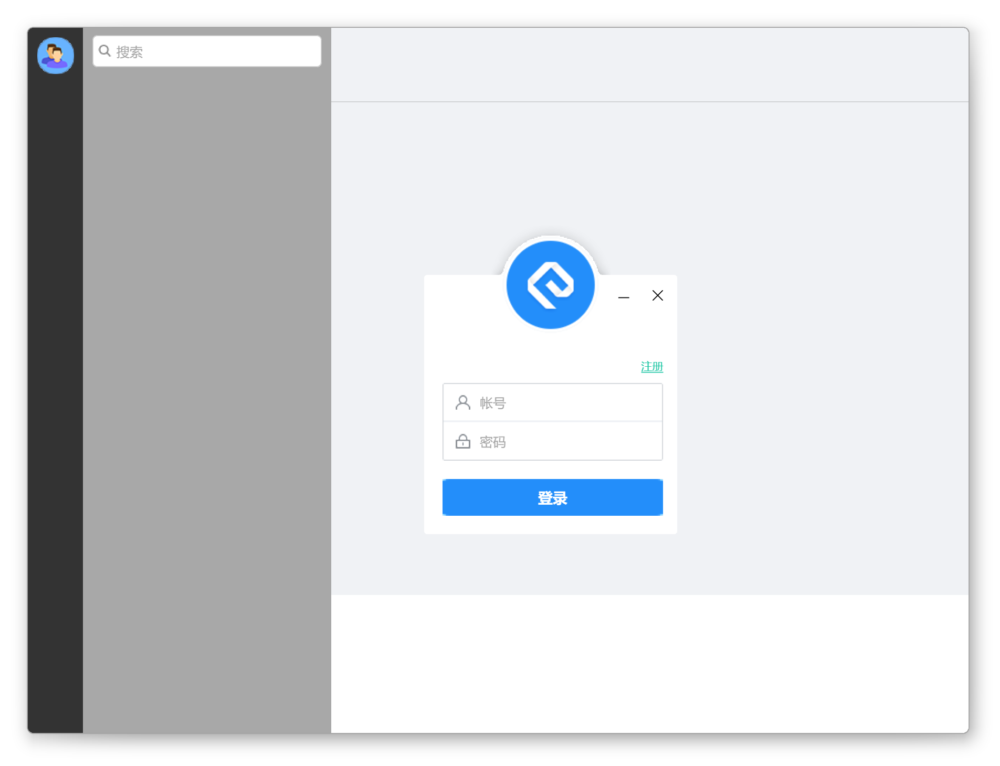

## 5. examples/ListBox
A program demonstrating how to use the ListBox container: the status bar shows the container type, item count and selection count, with a multi-select toggle; the event log at the bottom shows Select/UnSelect/SelChanged/Click/DoubleClick/RClick/Return and keyboard events with their item index; items carry an icon, a progress bar and a per-item delete button. Change the container tag in list_box.xml (VListBox / HListBox / VTileListBox / HTileListBox) to switch layout with no code changes.    
Code entry: [MainThread.cpp](../examples/ListBox/MainThread.cpp), [ListBoxForm.cpp](../examples/ListBox/ListBoxForm.cpp); skin resources: `bin/resources/themes/default/list_box/list_box.xml`, `list_box/item.xml`; related docs: [Control.en.md](Control.en.md).    
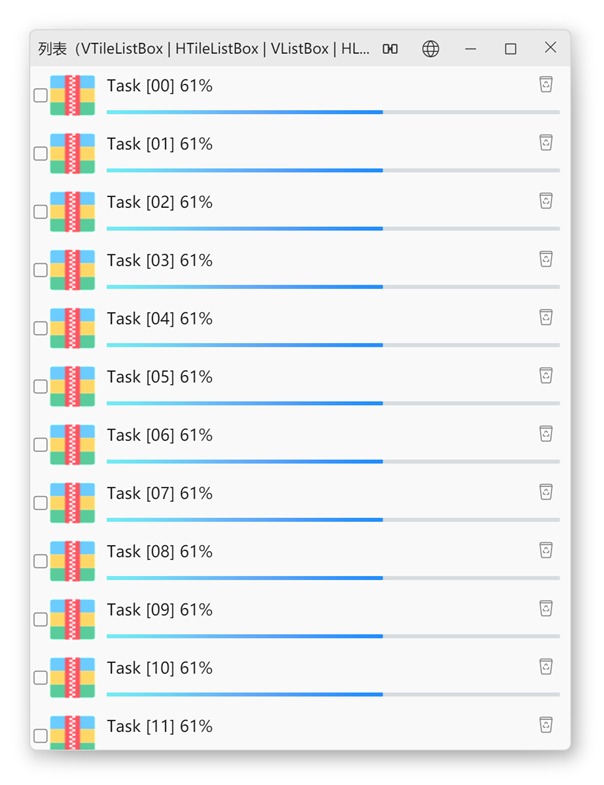
    
## 6. examples/ListCtrl
A program demonstrating how to use the ListCtrl control.    
Code entry: [MainThread.cpp](../examples/ListCtrl/MainThread.cpp), [MainForm.cpp](../examples/ListCtrl/MainForm.cpp); skin resources: `bin/resources/themes/default/list_ctrl/list_ctrl.xml` (the same folder also contains `loading*.xml` examples of loading states); related docs: [Control.en.md](Control.en.md).    
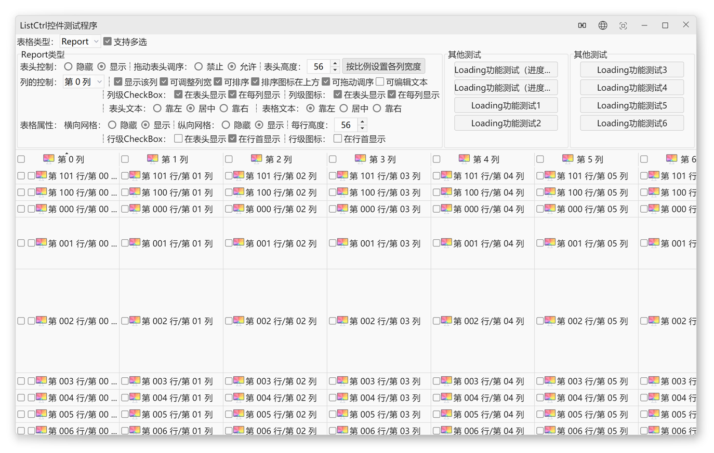

## 7. examples/MoveControl
A program demonstrating how to use the "drag_out_id" and "drop_in_id" attributes of the Box container to move controls between different containers: the app icons are SVG vector images (sharp at any scale), and the frequent-app state is saved to AppDb after dragging (simulated with in-memory storage).    
Code entry: [MainThread.cpp](../examples/MoveControl/MainThread.cpp), [MoveControlForm.cpp](../examples/MoveControl/MoveControlForm.cpp); skin resources: `bin/resources/themes/default/move_control/main.xml`, `move_control/app_item.xml`; related docs: [Control.en.md](Control.en.md), [XmlNode.en.md](XmlNode.en.md).    
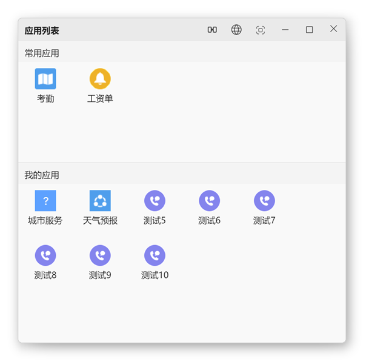
   
## 8. examples/render
A program demonstrating how to use the rendering engine, which also includes usage examples of various controls/containers.    
Code entry: [MainThread.cpp](../examples/render/MainThread.cpp), [RenderForm.cpp](../examples/render/RenderForm.cpp); skin resources: `bin/resources/themes/default/render/render.xml` (the same folder also contains the `page_*.xml` page examples); related docs: [Control.en.md](Control.en.md), [WindowShadow.en.md](WindowShadow.en.md).    
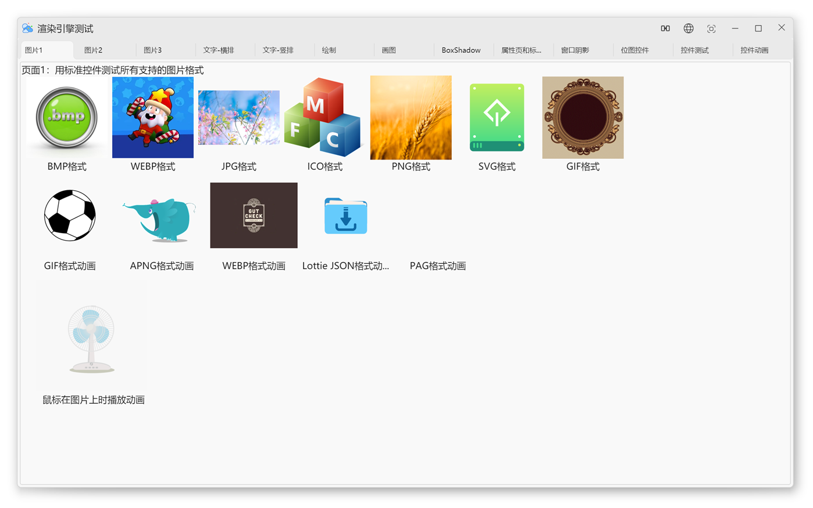
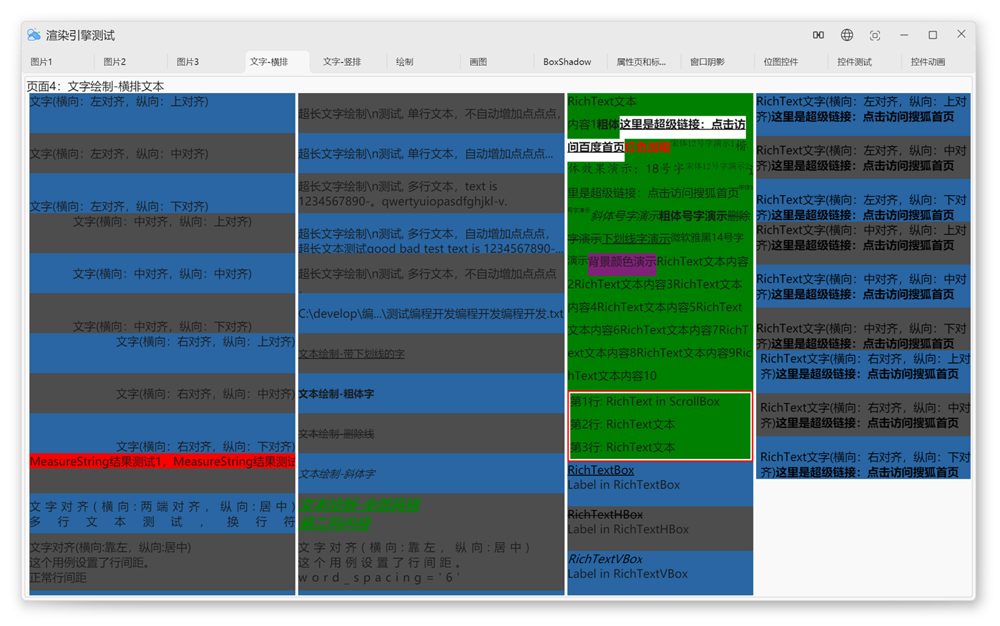
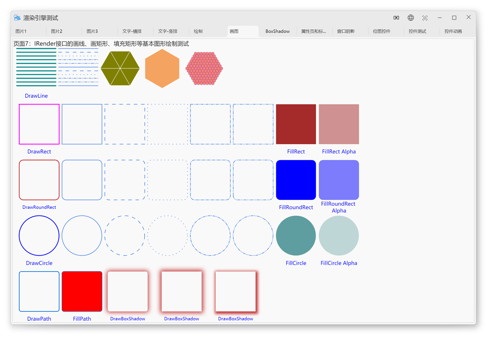
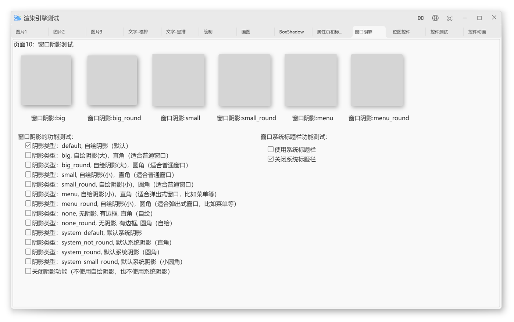

## 9. examples/RichEdit
A program demonstrating how to use the RichEdit control.    
Code entry: [MainThread.cpp](../examples/RichEdit/MainThread.cpp), [MainForm.cpp](../examples/RichEdit/MainForm.cpp), [FindForm.cpp](../examples/RichEdit/FindForm.cpp), [ReplaceForm.cpp](../examples/RichEdit/ReplaceForm.cpp); skin resources: `bin/resources/themes/default/rich_edit/rich_edit.xml`, `rich_edit/find.xml`, `rich_edit/replace.xml`; related docs: [Control.en.md](Control.en.md).    
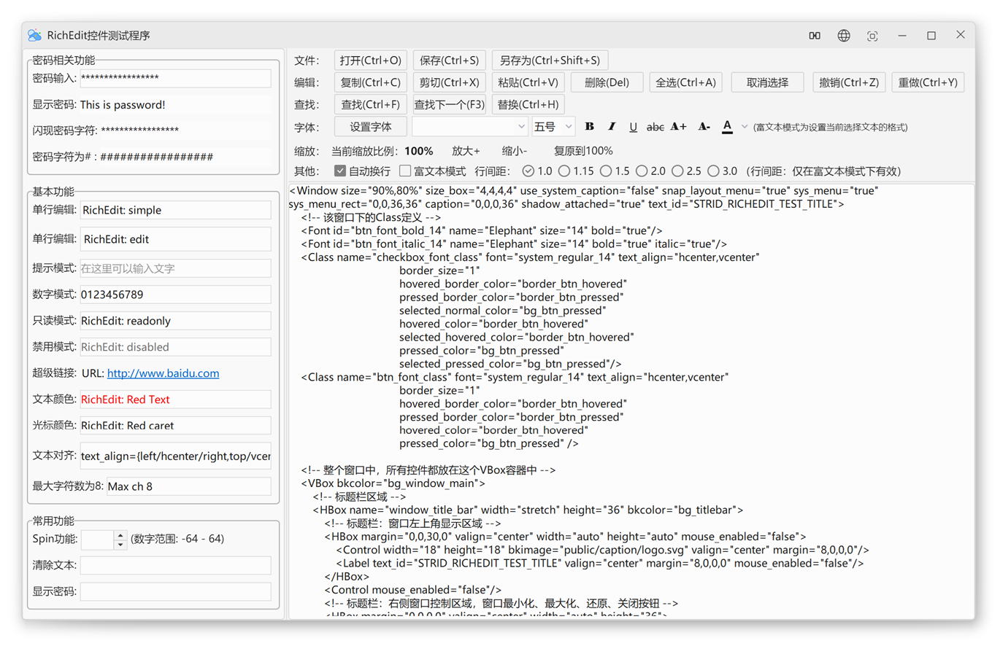

## 10. examples/TreeView
A program demonstrating how to use the TreeView control.    
Code entry: [MainThread.cpp](../examples/TreeView/MainThread.cpp), [MainForm.cpp](../examples/TreeView/MainForm.cpp); skin resources: `bin/resources/themes/default/tree_view/tree_view.xml`, `tree_view/tree_node.xml`; related docs: [Control.en.md](Control.en.md).    
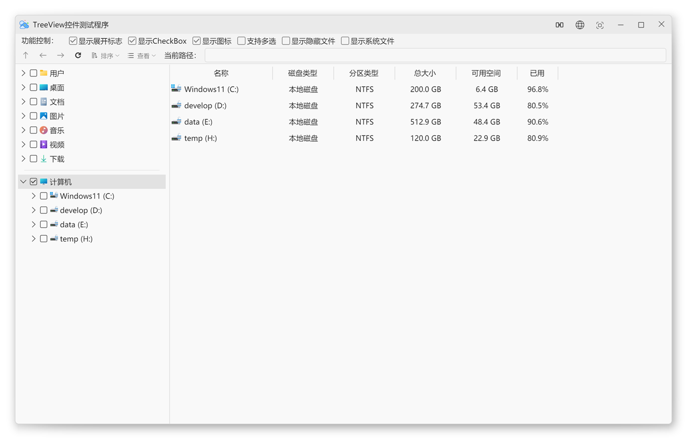
    
## 11. examples/VirtualListBox
A program demonstrating how to use a ListBox container implemented based on a virtual list.    
Code entry: [MainThread.cpp](../examples/VirtualListBox/MainThread.cpp), [MainForm.cpp](../examples/VirtualListBox/MainForm.cpp); skin resources: `bin/resources/themes/default/virtual_list_box/main.xml`, `virtual_list_box/item.xml`; related docs: [Control.en.md](Control.en.md).    
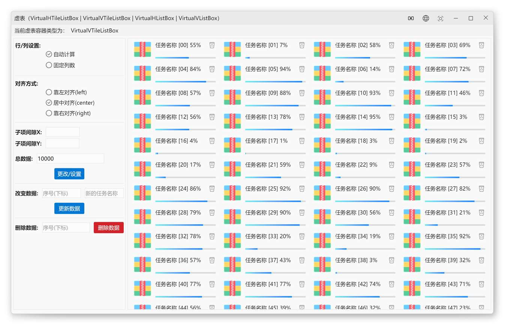
    
## 12. examples/MultiLang
A program demonstrating the multi-language feature: shows the current language name and language file, and renders the same text in three ways (Label, RichText control, and the rich_text property of Label); the language button in the title bar switches languages dynamically, refreshing every window immediately.    
Code entry: [MainThread.cpp](../examples/MultiLang/MainThread.cpp), [MainForm.cpp](../examples/MultiLang/MainForm.cpp); skin resources: `bin/resources/themes/default/MultiLang/MultiLang.xml`; related docs: [Global.en.md](Global.en.md).    
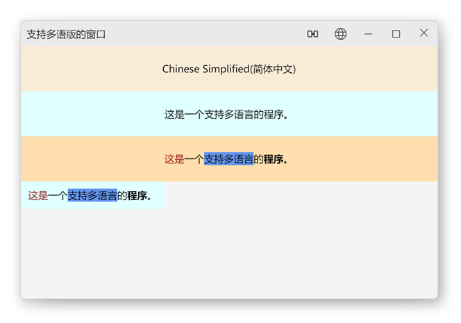

## 13. examples/DpiAware
A program demonstrating how to use the DPI awareness feature and how to dynamically set the window's DPI: the layout shows the DPI awareness mode, the monitor and window scale factors, and the window (physical pixels) versus content area (logical pixels) sizes; the right-hand panel demonstrates how the framework automatically picks the closest source image when 8 variants from 100% to 300% are provided; the bottom bar dynamically changes the display scale (60-500) and can open extra windows for comparison.    
Code entry: [MainThread.cpp](../examples/DpiAware/MainThread.cpp), [MainForm.cpp](../examples/DpiAware/MainForm.cpp); skin resources: `bin/resources/themes/default/dpi_aware/DpiAware.xml`; related docs: the Window C++ interfaces (DPI-related) in [Window.en.md](Window.en.md).    
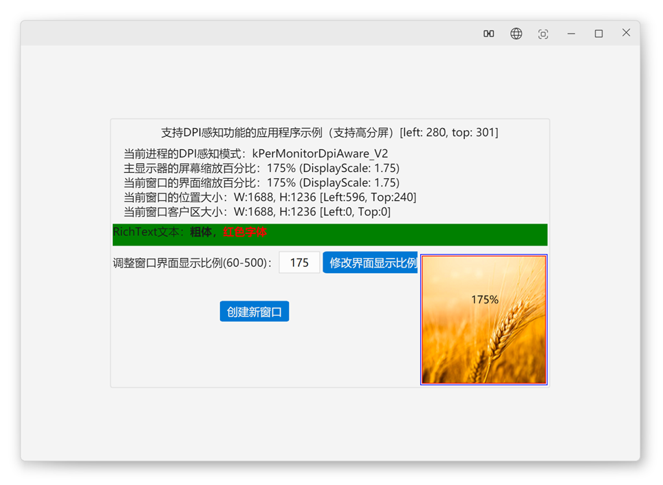

## 14. examples/threads
A program demonstrating the multi-threading feature: configurable thread pool size, live running state, OS thread ID and task counters of each worker thread, immediate/delayed/repeated/long-running tasks, a concurrency check that reports measured time and speedup against the serial baseline, and task cancellation; the pool stops in the background without blocking the UI and the log is timestamped. Timer (TimerManager) add/stop/tick observation is also included.    
Code entry: [MainThread.cpp](../examples/threads/MainThread.cpp), [MainForm.cpp](../examples/threads/MainForm.cpp), [WorkerThread.cpp](../examples/threads/WorkerThread.cpp); skin resources: `bin/resources/themes/default/threads/threads.xml`; related docs: the "Introducing the thread library" section in [Getting-Started.en.md](Getting-Started.en.md).    
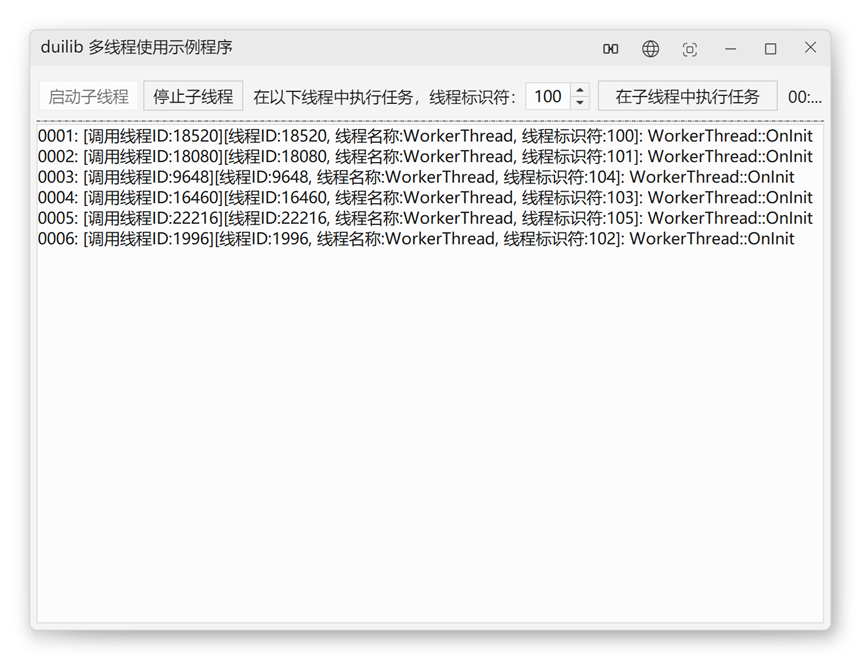

## 15. examples/layout
A program demonstrating the various layouts of containers.    
Code entry: [MainThread.cpp](../examples/layout/MainThread.cpp), [MainForm.cpp](../examples/layout/MainForm.cpp); skin resources: `bin/resources/themes/default/layout/layout.xml` (the `page_*.xml` files in the same folder demonstrate the various layout containers); related docs: [Box.en.md](Box.en.md).    
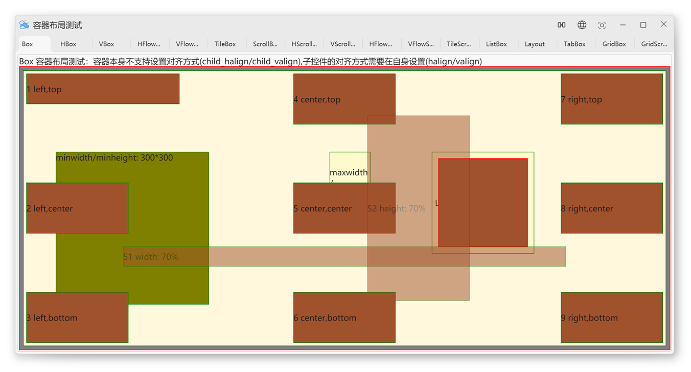

## 16. examples/cef
A program demonstrating how to use the CEF control, including C++ and JavaScript interaction.    
Code entry: [MainThread.cpp](../examples/cef/MainThread.cpp), [CefForm.cpp](../examples/cef/CefForm.cpp); skin resources: `bin/resources/themes/default/cef/cef.xml`; related docs: [CEF.en.md](CEF.en.md).    
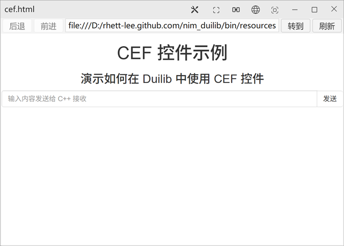

## 17. examples/CefBrowser
A custom multi-tab draggable browser example based on CEF.    
Code entry: [MainThread.cpp](../examples/CefBrowser/MainThread.cpp), [BrowserForm.cpp](../examples/CefBrowser/browser/BrowserForm.cpp), [DragForm.cpp](../examples/CefBrowser/browser/DragForm.cpp); skin resources: `bin/resources/themes/default/cef_browser/cef_browser.xml`, `cef_browser/drag_form.xml`, `cef_browser/browser_box.xml`, `cef_browser/tab_item.xml`; related docs: [CEF.en.md](CEF.en.md).    
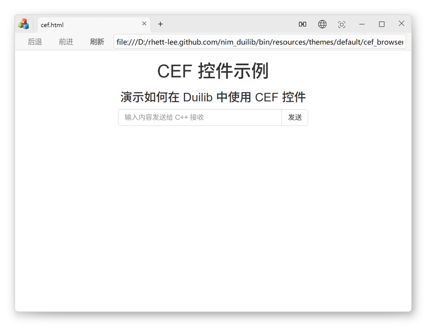
    
## 18. examples/WebView2
A program demonstrating how to use the WebView2 control.    
Code entry: [MainThread.cpp](../examples/WebView2/MainThread.cpp), [MainForm.cpp](../examples/WebView2/MainForm.cpp); skin resources: `bin/resources/themes/default/webview2/webview2.xml`; related docs: the WebView2Control section in [Control.en.md](Control.en.md).    
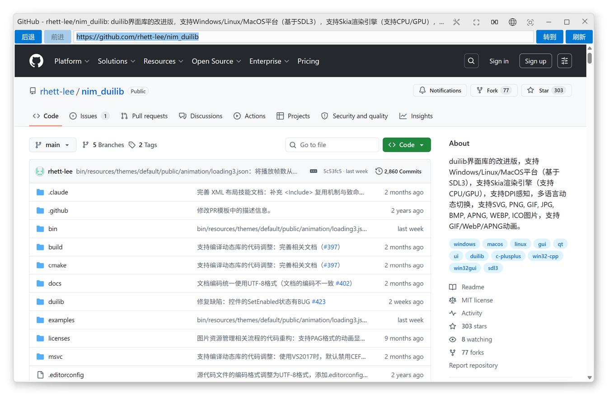

## 19. examples/WebView2Browser
A custom multi-tab draggable browser example based on WebView2.    
Code entry: [MainThread.cpp](../examples/WebView2Browser/MainThread.cpp), [BrowserForm.cpp](../examples/WebView2Browser/BrowserForm.cpp), [DragForm.cpp](../examples/WebView2Browser/DragForm.cpp); skin resources: `bin/resources/themes/default/webview2_browser/webview2_browser.xml`, `webview2_browser/drag_form.xml`, `webview2_browser/browser_box.xml`, `webview2_browser/tab_item.xml`; related docs: the WebView2Control section in [Control.en.md](Control.en.md).    
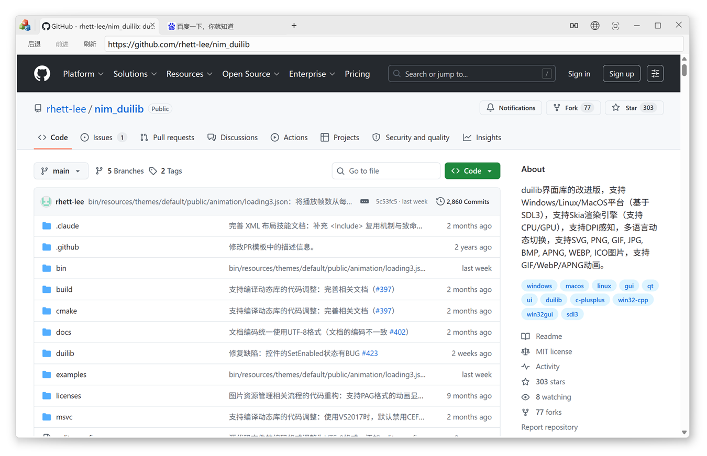
    
## 20. examples/ChildWindow    
A demonstration example of the child window control's features.    
Code entry: [MainThread.cpp](../examples/ChildWindow/MainThread.cpp), [MainForm.cpp](../examples/ChildWindow/MainForm.cpp); skin resources: `bin/resources/themes/default/child_window/child_window.xml`, `child_window/child_window_item.xml`; related docs: the ChildWindow section in [Control.en.md](Control.en.md).    
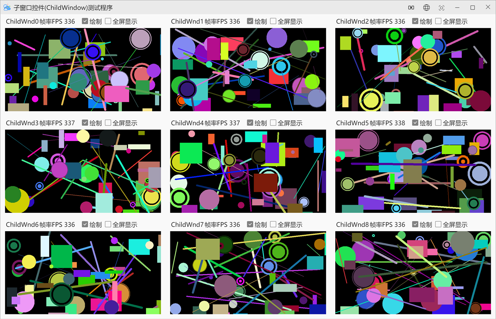
    
## 21. examples/XmlPreview    
A demonstration example of the XML file interface preview feature.    
Code entry: [MainThread.cpp](../examples/XmlPreview/MainThread.cpp), [MainForm.cpp](../examples/XmlPreview/MainForm.cpp); skin resources: `bin/resources/themes/default/xml_preview/xml_preview.xml`; related docs: [XmlNode.en.md](XmlNode.en.md), [XmlEvents.en.md](XmlEvents.en.md), [XmlTools.en.md](XmlTools.en.md).    
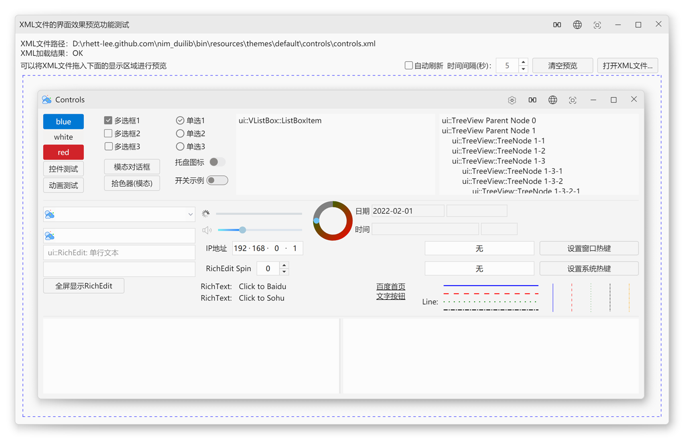
    
## 22. examples/ColorTheme    
A demonstration example of the theme color preview and generation feature.    
Code entry: [MainThread.cpp](../examples/ColorTheme/MainThread.cpp), [MainForm.cpp](../examples/ColorTheme/MainForm.cpp); skin resources: `bin/resources/themes/default/color_theme/color_theme.xml`, `color_theme/flyout_demo.xml`; related docs: [Theme.en.md](Theme.en.md), [ThemeColor.en.md](ThemeColor.en.md).    
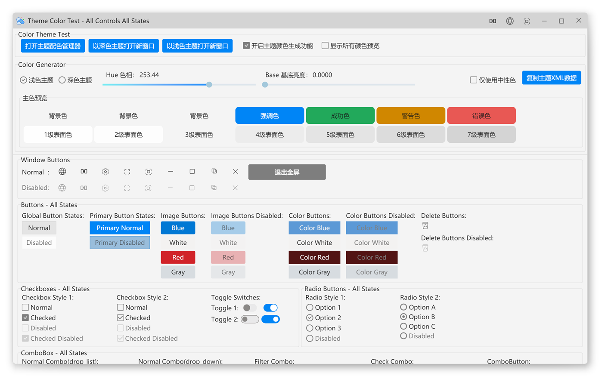

## 23. examples/panel
Demonstrates the titled Panel/PanelHBox/PanelVBox panel containers, including: title bar styling, collapsing/expanding by clicking the title bar (with animation), accordion groups, collapse trigger hit areas, custom arrow state images, left-aligned arrow and title alignment, title bar slots, the before-collapse cancel event, and controlling the panel state from C++ code.    
Code entry: [MainThread.cpp](../examples/panel/MainThread.cpp), [PanelForm.cpp](../examples/panel/PanelForm.cpp); skin resources: `bin/resources/themes/default/panel/panel.xml`; related docs: the Panel/PanelHBox/PanelVBox section in [Box.en.md](Box.en.md).    
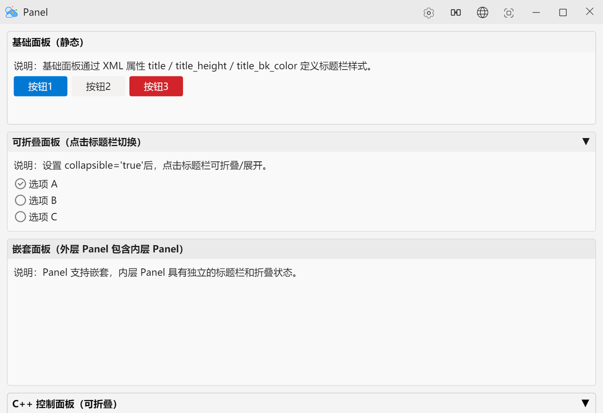
