简体中文 | [English](Examples.en.md)

## 示例程序

`examples` 目录包含 23 个可直接编译运行的示例，覆盖从第一个窗口、常用控件，到富文本、主题、多语言、多线程，以及 CEF/WebView2 浏览器的完整场景。每个示例都可以作为新工程的起点：先运行看效果，再按代码入口阅读实现。

> 第一次使用？建议先按 [快速上手（Windows + Visual Studio）](Getting-Started.md) 或 [快速上手（CMake）](Getting-Started-CMake.md) 完成编译。所有示例编译后都输出到仓库根目录的 `bin` 目录，直接运行即可。

### 按目标选择示例

| 你想做什么 | 推荐示例 |
| :--- | :--- |
| 创建第一个窗口、了解应用骨架 | [basic](#1-examplesbasic) |
| 一次看全常用控件、消息框与 Toast | [controls](#3-examplescontrols) |
| 学习列表、表格、树与虚拟列表 | [ListBox](#5-exampleslistbox)、[ListCtrl](#6-exampleslistctrl)、[TreeView](#10-examplestreeview)、[VirtualListBox](#11-examplesvirtuallistbox) |
| 学习布局、拖拽与面板容器 | [layout](#15-exampleslayout)、[MoveControl](#7-examplesmovecontrol)、[panel](#23-examplespanel) |
| 做记事本或富文本编辑 | [RichEdit](#9-examplesrichedit) |
| 主题、多语言与 DPI 适配 | [ColorTheme](#22-examplescolortheme)、[MultiLang](#12-examplesmultilang)、[DpiAware](#13-examplesdpiaware) |
| 学习多线程与定时器 | [threads](#14-examplesthreads) |
| 拾色器、子窗口、XML 预览 | [ColorPicker](#2-examplescolorpicker)、[ChildWindow](#20-exampleschildwindow)、[XmlPreview](#21-examplesxmlpreview) |
| 内嵌浏览器 | [cef](#16-examplescef)、[CefBrowser](#17-examplescefbrowser)、[WebView2](#18-exampleswebview2)、[WebView2Browser](#19-exampleswebview2browser) |
| 做完整的聊天界面 | [chat](#4-exampleschat) |

## 1. examples/basic
**最小窗口骨架。** 一个可以直接作为新项目起点的窗口示例：标准标题栏、最小化/最大化/还原/关闭按钮、主题与语言切换按钮，全部由 C++ 与 XML 皮肤配合完成。    
**适合**：第一次接触 nim_duilib，想先弄清楚一个可运行应用最少需要哪些文件。    
**代码入口**：[MainThread.cpp](../examples/basic/MainThread.cpp)、[MainForm.cpp](../examples/basic/MainForm.cpp)；**界面资源**：`bin/resources/themes/default/basic/basic.xml`；**相关文档**：[Getting-Started.md](Getting-Started.md)、[Window.md](Window.md)。    
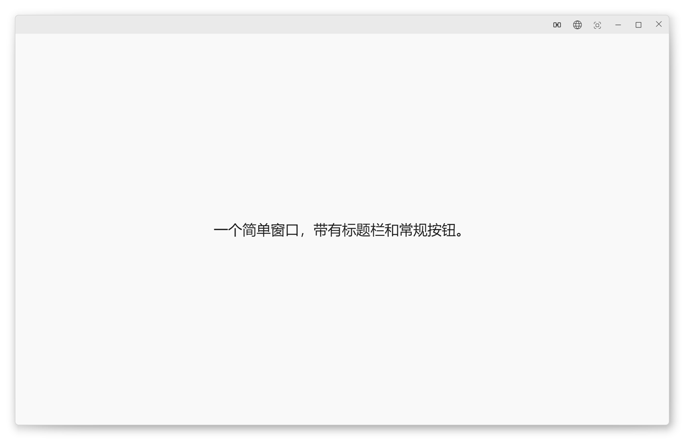

## 2. examples/ColorPicker
**拾色器完整接入示例。** 主窗口显示当前颜色的色块、`#AARRGGBB` 与 R/G/B/A 分量；点击「打开调色板」弹出真彩拾色器，拖动时通过 `AttachSelectColor` 实时预览，点「确定」后由 `AttachWindowClose` 取得最终颜色，点「取消」或按 Esc 不采用，事件日志逐条记录回调。    
**适合**：需要在应用中选颜色，或想学习独立窗口、模态交互与实时预览回调。    
**代码入口**：[MainThread.cpp](../examples/ColorPicker/MainThread.cpp)、[MainForm.cpp](../examples/ColorPicker/MainForm.cpp)；**界面资源**：`bin/resources/themes/default/color_picker_demo/ColorPickerDemo.xml`（示例窗口）与 `bin/resources/themes/default/public/color/color_picker.xml`（拾色器本身是独立窗口，皮肤目录为 `public`）；**相关文档**：[Control.md](Control.md) 中的 ColorPicker 章节。    
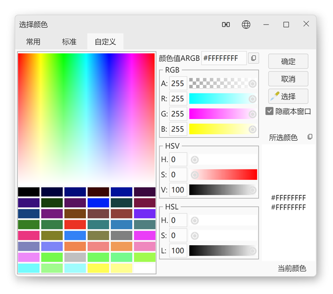    
（左：示例主窗口；右：拾色器）

## 3. examples/controls
**控件总览。** 常用控件的样式与交互集中在一个窗口中展示，包含按钮、复选框、下拉框、进度条、滑块、日期、菜单、消息框、Toast、树形表格等；同目录下按控件拆分了多份 XML（如 `message_box_test.xml`、`toast_test.xml`、`tree_grid.xml`），便于直接复制到自己的工程。    
**适合**：想快速确认框架支持哪些控件、长什么样、对应哪段 XML。    
**代码入口**：[MainThread.cpp](../examples/controls/MainThread.cpp)、[ControlForm.cpp](../examples/controls/ControlForm.cpp)；**界面资源**：`bin/resources/themes/default/controls/controls.xml`；**相关文档**：[Control.md](Control.md)、[MessageBox.md](MessageBox.md)、[Toast.md](Toast.md)。    
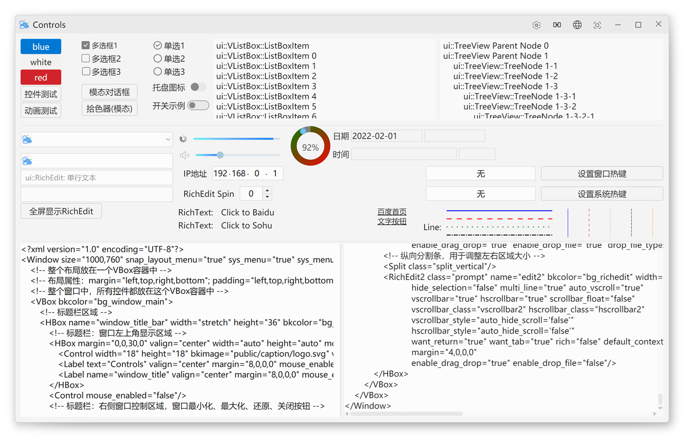

## 4. examples/chat
**完整的聊天应用。** 从登录窗口进入聊天主界面，导航、会话、消息、输入区和各种消息交互都已串起来，适合用来学习复杂界面的组织方式。    
**适合**：想做一个 IM/客服类界面，或需要参考多面板布局与事件联动。    
**亮点**：
- 登录后进入聊天主界面，主题与多语言切换立即生效；
- 会话/联系人/收藏三栏导航，未读角标、搜索过滤、会话历史分别保存；
- 消息支持文字、图片、引用、撤回、发送中/已送达/已读与失败重试；
- 双击复制、右键菜单、历史浏览时的新消息提示、头像风格切换；
- 窗口可缩放，布局自适应；未接线的按钮用 Toast 给出反馈。

**代码入口**：[MainThread.cpp](../examples/chat/MainThread.cpp)、[LoginForm.cpp](../examples/chat/LoginForm.cpp)、[ChatForm.cpp](../examples/chat/ChatForm.cpp)；**界面资源**：`bin/resources/themes/default/chat/wechat.xml`、`login.xml`、`menu_settings.xml`、`chat_message_menu.xml`、`chat_image_menu.xml`；**相关文档**：[Box.md](Box.md)、[Control.md](Control.md)、[Menu.md](Menu.md)。    
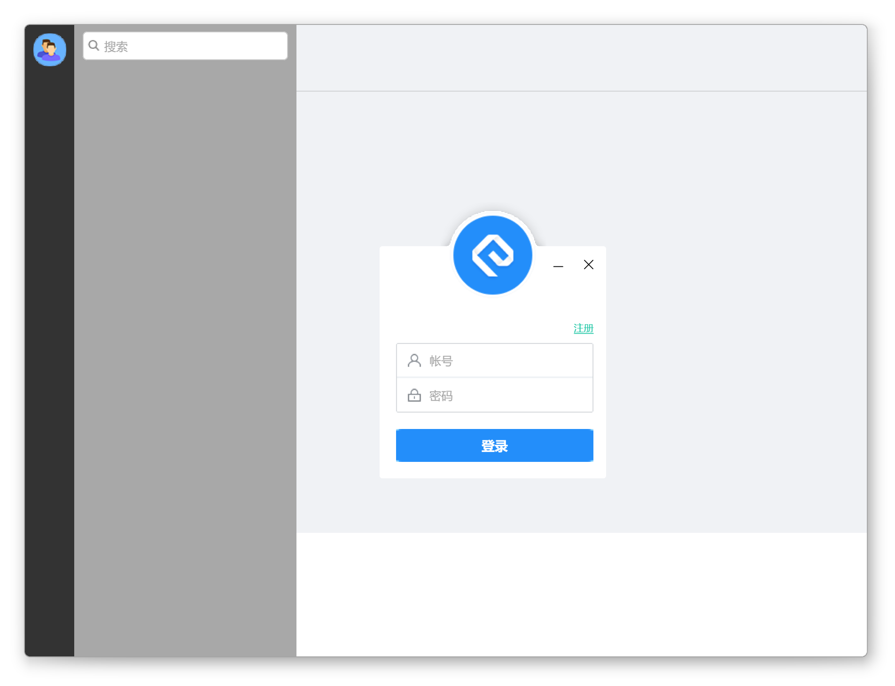

## 5. examples/ListBox
**列表容器全家桶。** 状态栏实时显示容器类型、项数与已选数量，可勾选切换多选模式；事件日志显示 Select/UnSelect/SelChanged/Click/DoubleClick/RClick/Return 及键盘事件；列表项支持图标、进度条与逐项删除。修改 `list_box.xml` 中的容器标签（`VListBox` / `HListBox` / `VTileListBox` / `HTileListBox`）即可切换布局，C++ 代码无需改动。    
**适合**：学习 ListBox 系列的布局差异、选择模式与事件参数。    
**代码入口**：[MainThread.cpp](../examples/ListBox/MainThread.cpp)、[ListBoxForm.cpp](../examples/ListBox/ListBoxForm.cpp)；**界面资源**：`bin/resources/themes/default/list_box/list_box.xml`、`list_box/item.xml`；**相关文档**：[Control.md](Control.md)。    
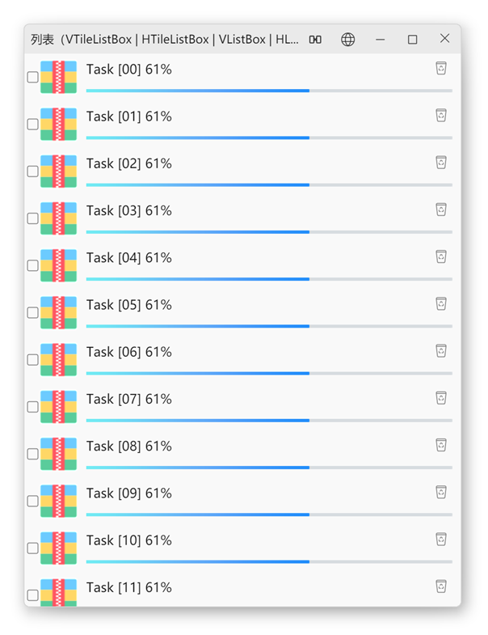

## 6. examples/ListCtrl
**表格/报表控件示例。** 演示 ListCtrl 的列、表头、数据项与子项组织方式，同目录下还包含 `loading*.xml` 等加载状态示例，可作为数据列表、任务列表、文件列表的基础。    
**适合**：需要表格、报表视图，或想了解大数据量列表的加载与占位效果。    
**代码入口**：[MainThread.cpp](../examples/ListCtrl/MainThread.cpp)、[MainForm.cpp](../examples/ListCtrl/MainForm.cpp)；**界面资源**：`bin/resources/themes/default/list_ctrl/list_ctrl.xml`；**相关文档**：[Control.md](Control.md)。    
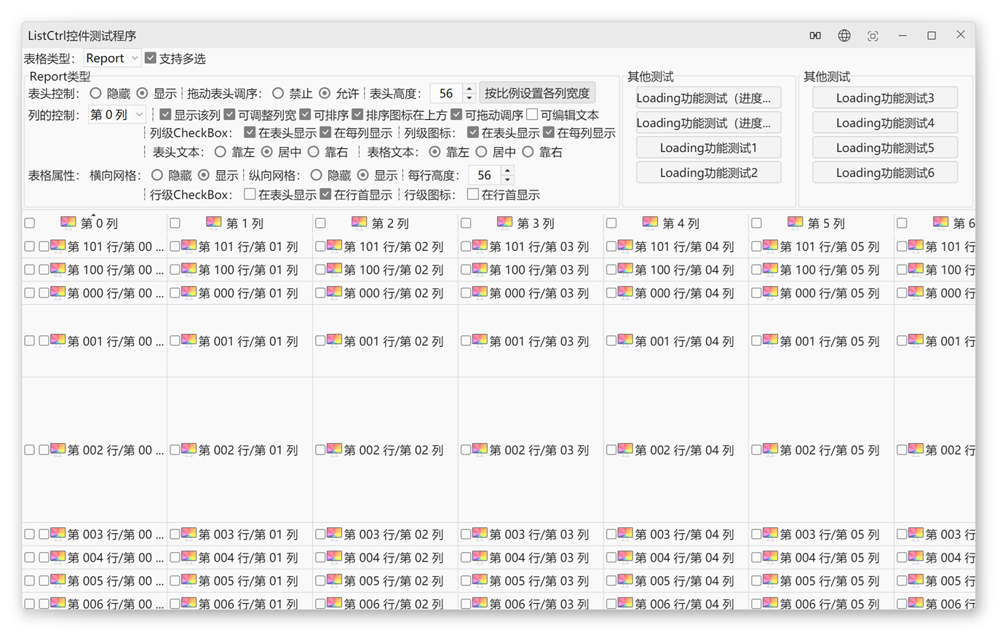

## 7. examples/MoveControl
**跨容器拖拽。** 通过 Box 的 `drag_out_id` 与 `drop_in_id` 属性，把控件从一个容器拖到另一个容器；应用图标使用 SVG 矢量图，缩放不失真；拖动后的“常用应用”状态记录到示例的 AppDb（内存模拟数据库）。    
**适合**：做桌面图标整理、看板、可拖拽面板等交互。    
**代码入口**：[MainThread.cpp](../examples/MoveControl/MainThread.cpp)、[MoveControlForm.cpp](../examples/MoveControl/MoveControlForm.cpp)；**界面资源**：`bin/resources/themes/default/move_control/main.xml`、`move_control/app_item.xml`；**相关文档**：[Control.md](Control.md)、[XmlNode.md](XmlNode.md)。    
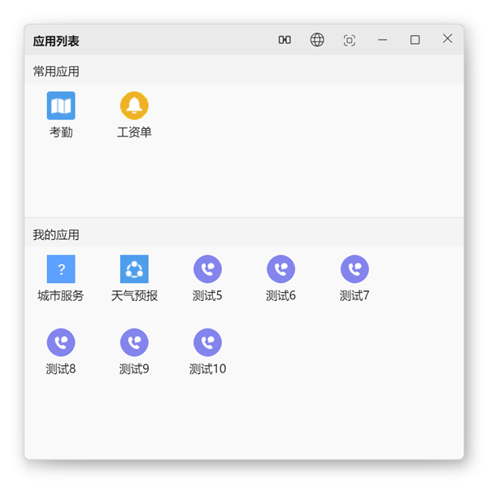

## 8. examples/render
**渲染引擎与控件画廊。** 演示 Skia 渲染接口的用法，同时把各种控件、容器、窗口阴影集中到多个页面中展示；`render.xml` 之外还有 `page_*.xml` 分页示例，便于按页阅读。    
**适合**：想了解自绘、渲染接口，或想一页页浏览控件效果。    
**代码入口**：[MainThread.cpp](../examples/render/MainThread.cpp)、[RenderForm.cpp](../examples/render/RenderForm.cpp)；**界面资源**：`bin/resources/themes/default/render/render.xml`、`render/page_*.xml`；**相关文档**：[Control.md](Control.md)、[WindowShadow.md](WindowShadow.md)。    
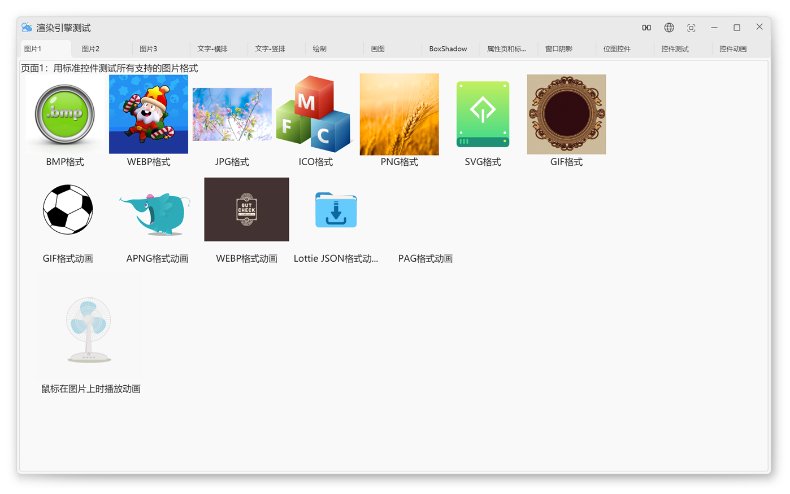
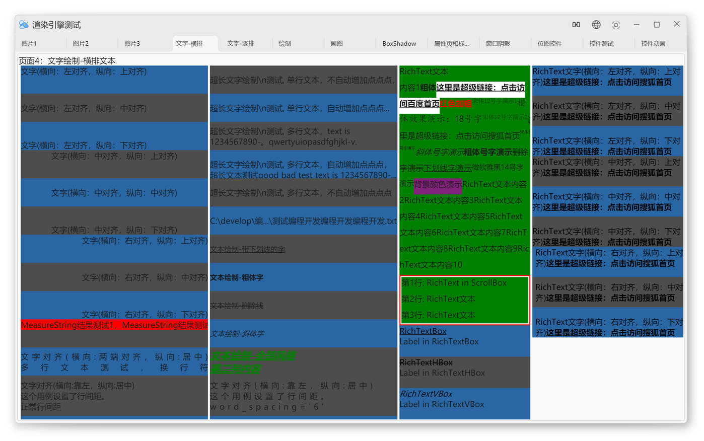
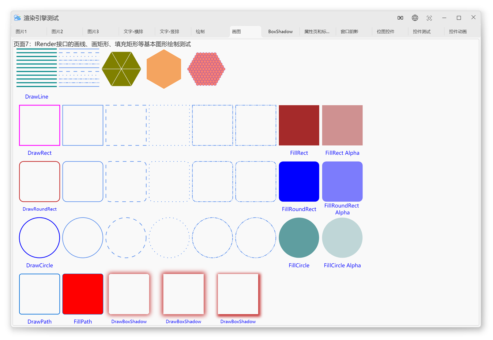
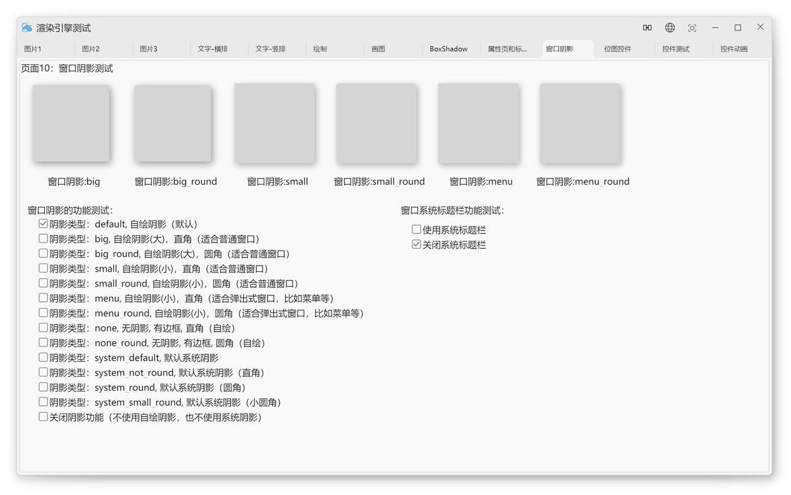

## 9. examples/RichEdit
**简易记事本。** 覆盖富文本编辑器的常见能力：新建、打开（TXT/RTF）、保存、查找替换、字体与字号、粗体/斜体/下划线/删除线、文字颜色、缩放、自动换行、富文本模式与行距、复制/剪切/粘贴/撤销/重做/全选，并支持拖入 `.txt`/`.rtf` 文件打开；底部状态栏显示光标位置、字符数、缩放比例、编辑模式与编码，窗口与编辑设置会在退出时保存。    
**适合**：需要文本编辑、富文本展示，或想学习 RichEdit 与菜单/工具栏的配合。    
**快捷键**：Ctrl+N 新建、Ctrl+O 打开、Ctrl+S 保存、Ctrl+Shift+S 另存为、Ctrl+F 查找、Ctrl+H 替换、F3 查找下一个、Ctrl+0 缩放复位、Ctrl+滚轮缩放。    
**代码入口**：[MainThread.cpp](../examples/RichEdit/MainThread.cpp)、[MainForm.cpp](../examples/RichEdit/MainForm.cpp)、[FindForm.cpp](../examples/RichEdit/FindForm.cpp)、[ReplaceForm.cpp](../examples/RichEdit/ReplaceForm.cpp)；**界面资源**：`bin/resources/themes/default/rich_edit/rich_edit.xml`、`find.xml`、`replace.xml`；**相关文档**：[Control.md](Control.md)。    
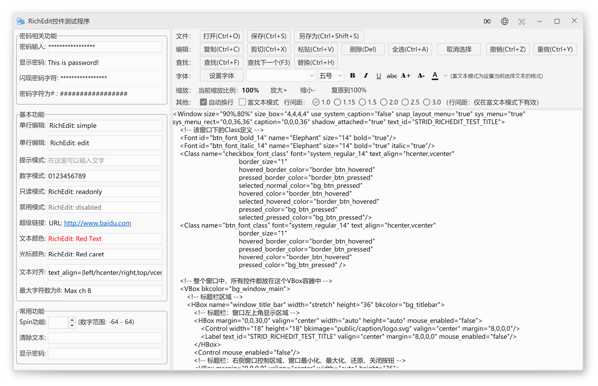

## 10. examples/TreeView
**资源管理器式文件浏览。** 左侧目录树、右侧文件列表，支持列表/图标/大图标视图、按列排序、前进/后退/向上导航、地址栏路径跳转、当前目录内按名称搜索；底部状态栏显示当前路径、项目统计与视图/排序方式。    
**适合**：需要目录树 + 文件列表的组合界面，或想学习 TreeView 与列表联动。    
**代码入口**：[MainThread.cpp](../examples/TreeView/MainThread.cpp)、[MainForm.cpp](../examples/TreeView/MainForm.cpp)；**界面资源**：`bin/resources/themes/default/tree_view/tree_view.xml`、`tree_view/tree_node.xml`；**相关文档**：[Control.md](Control.md)。    
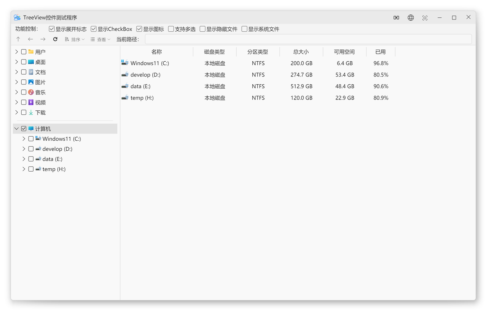

## 11. examples/VirtualListBox
**虚表列表。** 演示基于虚表实现的 ListBox 容器：只为可见区域创建列表项，适合展示大量数据；示例包含数据源、项模板与滚动加载的组织方式。    
**适合**：列表数据量大、需要控制内存与创建开销的场景。    
**代码入口**：[MainThread.cpp](../examples/VirtualListBox/MainThread.cpp)、[MainForm.cpp](../examples/VirtualListBox/MainForm.cpp)；**界面资源**：`bin/resources/themes/default/virtual_list_box/main.xml`、`virtual_list_box/item.xml`；**相关文档**：[Control.md](Control.md)。    
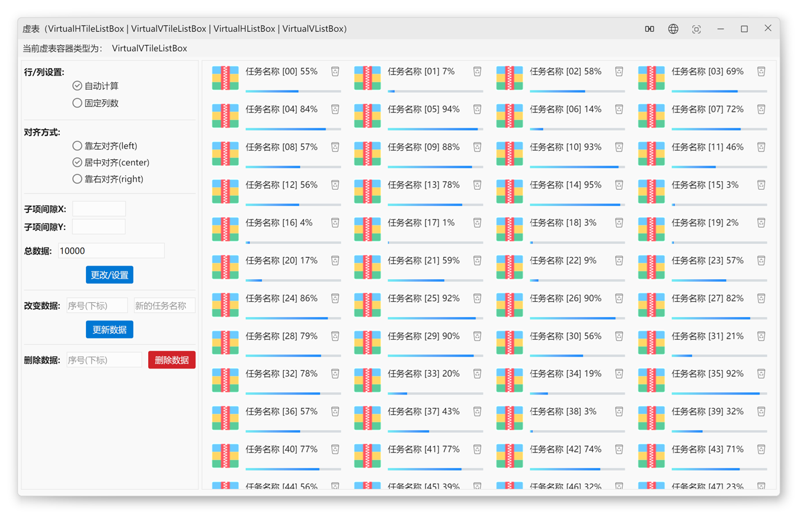

## 12. examples/MultiLang
**多语言切换。** 展示当前语言名称与语言文件，以及同一段文案的三种渲染方式（Label、RichText 控件、Label 的 `rich_text` 属性）；点击标题栏语言按钮即可动态切换，所有窗口文本立即刷新。    
**适合**：需要国际化，或想了解 `text_id` 与语言资源的组织方式。    
**代码入口**：[MainThread.cpp](../examples/MultiLang/MainThread.cpp)、[MainForm.cpp](../examples/MultiLang/MainForm.cpp)；**界面资源**：`bin/resources/themes/default/MultiLang/MultiLang.xml`；**相关文档**：[Global.md](Global.md)。    
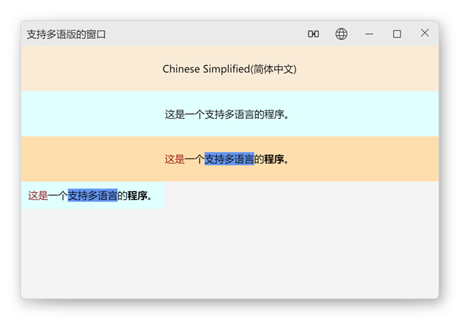

## 13. examples/DpiAware
**DPI 适配演示。** 分栏展示 DPI 感知模式、主显示器与窗口缩放百分比、窗口物理像素与内容区逻辑像素大小；右侧用同一张图片的 100%~300% 共 8 份图源，演示框架如何自动选用最接近的一份；底部可输入 60~500 的比例动态修改界面缩放，也可新建窗口对比。    
**适合**：需要适配高 DPI 屏幕、多显示器或可缩放界面的应用。    
**代码入口**：[MainThread.cpp](../examples/DpiAware/MainThread.cpp)、[MainForm.cpp](../examples/DpiAware/MainForm.cpp)；**界面资源**：`bin/resources/themes/default/dpi_aware/DpiAware.xml`；**相关文档**：[Window.md](Window.md) 中的 DPI 相关接口。    
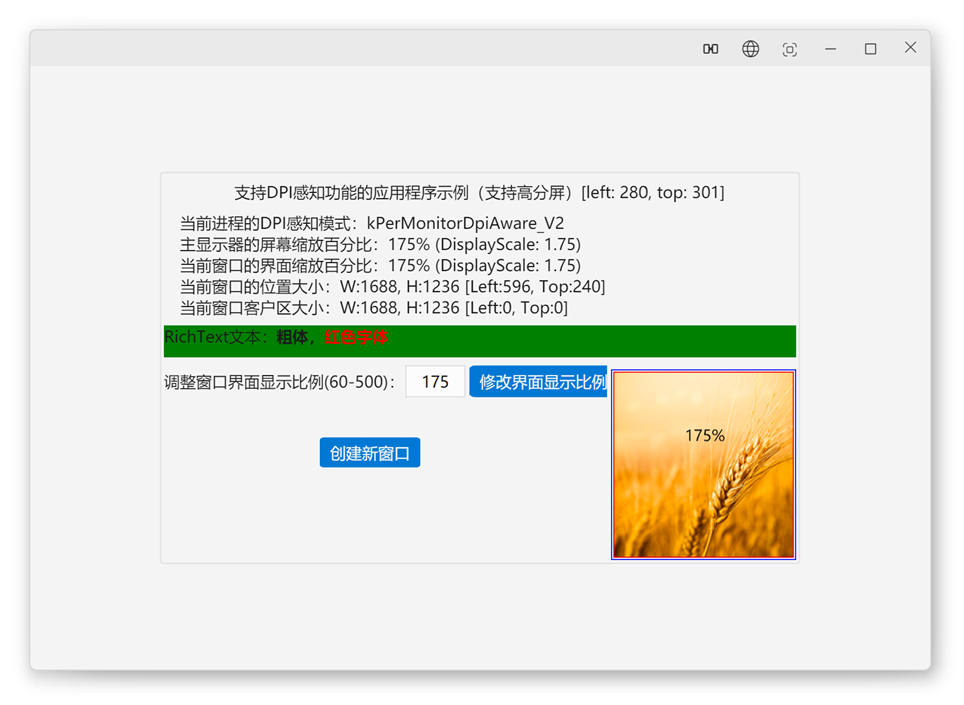

## 14. examples/threads
**线程池与定时器。** 可配置线程池线程数，实时查看各工作线程状态、操作系统线程 ID 与任务计数；支持立即执行、延迟执行、重复执行、长耗时任务、并发加速比验证与任务取消；停止线程池在后台完成、不阻塞界面，并集成 TimerManager 的添加、停止与触发观察。    
**适合**：需要在界面应用中安全地使用后台任务、线程池与定时器。    
**代码入口**：[MainThread.cpp](../examples/threads/MainThread.cpp)、[MainForm.cpp](../examples/threads/MainForm.cpp)、[WorkerThread.cpp](../examples/threads/WorkerThread.cpp)；**界面资源**：`bin/resources/themes/default/threads/threads.xml`；**相关文档**：[Getting-Started.md](Getting-Started.md) 中的“引入线程库”。    
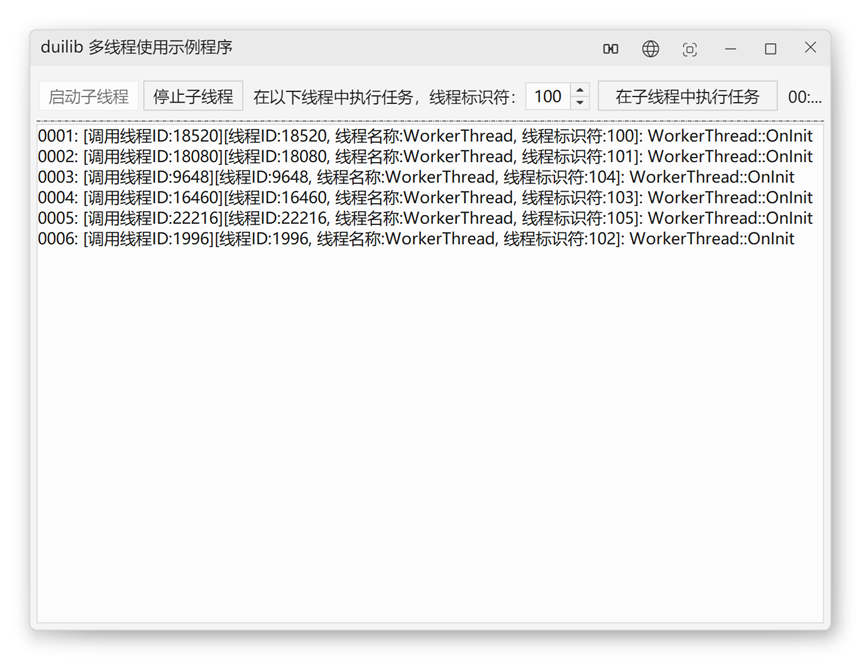

## 15. examples/layout
**布局容器大全。** 演示 VBox/HBox、流式布局、瓦片布局、网格布局、滚动容器、分割条等布局方式；同目录下的 `page_*.xml` 分别对应不同布局，修改 XML 即可对比效果。    
**适合**：需要快速找到合适的布局容器，或想理解拉伸、对齐、边距与滚动行为。    
**代码入口**：[MainThread.cpp](../examples/layout/MainThread.cpp)、[MainForm.cpp](../examples/layout/MainForm.cpp)；**界面资源**：`bin/resources/themes/default/layout/layout.xml`、`layout/page_*.xml`；**相关文档**：[Box.md](Box.md)。    
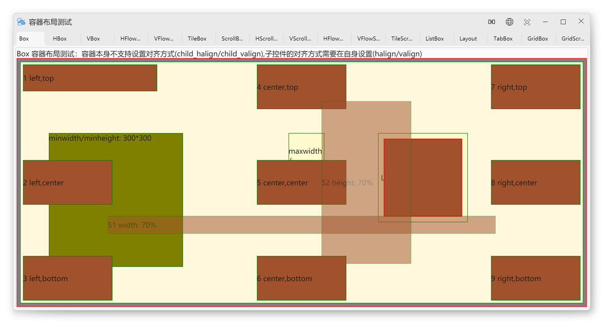

## 16. examples/cef
**CEF 控件与 JS 交互。** 在窗口中嵌入 CEF 浏览器，演示 C++ 与 JavaScript 的双向调用、页面加载与浏览器事件；适合需要内嵌 Chromium 的桌面应用。    
**代码入口**：[MainThread.cpp](../examples/cef/MainThread.cpp)、[CefForm.cpp](../examples/cef/CefForm.cpp)；**界面资源**：`bin/resources/themes/default/cef/cef.xml`；**相关文档**：[CEF.md](CEF.md)。    
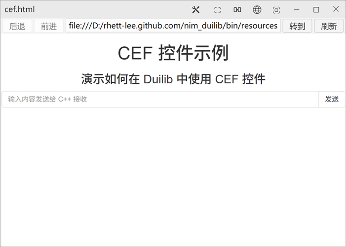

## 17. examples/CefBrowser
**基于 CEF 的多标签浏览器。** 支持多标签、标签拖拽、地址栏与前进/后退等浏览器基础交互，可作为浏览器类应用的骨架。    
**代码入口**：[MainThread.cpp](../examples/CefBrowser/MainThread.cpp)、[BrowserForm.cpp](../examples/CefBrowser/browser/BrowserForm.cpp)、[DragForm.cpp](../examples/CefBrowser/browser/DragForm.cpp)；**界面资源**：`bin/resources/themes/default/cef_browser/cef_browser.xml`、`drag_form.xml`、`browser_box.xml`、`tab_item.xml`；**相关文档**：[CEF.md](CEF.md)。    
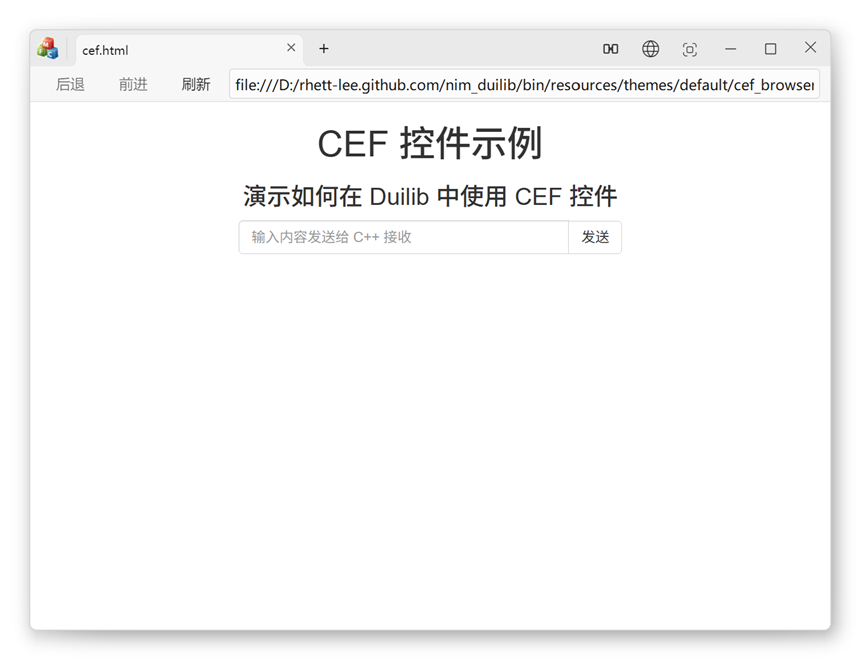

## 18. examples/WebView2
**WebView2 控件。** 使用系统 Edge WebView2 运行时嵌入网页，演示控件创建、导航和基础交互；相比 CEF，部署体积更小，适合 Windows 平台应用。    
**代码入口**：[MainThread.cpp](../examples/WebView2/MainThread.cpp)、[MainForm.cpp](../examples/WebView2/MainForm.cpp)；**界面资源**：`bin/resources/themes/default/webview2/webview2.xml`；**相关文档**：[Control.md](Control.md) 中的 WebView2Control 章节。    
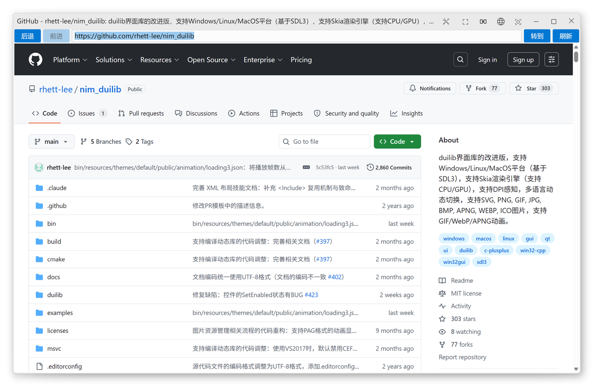

## 19. examples/WebView2Browser
**基于 WebView2 的多标签浏览器。** 多标签、标签拖拽、地址栏与导航按钮的组合示例，适合需要轻量浏览器界面的 Windows 应用。    
**代码入口**：[MainThread.cpp](../examples/WebView2Browser/MainThread.cpp)、[BrowserForm.cpp](../examples/WebView2Browser/BrowserForm.cpp)、[DragForm.cpp](../examples/WebView2Browser/DragForm.cpp)；**界面资源**：`bin/resources/themes/default/webview2_browser/webview2_browser.xml`、`drag_form.xml`、`browser_box.xml`、`tab_item.xml`；**相关文档**：[Control.md](Control.md) 中的 WebView2Control 章节。    
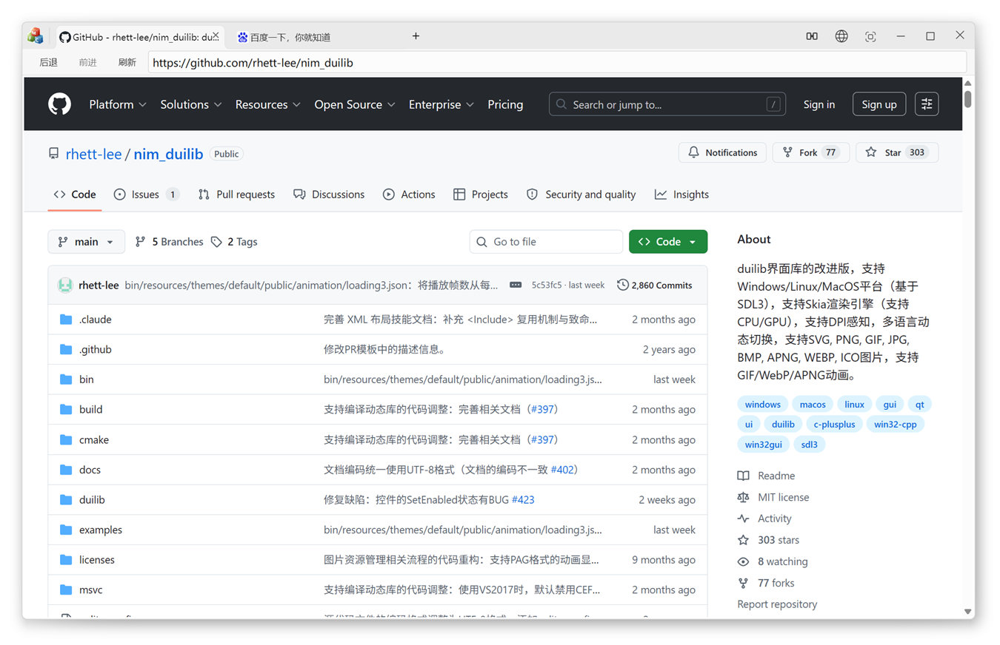

## 20. examples/ChildWindow
**子窗口容器。** 演示 ChildWindow 如何把其他窗口的内容嵌入当前窗口的控件树中，用于多文档界面、嵌入式面板等场景。    
**代码入口**：[MainThread.cpp](../examples/ChildWindow/MainThread.cpp)、[MainForm.cpp](../examples/ChildWindow/MainForm.cpp)；**界面资源**：`bin/resources/themes/default/child_window/child_window.xml`、`child_window/child_window_item.xml`；**相关文档**：[Control.md](Control.md) 中的 ChildWindow 章节。    
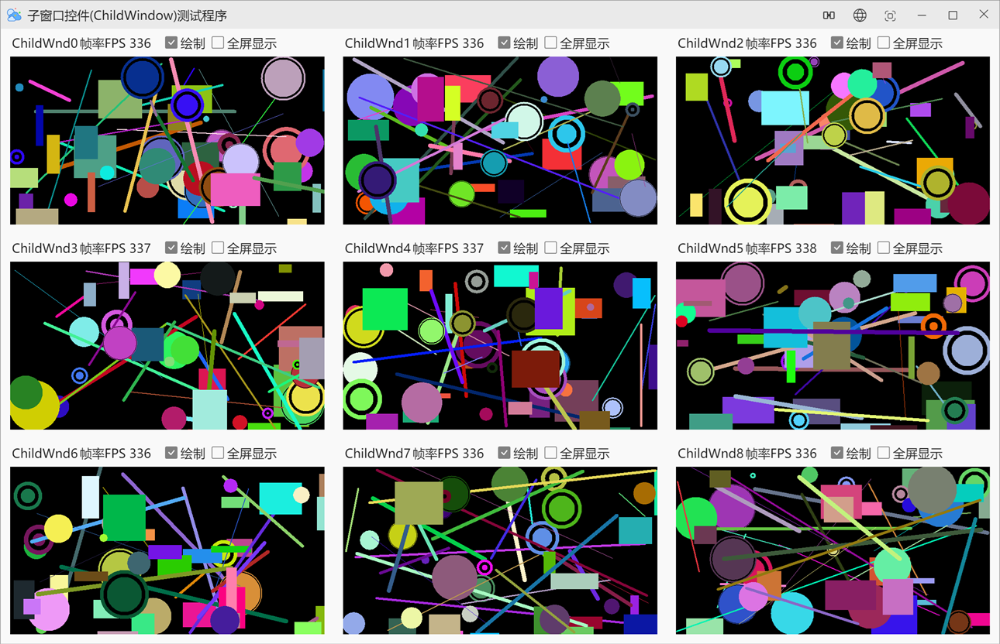

## 21. examples/XmlPreview
**XML 界面实时预览。** 打开 XML 文件或直接拖入预览区域即可查看界面效果；支持重新加载、清空预览；顶部信息卡片显示完整路径、加载状态与失败详情（文件、行号、列号）；勾选“自动刷新”后按 1–60 秒间隔检测文件变化并重新预览。    
**适合**：调整皮肤 XML 时边改边看，或排查 XML 加载错误。    
**代码入口**：[MainThread.cpp](../examples/XmlPreview/MainThread.cpp)、[MainForm.cpp](../examples/XmlPreview/MainForm.cpp)；**界面资源**：`bin/resources/themes/default/xml_preview/xml_preview.xml`；**相关文档**：[XmlNode.md](XmlNode.md)、[XmlEvents.md](XmlEvents.md)、[XmlTools.md](XmlTools.md)。    
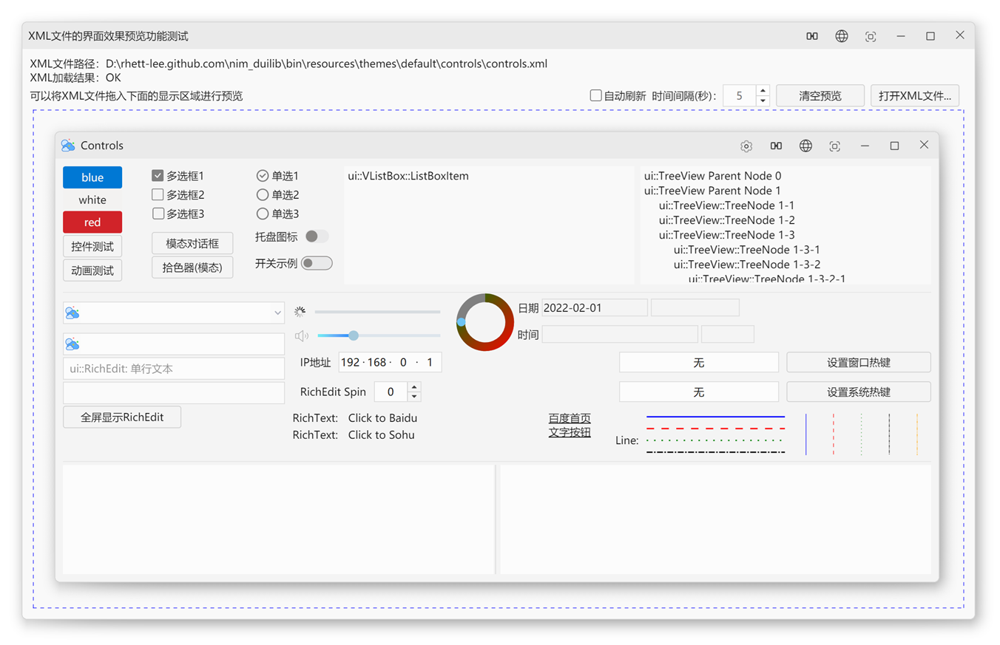

## 22. examples/ColorTheme
**主题颜色预览与生成。** 演示主题色的预览、切换与生成流程，包含 Flyout 弹出层示例，可作为自定义主题、品牌换色的参考。    
**适合**：需要做暗色/亮色主题、品牌配色或主题生成工具。    
**代码入口**：[MainThread.cpp](../examples/ColorTheme/MainThread.cpp)、[MainForm.cpp](../examples/ColorTheme/MainForm.cpp)；**界面资源**：`bin/resources/themes/default/color_theme/color_theme.xml`、`color_theme/flyout_demo.xml`；**相关文档**：[Theme.md](Theme.md)、[ThemeColor.md](ThemeColor.md)。    
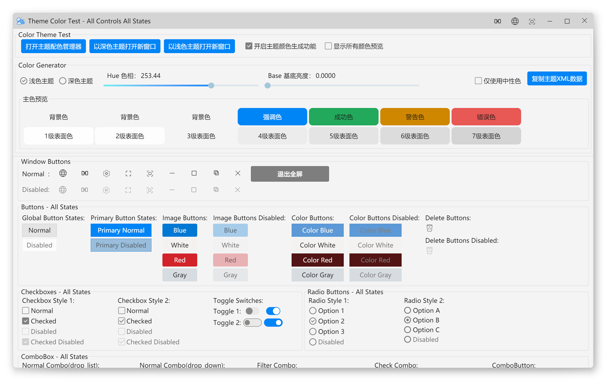

## 23. examples/panel
**带标题栏的面板容器。** 演示 Panel/PanelHBox/PanelVBox 的用法：标题栏样式、点击折叠/展开（带动画）、手风琴分组、折叠触发热区、自定义箭头状态图片、箭头左置与标题对齐、标题栏槽位、折叠前取消事件，以及通过 C++ 代码控制面板状态。    
**适合**：做设置页、折叠分组、侧边栏分区等界面。    
**代码入口**：[MainThread.cpp](../examples/panel/MainThread.cpp)、[PanelForm.cpp](../examples/panel/PanelForm.cpp)；**界面资源**：`bin/resources/themes/default/panel/panel.xml`；**相关文档**：[Box.md](Box.md) 中的 Panel/PanelHBox/PanelVBox 章节。    
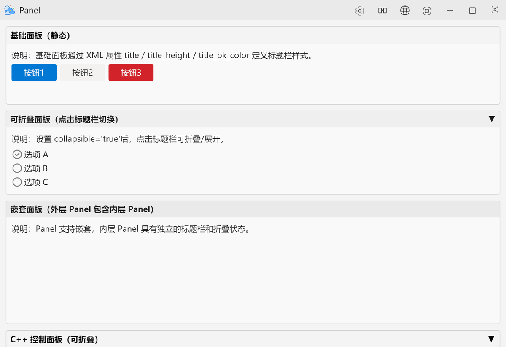
