简体中文 | [English](Examples.en.md)

## 示例程序
examples 目录中包含了一些示例程序，可以参考这些示例程序来完善自己的应用程序。

## 1. examples/basic
一个基础的窗口示例程序，带有最小化、最大化、还原和关闭按钮。    
macOS 下默认编译为 `bin/basic.app`，C++ 代码无需修改；配置方法见
[build/macos-app-bundle.md](../build/macos-app-bundle.md)。    
代码入口：[MainThread.cpp](../examples/basic/MainThread.cpp)、[MainForm.cpp](../examples/basic/MainForm.cpp)；界面资源：`bin/resources/themes/default/basic/basic.xml`；相关文档：[Getting-Started.md](Getting-Started.md)、[Window.md](Window.md)。    
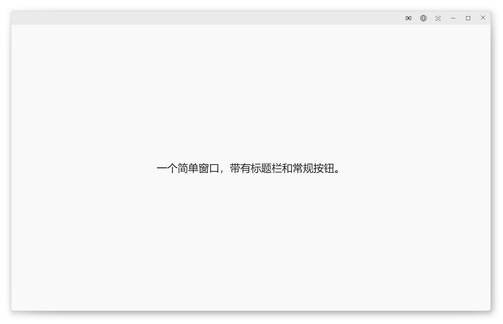

## 2. examples/ColorPicker
演示如何使用拾色器控件的程序：主窗口显示当前颜色（色块 + #AARRGGBB + R/G/B/A 分量），点「打开调色板」弹出真彩拾色器；拖动拾色器时通过 AttachSelectColor 实时预览，点「确定」后由 AttachWindowClose 得到最终颜色，点「取消」或按 Esc 不采用，事件日志逐条记录回调。    
代码入口：[MainThread.cpp](../examples/ColorPicker/MainThread.cpp)、[MainForm.cpp](../examples/ColorPicker/MainForm.cpp)；界面资源：`bin/resources/themes/default/color_picker_demo/ColorPickerDemo.xml`（示例窗口）与 `bin/resources/themes/default/public/color/color_picker.xml`（拾色器本身是独立窗口，皮肤目录为 `public`）；相关文档：[Control.md](Control.md) 中的 ColorPicker 章节。    
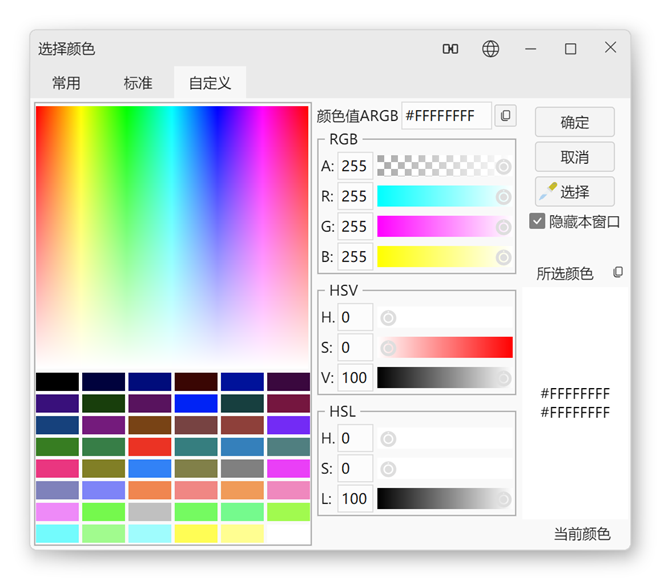

## 3. examples/controls
一些常用控件的样式使用方法示例。    
代码入口：[MainThread.cpp](../examples/controls/MainThread.cpp)、[ControlForm.cpp](../examples/controls/ControlForm.cpp)；界面资源：`bin/resources/themes/default/controls/controls.xml`（同目录下还有各控件的示例 XML，如 `message_box_test.xml`、`toast_test.xml`、`tree_grid.xml` 等）；相关文档：[Control.md](Control.md)、[MessageBox.md](MessageBox.md)、[Toast.md](Toast.md)。    
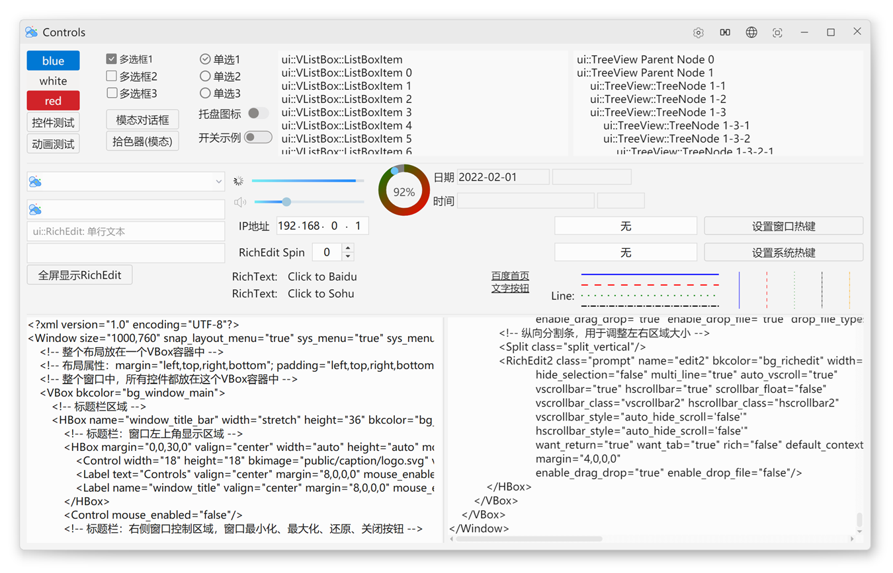

## 4. examples/chat
包含一个登录窗口和一个模拟 PC 聊天布局的窗口示例：登录窗口会提示"输入任意用户名和密码即可登录"，右上角提供主题切换与多语言切换按钮（弹出框架内置菜单，切换后立即生效，登录窗口的背景图也会跟随深浅色主题切换）；登录成功后进入聊天主界面（不退出程序），主界面含标题栏、左侧导航栏、可切换的会话/联系人/收藏面板、消息区与输入区，支持发送消息与模拟自动回复；消息区使用框架的 ChatMessageList 控件渲染气泡。左下角设置按钮弹出菜单（发起聊天/联系人/关于本示例/退出登录），菜单中的“退出登录”会关闭主界面并结束程序；输入框回车发送、Ctrl+回车换行；发送的消息依次显示"发送中/已送达/已读"，输入以 `/fail` 开头的文本可模拟发送失败，点击"发送失败，点击重试"即重发；双击消息复制该条文本，右键保留当前选区（无选区时选中该条消息）并弹出"复制/全选"菜单（无选区时"复制"置灰）；向上翻看历史时新到达的消息不会把视图拽走，而是在消息区底部显示"↓ N 条新消息"提示，点击即回到底部；未接线的工具按钮以 Toast 提示给出反馈；会话数据按会话分别保存消息历史，切换会话时各自的消息、发送状态都会保留；会话列表右下角的红点是未读角标，未读消息到达其它会话时角标计数累加，切入会话即清零；点击"联系人"里的一位好友即可发起会话（已有会话则直接切换过去，没有则新建会话并插入会话列表）；会话列表顶部的搜索框输入关键字即可按会话名/预览内容过滤会话与联系人，没有匹配项时显示"没有找到相关结果"；消息区支持四种消息形态：文字消息、图片消息（点击输入区的图片按钮，在弹出菜单中挑选一张示例图片即可发送）、引用消息（点击输入区的引用按钮引用最近一条消息，或在消息上右键选择"引用"指定消息；气泡顶部显示引用摘要，双击引用块可跳转到被引用的消息并短暂高亮）、消息撤回（右键自己发送的消息选择"撤回"，撤回后只剩一行灰色提示且不再可复制）；消息头像使用图片资源绘制，点击消息头像可在文字头像与图片头像之间切换（切换结果按会话保留）；标题栏右侧的主题切换、多语言切换按钮弹出框架内置菜单，切换后立即生效（会话名称、预览文案、标题栏与消息时间戳都会按新语言重建，切换前后内容一致，不会残留上一种语言的文案）；窗口支持最大化/还原，也可拖动窗口边缘调整大小，布局随尺寸自适应（与 examples/controls 等其他示例保持一致）。    
代码入口：[MainThread.cpp](../examples/chat/MainThread.cpp)、[LoginForm.cpp](../examples/chat/LoginForm.cpp)、[ChatForm.cpp](../examples/chat/ChatForm.cpp)；界面资源：`bin/resources/themes/default/chat/wechat.xml`、`bin/resources/themes/default/chat/login.xml`、`bin/resources/themes/default/chat/menu_settings.xml`、`bin/resources/themes/default/chat/chat_message_menu.xml`、`bin/resources/themes/default/chat/chat_image_menu.xml`；相关文档：[Box.md](Box.md)、[Control.md](Control.md)、[Menu.md](Menu.md)。    
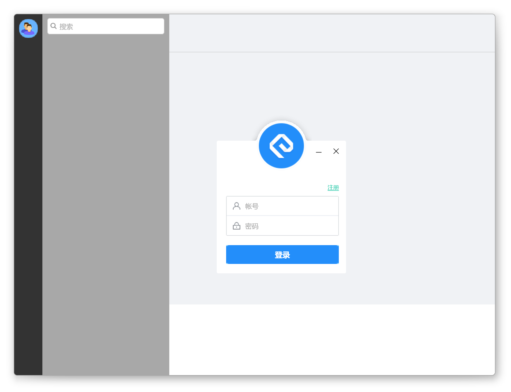

## 5. examples/ListBox
演示如何使用ListBox容器的程序：状态栏显示当前容器类型、项数与已选数量，可勾选切换多选模式；底部事件日志实时显示 Select/UnSelect/SelChanged/Click/DoubleClick/RClick/Return 及键盘事件与索引参数；列表项支持图标、进度条与逐项删除。修改 list_box.xml 中的容器标签（VListBox / HListBox / VTileListBox / HTileListBox）即可切换布局，代码无需改动。    
代码入口：[MainThread.cpp](../examples/ListBox/MainThread.cpp)、[ListBoxForm.cpp](../examples/ListBox/ListBoxForm.cpp)；界面资源：`bin/resources/themes/default/list_box/list_box.xml`、`list_box/item.xml`；相关文档：[Control.md](Control.md)。    
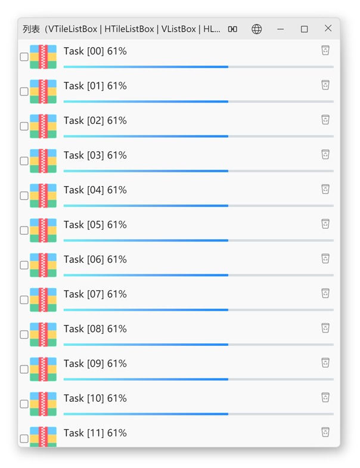
    
## 6. examples/ListCtrl
演示如何使用ListCtrl控件。    
代码入口：[MainThread.cpp](../examples/ListCtrl/MainThread.cpp)、[MainForm.cpp](../examples/ListCtrl/MainForm.cpp)；界面资源：`bin/resources/themes/default/list_ctrl/list_ctrl.xml`（同目录下还有 `loading*.xml` 等加载状态示例）；相关文档：[Control.md](Control.md)。    
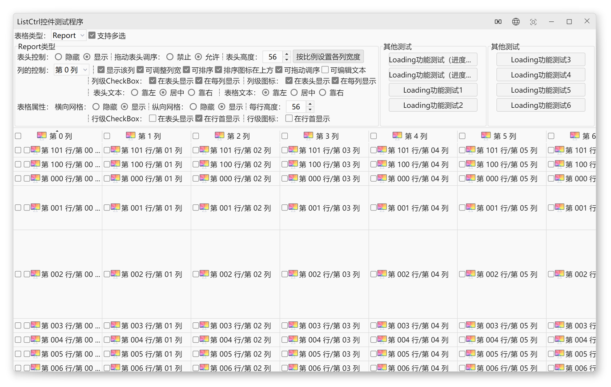

## 7. examples/MoveControl
演示如何使用Box容器的"drag_out_id"和"drop_in_id"属性来实现控件在不同容器之间的移动效果：应用图标为 SVG 矢量图（缩放不失真），拖动后"常用应用"的状态会记录到 AppDb 中（示例用内存模拟数据库）。    
代码入口：[MainThread.cpp](../examples/MoveControl/MainThread.cpp)、[MoveControlForm.cpp](../examples/MoveControl/MoveControlForm.cpp)；界面资源：`bin/resources/themes/default/move_control/main.xml`、`move_control/app_item.xml`；相关文档：[Control.md](Control.md)、[XmlNode.md](XmlNode.md)。    
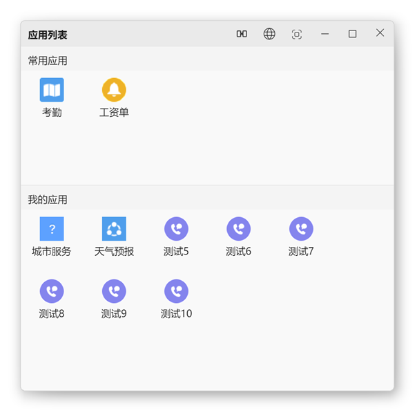
   
## 8. examples/render
演示如何使用渲染引擎的程序，同时也包含了各种控件/容器的使用示例。    
代码入口：[MainThread.cpp](../examples/render/MainThread.cpp)、[RenderForm.cpp](../examples/render/RenderForm.cpp)；界面资源：`bin/resources/themes/default/render/render.xml`（同目录下还有 `page_*.xml` 各页面示例）；相关文档：[Control.md](Control.md)、[WindowShadow.md](WindowShadow.md)。    
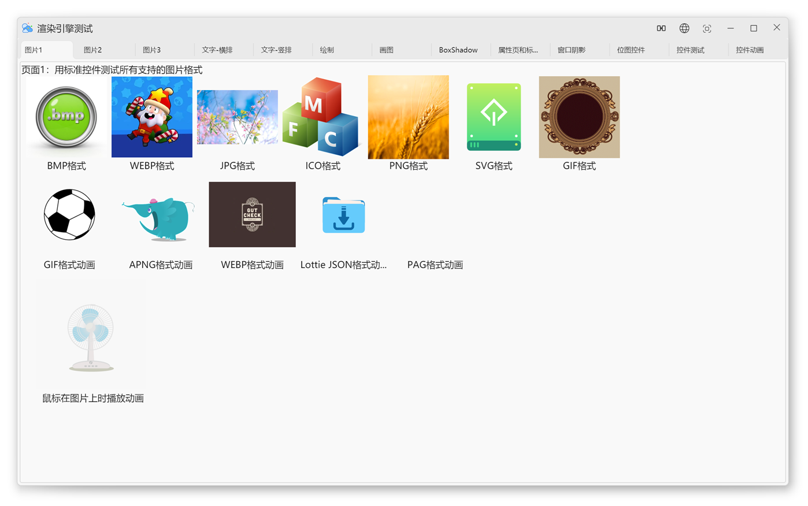
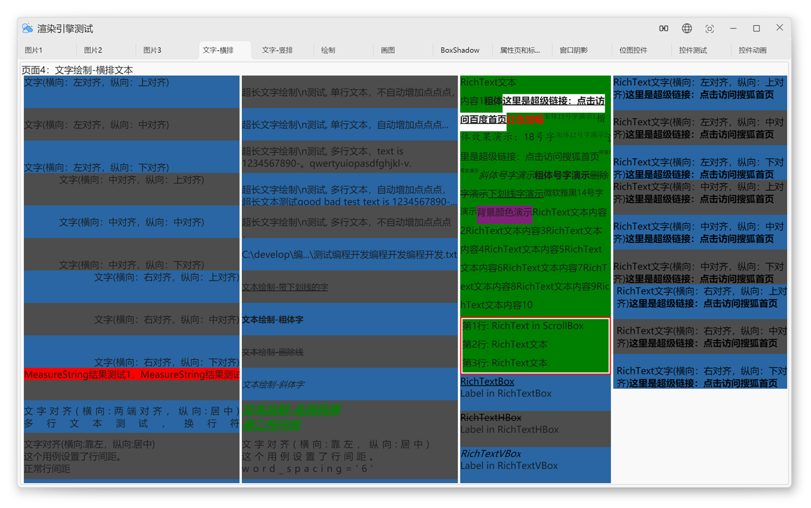
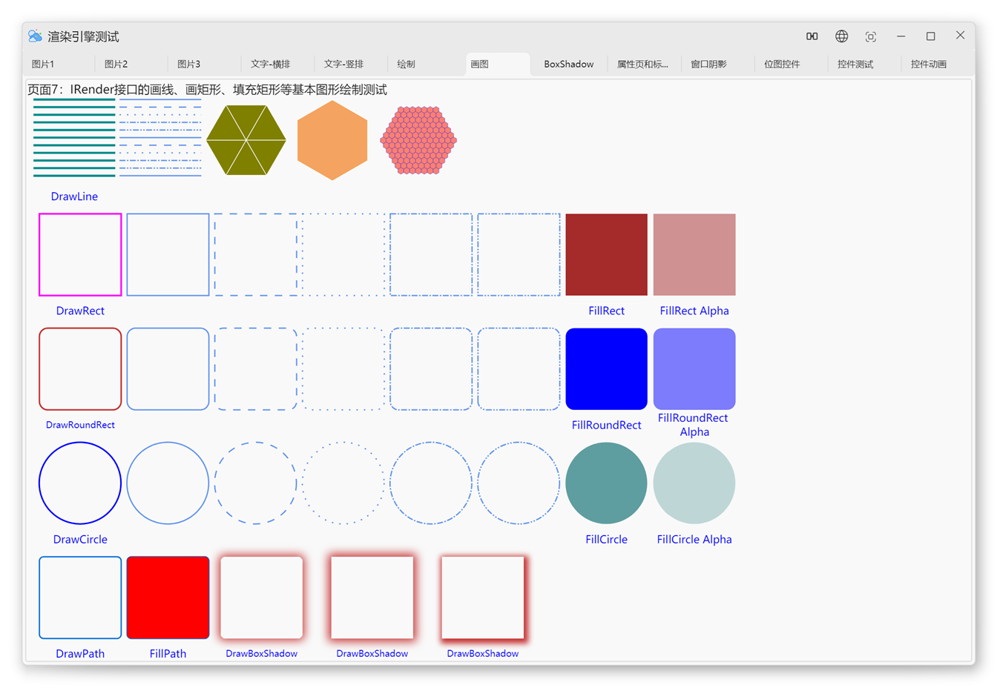
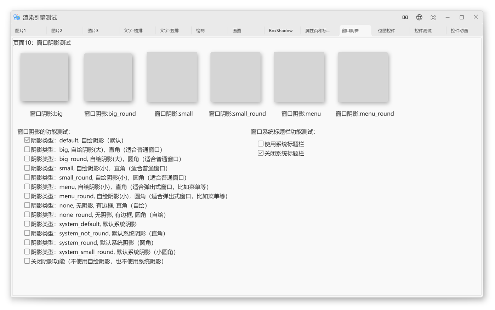

## 9. examples/RichEdit
演示如何使用RichEdit控件，实现一个简易记事本：新建、打开（TXT/RTF）、保存、查找与替换、字体名称与字号、粗体/斜体/下划线/删除线、文字颜色、缩放（下拉比例、Ctrl+滚轮）、自动换行、富文本模式与行距、复制/剪切/粘贴/撤销/重做/全选，支持拖入 `.txt`/`.rtf` 文件打开；底部状态栏显示光标位置、字符数、缩放比例、编辑模式与编码，并实时提示操作结果；窗口位置与大小、左侧分栏宽度、缩放、字体、换行与富文本状态在退出时保存，下次启动自动恢复。    
快捷键：Ctrl+N 新建、Ctrl+O 打开、Ctrl+S 保存、Ctrl+Shift+S 另存为、Ctrl+F 查找、Ctrl+H 替换、F3 查找下一个、Ctrl+0 缩放复位为 100%、Ctrl+滚轮 缩放；查找/替换对话框中 Enter 执行、Esc 关闭、F3 查找下一个。    
代码入口：[MainThread.cpp](../examples/RichEdit/MainThread.cpp)、[MainForm.cpp](../examples/RichEdit/MainForm.cpp)、[FindForm.cpp](../examples/RichEdit/FindForm.cpp)、[ReplaceForm.cpp](../examples/RichEdit/ReplaceForm.cpp)；界面资源：`bin/resources/themes/default/rich_edit/rich_edit.xml`、`rich_edit/find.xml`、`rich_edit/replace.xml`；用户设置文件：`user/RichEdit_settings.ini`；相关文档：[Control.md](Control.md)。    
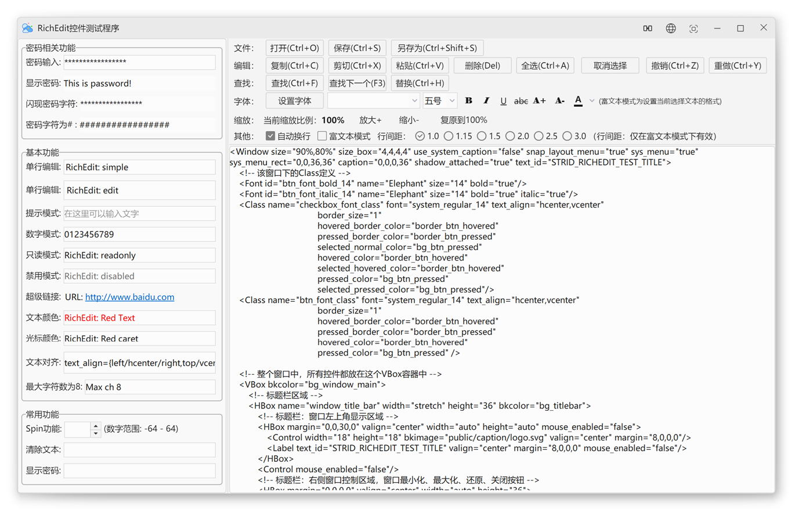

## 10. examples/TreeView
演示如何使用TreeView（目录树）控件，实现一个类似资源管理器的文件浏览程序：左侧目录树、右侧文件列表（列表视图/图标视图/大图标视图等），支持视图切换、按列排序、前进/后退/向上导航、地址栏路径跳转、当前目录内按名称搜索过滤，底部状态栏实时显示当前路径、项目统计与视图/排序方式。    
代码入口：[MainThread.cpp](../examples/TreeView/MainThread.cpp)、[MainForm.cpp](../examples/TreeView/MainForm.cpp)；界面资源：`bin/resources/themes/default/tree_view/tree_view.xml`、`tree_view/tree_node.xml`；相关文档：[Control.md](Control.md)。    
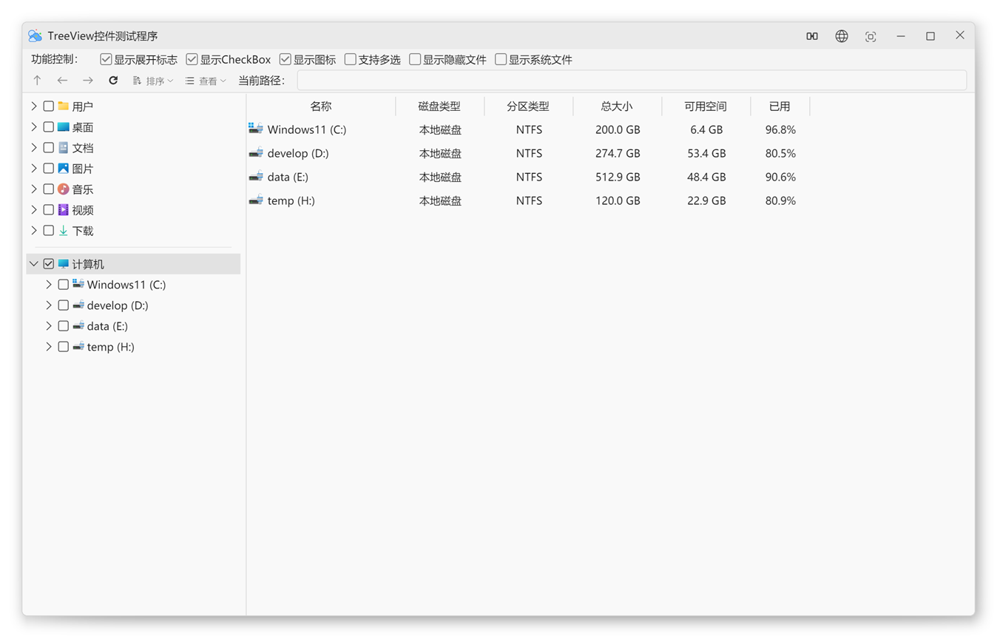
    
## 11. examples/VirtualListBox
演示如何使用基于虚表实现的ListBox容器。    
代码入口：[MainThread.cpp](../examples/VirtualListBox/MainThread.cpp)、[MainForm.cpp](../examples/VirtualListBox/MainForm.cpp)；界面资源：`bin/resources/themes/default/virtual_list_box/main.xml`、`virtual_list_box/item.xml`；相关文档：[Control.md](Control.md)。    
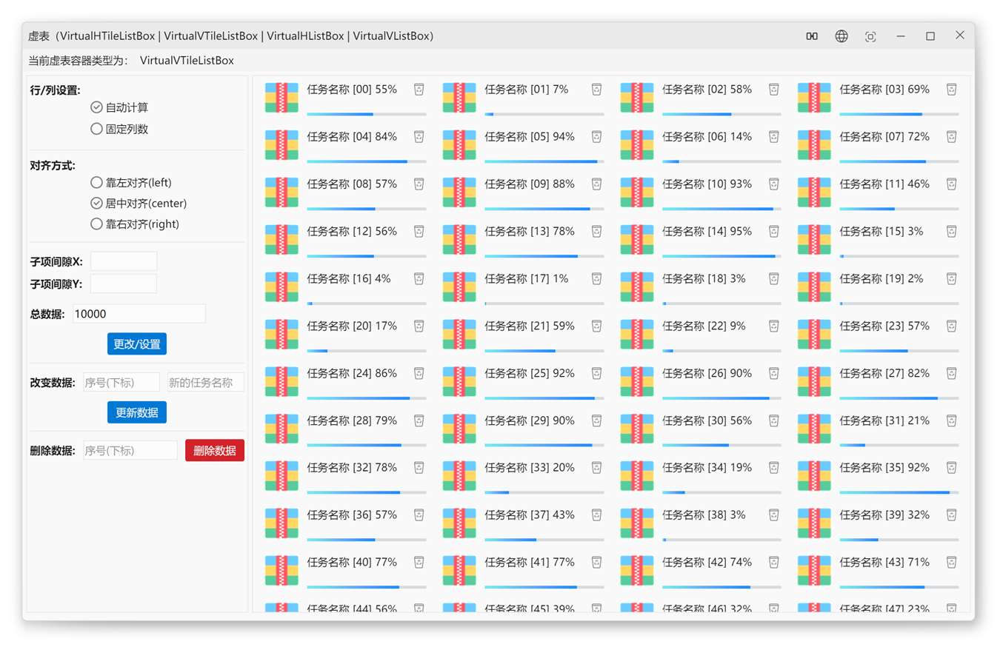
    
## 12. examples/MultiLang
演示如何使用多语言功能：展示当前语言名称与语言文件，以及同一段文案的三种渲染方式（Label、RichText 控件、Label 的 rich_text 属性）；点击标题栏的语言按钮可动态切换语言，切换后所有窗口的文本立即刷新。    
代码入口：[MainThread.cpp](../examples/MultiLang/MainThread.cpp)、[MainForm.cpp](../examples/MultiLang/MainForm.cpp)；界面资源：`bin/resources/themes/default/MultiLang/MultiLang.xml`；相关文档：[Global.md](Global.md)。    
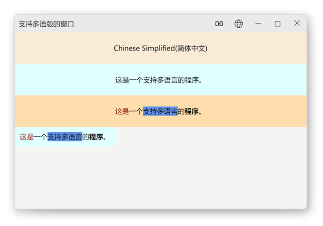

## 13. examples/DpiAware
演示如何使用DPI感知功能，如何动态设置窗口的DPI：界面分栏展示 DPI 感知模式、主显示器与窗口的缩放百分比、窗口（物理像素）与内容区（逻辑像素）的大小；右侧演示同一张图片准备 100%~300% 共 8 份图源时，框架如何按当前缩放自动选用最接近的一份；底部可输入 60~500 的比例动态修改界面缩放，也可新建窗口做对比。    
代码入口：[MainThread.cpp](../examples/DpiAware/MainThread.cpp)、[MainForm.cpp](../examples/DpiAware/MainForm.cpp)；界面资源：`bin/resources/themes/default/dpi_aware/DpiAware.xml`；相关文档：[Window.md](Window.md) 中的窗口 C++ 接口（DPI 相关）。    
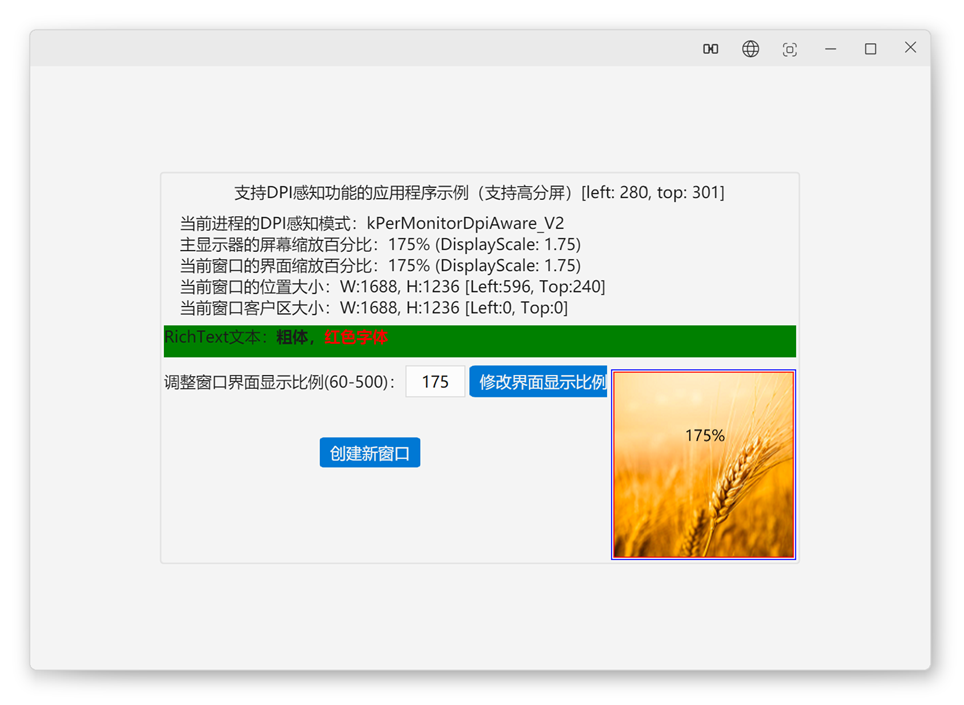

## 14. examples/threads
演示如何使用多线程功能：可配置线程池的线程个数，实时查看各工作线程的运行状态、操作系统线程ID与已执行任务次数；支持立即执行、延迟执行、重复执行、长耗时任务、并发验证（给出实测耗时与串行基线的加速比）与任务取消；停止线程池在后台完成、不阻塞界面，日志带时间戳，并集成了定时器（TimerManager）的添加、停止与触发观察。    
代码入口：[MainThread.cpp](../examples/threads/MainThread.cpp)、[MainForm.cpp](../examples/threads/MainForm.cpp)、[WorkerThread.cpp](../examples/threads/WorkerThread.cpp)；界面资源：`bin/resources/themes/default/threads/threads.xml`；相关文档：[Getting-Started.md](Getting-Started.md) 中的“引入线程库”。    
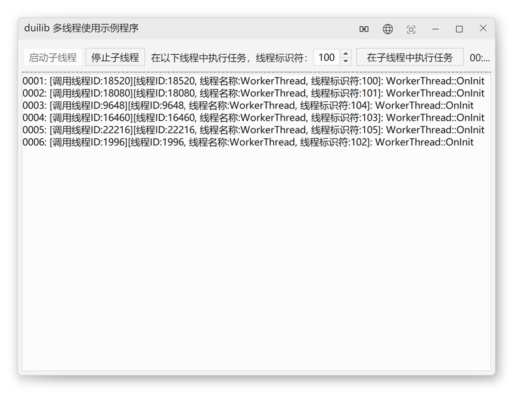

## 15. examples/layout
演示容器的各种布局。    
代码入口：[MainThread.cpp](../examples/layout/MainThread.cpp)、[MainForm.cpp](../examples/layout/MainForm.cpp)；界面资源：`bin/resources/themes/default/layout/layout.xml`（同目录下的 `page_*.xml` 分别演示各种布局容器）；相关文档：[Box.md](Box.md)。    
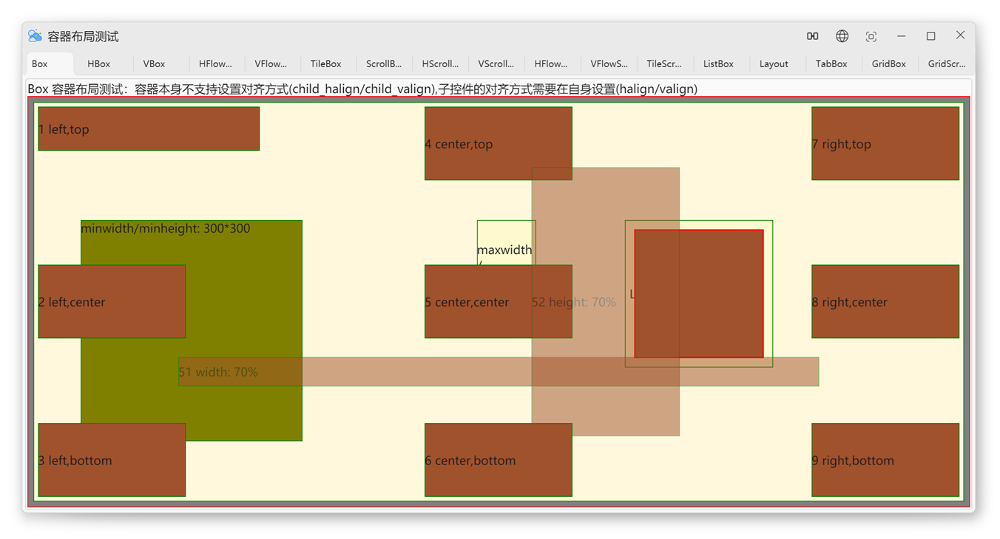

## 16. examples/cef
演示如何在使用 CEF 控件，包含 C++ 与 JavaScript 交互。    
代码入口：[MainThread.cpp](../examples/cef/MainThread.cpp)、[CefForm.cpp](../examples/cef/CefForm.cpp)；界面资源：`bin/resources/themes/default/cef/cef.xml`；相关文档：[CEF.md](CEF.md)。    
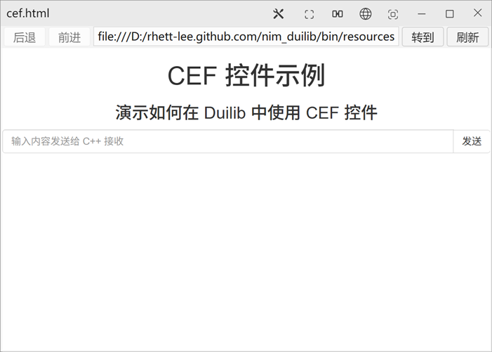

## 17. examples/CefBrowser
基于 CEF 的自定义多标签可拖曳浏览器示例。    
代码入口：[MainThread.cpp](../examples/CefBrowser/MainThread.cpp)、[BrowserForm.cpp](../examples/CefBrowser/browser/BrowserForm.cpp)、[DragForm.cpp](../examples/CefBrowser/browser/DragForm.cpp)；界面资源：`bin/resources/themes/default/cef_browser/cef_browser.xml`、`cef_browser/drag_form.xml`、`cef_browser/browser_box.xml`、`cef_browser/tab_item.xml`；相关文档：[CEF.md](CEF.md)。    
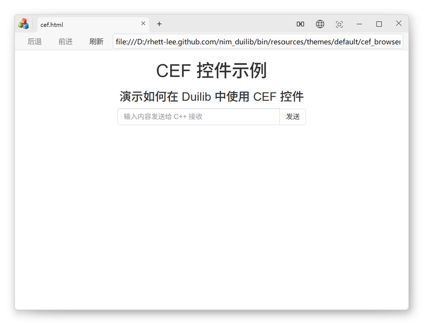
    
## 18. examples/WebView2
演示如何在使用 WebView2 控件。    
代码入口：[MainThread.cpp](../examples/WebView2/MainThread.cpp)、[MainForm.cpp](../examples/WebView2/MainForm.cpp)；界面资源：`bin/resources/themes/default/webview2/webview2.xml`；相关文档：[Control.md](Control.md) 中的 WebView2Control 章节。    
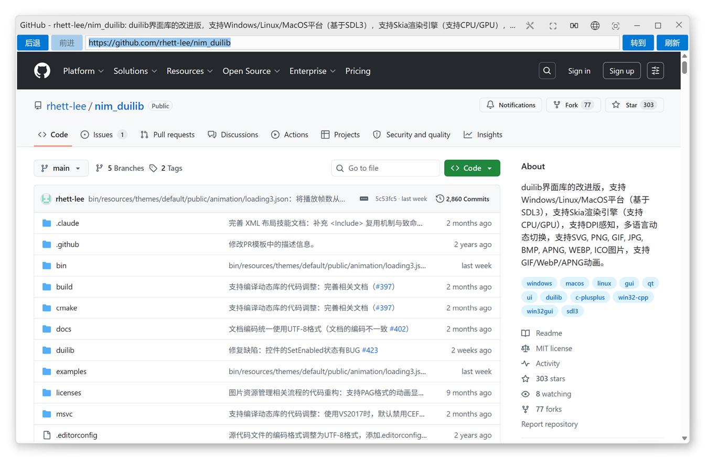

## 19. examples/WebView2Browser
基于 WebView2 的自定义多标签可拖曳浏览器示例。    
代码入口：[MainThread.cpp](../examples/WebView2Browser/MainThread.cpp)、[BrowserForm.cpp](../examples/WebView2Browser/BrowserForm.cpp)、[DragForm.cpp](../examples/WebView2Browser/DragForm.cpp)；界面资源：`bin/resources/themes/default/webview2_browser/webview2_browser.xml`、`webview2_browser/drag_form.xml`、`webview2_browser/browser_box.xml`、`webview2_browser/tab_item.xml`；相关文档：[Control.md](Control.md) 中的 WebView2Control 章节。    
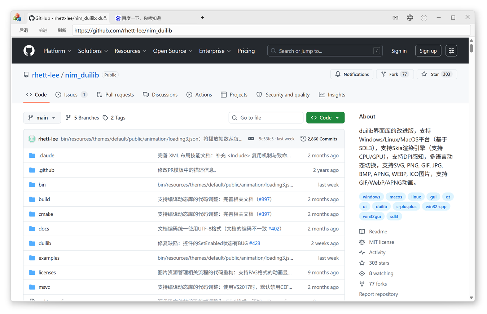
    
## 20. examples/ChildWindow    
子窗口控件的功能演示示例。    
代码入口：[MainThread.cpp](../examples/ChildWindow/MainThread.cpp)、[MainForm.cpp](../examples/ChildWindow/MainForm.cpp)；界面资源：`bin/resources/themes/default/child_window/child_window.xml`、`child_window/child_window_item.xml`；相关文档：[Control.md](Control.md) 中的 ChildWindow 章节。    
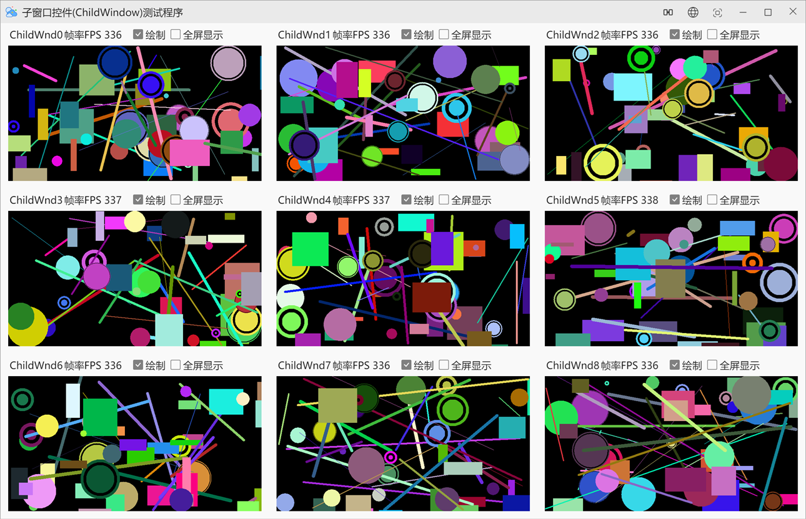
    
## 21. examples/XmlPreview    
XML文件的界面效果预览功能演示示例：支持打开 XML 文件、把 XML 文件拖入预览区域、重新加载与清空预览；顶部信息卡片显示完整路径、加载状态（加载成功/加载失败/等待加载）与失败详情（文件、行号、列号）；勾选“自动刷新”后按设定间隔（1–60 秒）检测文件变化并自动重新预览。    
代码入口：[MainThread.cpp](../examples/XmlPreview/MainThread.cpp)、[MainForm.cpp](../examples/XmlPreview/MainForm.cpp)；界面资源：`bin/resources/themes/default/xml_preview/xml_preview.xml`；相关文档：[XmlNode.md](XmlNode.md)、[XmlEvents.md](XmlEvents.md)、[XmlTools.md](XmlTools.md)。    
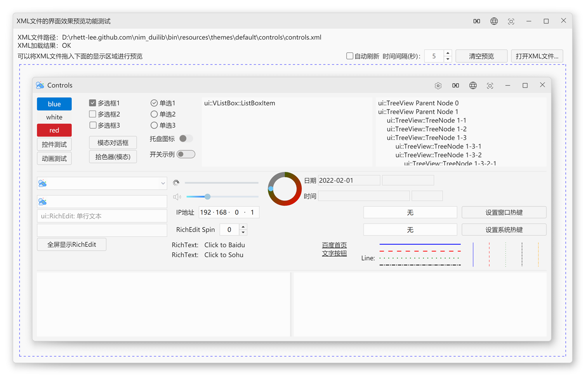
    
## 22. examples/ColorTheme    
主题颜色预览与生成功能演示示例。    
代码入口：[MainThread.cpp](../examples/ColorTheme/MainThread.cpp)、[MainForm.cpp](../examples/ColorTheme/MainForm.cpp)；界面资源：`bin/resources/themes/default/color_theme/color_theme.xml`、`color_theme/flyout_demo.xml`；相关文档：[Theme.md](Theme.md)、[ThemeColor.md](ThemeColor.md)。    
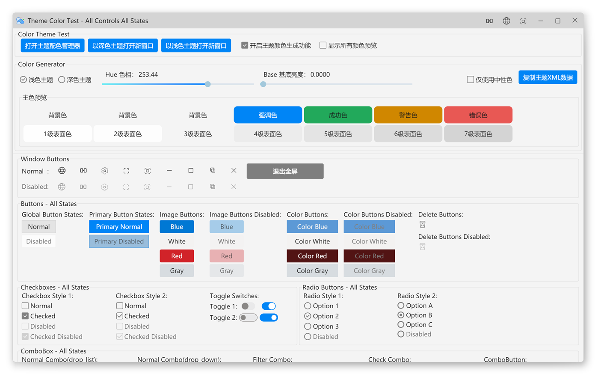

## 23. examples/panel
演示 Panel/PanelHBox/PanelVBox 带标题栏面板容器的用法，包含：标题栏样式、点击标题栏折叠/展开（支持动画）、手风琴分组、折叠触发热区、自定义箭头状态图片、箭头左置与标题对齐、标题栏槽位、折叠前取消事件，以及通过 C++ 代码控制面板状态。    
代码入口：[MainThread.cpp](../examples/panel/MainThread.cpp)、[PanelForm.cpp](../examples/panel/PanelForm.cpp)；界面资源：`bin/resources/themes/default/panel/panel.xml`；相关文档：[Box.md](Box.md) 中的 Panel/PanelHBox/PanelVBox 章节。    
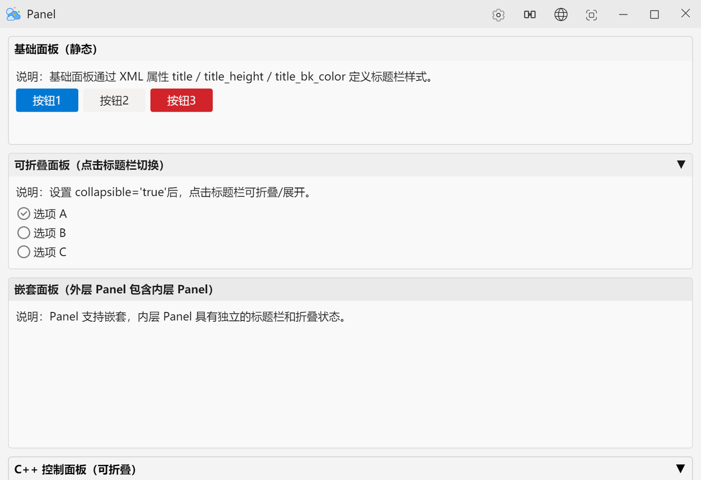
