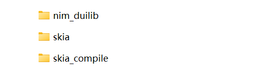
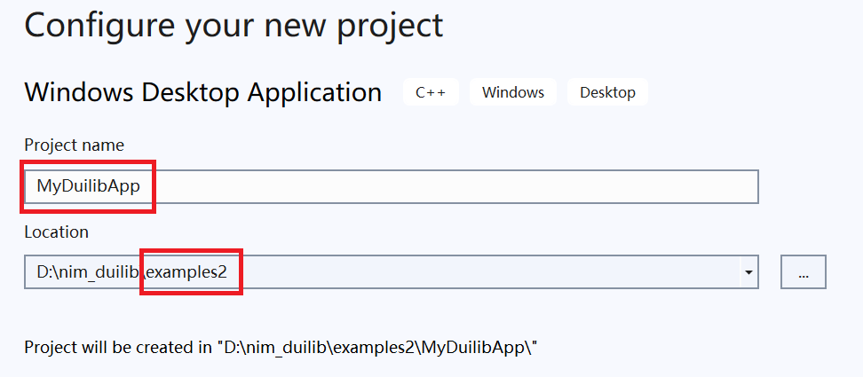
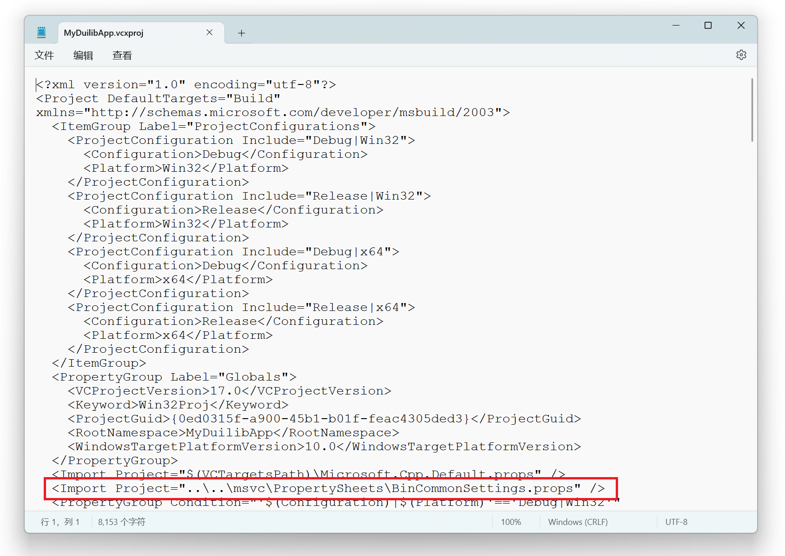
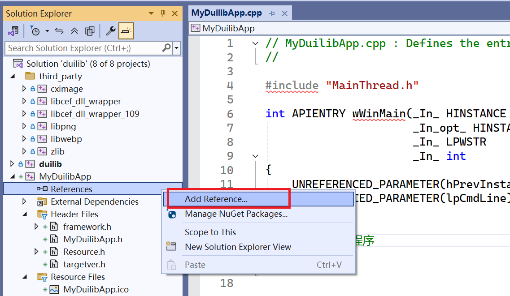
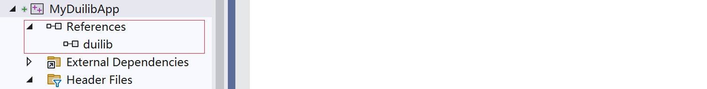

English | [简体中文](Getting-Started.md)

> Last synced: 2026-11-27

# Quick Start (Windows, using VS 2022 as an example)

> For CMake users (Windows/Linux/macOS/FreeBSD), see [Quick Start (CMake)](Getting-Started-CMake.en.md).

This example will guide you to quickly deploy a basic application based on nim_duilib. This example is similar to the `basic` project in `examples`; if you prefer to read code, you can open the `build\examples.sln` solution and refer to the example code without spending extra time.

## Get the code and prepare dependencies

1. Get the project code

```bash
git clone https://github.com/rhett-lee/nim_duilib
```

2. Prepare the Skia rendering engine and other dependencies (the Skia patch archive ships with the repository in `build/skia_patch/`, so no external repository is cloned)

```bash
cd nim_duilib
python build/build.py deps
```

On Windows, if `python3` is not available, use `python` or `py -3` instead; on Linux/macOS, `python3` is normally used.
If you do not need CEF, run `python build/build.py deps --no-cef` and build the examples from `build\examples_no_cef.sln` instead.

When dependency preparation finishes, the Skia source is in the `skia/` directory next to `nim_duilib`, and `skia.lib` and related libraries are generated under `skia/out/<platform-config-dir>/` (for example, the x64 Debug configuration uses `skia/out/llvm.x64.debug/skia.lib`). This step is also required when using the existing Visual Studio solution.

3. The basic structure of the source code directories of several projects within the working directory is as follows



## Build the existing examples

Open `build\examples.sln` with Visual Studio, select Debug|x64 or Release|x64, and press F7 to build all example programs. The built executables are placed in the `bin` directory at the repository root.

## Create a basic project

Open the `build\examples.sln` solution with Visual Studio, create a new Windows desktop application, and complete your first program based on the duilib GUI library step by step.

1. Create a new Windows desktop application in the solution (VS2022, application type: Windows Desktop Application).
Assume the program name is `MyDuilibApp`, choose the `examples` directory under the repository root as the location (the project file will be created at `examples\MyDuilibApp\MyDuilibApp.vcxproj`), and select x64 as the platform.    



2. Disable the precompiled header (recommended). The VS project template enables precompiled headers by default, while the property sheets provided by nim_duilib do not configure any precompiled header, so deleting `pch.h`/`pch.cpp` from the template directly will break the build.
In "Project Properties → C/C++ → Precompiled Headers → Precompiled Header", select "Not Using Precompiled Headers", then delete `pch.h`, `pch.cpp`, and the `#include "pch.h"` lines from the code. Alternatively, keep these files and leave precompiled headers enabled.

3. Clean up the generated code, keeping only the essential wWinMain function:
```cpp
#include "MainThread.h"

int APIENTRY wWinMain(_In_ HINSTANCE hInstance,
                     _In_opt_ HINSTANCE hPrevInstance,
                     _In_ LPWSTR    lpCmdLine,
                     _In_ int       nCmdShow)
{
    UNREFERENCED_PARAMETER(hPrevInstance);
    UNREFERENCED_PARAMETER(lpCmdLine);


    //Exit the program normally
    return 0;
}
```

## Configure project properties
- Use the common configuration provided by nim_duilib (`msvc\PropertySheets\BinCommonSettings.props`)    
(1) Open the just-created project file (`examples\MyDuilibApp\MyDuilibApp.vcxproj`) with a text editor    
(2) Find the line `<Import Project="$(VCTargetsPath)\Microsoft.Cpp.Default.props" />` and insert a line after it, adding the following content:    
         `<Import Project="..\..\msvc\PropertySheets\BinCommonSettings.props" />`    
(3) Save the changes to the project file; if it is already open in VS, it needs to be reloaded.    



- Right-click the project -> Add -> Reference, and add duilib as a reference project, so that you do not need to manually import library files.



After a successful addition, you can see the successfully referenced project:    
  

## Create a simple window

Create a window class MainForm, inheriting from the `ui::WindowImplBase` class, and overriding methods such as `GetSkinFolder` and `GetSkinFile`.

```cpp
//MainForm.h
#ifndef EXAMPLES_MAIN_FORM_H_
#define EXAMPLES_MAIN_FORM_H_

// duilib
#include "duilib/duilib.h"

/** Implementation of the application's main window
*/
class MainForm : public ui::WindowImplBase
{
    typedef ui::WindowImplBase BaseClass;
public:
    MainForm();
    virtual ~MainForm() override;

    /**  Called when the window is created, implemented by the subclass to obtain the window skin directory
    * @return the subclass must implement and return the window skin directory
    */
    virtual DString GetSkinFolder() override;

    /**  Called when the window is created, implemented by the subclass to obtain the window skin XML description file
    * @return the subclass must implement and return the window skin XML description file
    *         The returned content can be the XML file content (a string starting with the character '<'),
    *         or a file path (a string not starting with '<'); the file must be findable in the path returned by GetSkinFolder()
    */
    virtual DString GetSkinFile() override;

    /** Called after the window is created, for the subclass to do some initialization work
    */
    virtual void OnInitWindow() override;
};

#endif //EXAMPLES_MAIN_FORM_H_
```

```cpp
//MainForm.cpp
#include "MainForm.h"

MainForm::MainForm()
{
}

MainForm::~MainForm()
{
}

DString MainForm::GetSkinFolder()
{
    return _T("my_duilib_app");
}

DString MainForm::GetSkinFile()
{
    return _T("MyDuilibForm.xml");
}

void MainForm::OnInitWindow()
{
    BaseClass::OnInitWindow();
    //Window initialization is complete; you can now perform initialization for this Form

}
```

## Create the window description XML file

In the window class we created, we specified the window description file directory as `my_duilib_app` and the window description file as `MyDuilibForm.xml`.
Next, create the `my_duilib_app` folder under the `bin\resources\themes\default` directory and create a new `MyDuilibForm.xml` file, then write the following content.    
Note: the XML file encoding format is UTF-8, and the file does not need to be added to the VS project — it is read directly from `bin\resources` at run time.  
```xml
<?xml version="1.0" encoding="UTF-8"?>
<Window size="75%,75%" min_size="240,100"
        caption="0,0,0,36" use_system_caption="false" snap_layout_menu="true" sys_menu="true" sys_menu_rect="0,0,36,36"
        shadow_type="default" shadow_snap="true"
        size_box="4,4,4,4" icon="public/caption/logo.ico">
    <!-- All controls in the entire window are placed in this VBox container -->
    <VBox bkcolor="bg_window_main">
        <!-- Title bar area -->
        <HBox name="window_title_bar" width="stretch" height="36" bkcolor="bg_titlebar">
            <!-- Title bar: display area at the top-left of the window -->
            <Control mouse_enabled="false"/>
            <!-- Title bar: window control area on the right, with window minimize, maximize, restore and close buttons -->
            <HBox margin="0,0,0,0" valign="center" width="auto" height="36">
                <Button class="btn_wnd_fullscreen_11" height="32" width="40" name="btn_window_fullscreen" margin="0,2,0,2"/>
                <Button class="btn_wnd_min_11" height="32" width="40" name="btn_window_min" margin="0,2,0,2"/>
                <Box height="stretch" width="40" margin="0,2,0,2">
                    <Button class="btn_wnd_max_11" height="32" width="stretch" name="btn_window_max"/>
                    <Button class="btn_wnd_restore_11" height="32" width="stretch" name="btn_window_restore" visible="false"/>
                </Box>
                <Button class="btn_wnd_close_11" height="stretch" width="40" name="btn_window_close" margin="0,0,0,2"/>
            </HBox>
        </HBox>
        <!-- End of title bar area -->

        <!-- Working area: everything other than the title bar is placed in this large Box area -->
        <Box bkcolor="bg_container">
            <VBox margin="0,0,0,0" valign="center" halign="center">
                <Label name="tooltip" text="This is a simple nim_duilib window, with a title bar and regular buttons." height="100%" width="100%" text_align="hcenter,vcenter"/>
            </VBox>
        </Box>
    </VBox>
</Window>
```

Note: this example does not include theme-switch or language-switch buttons. The window skin is looked up in the currently active theme directory, so after switching themes the `my_duilib_app` folder must also exist under `themes\color_light` and `themes\color_dark`. If you need these buttons, copy the skin files to every theme directory and handle the button events as shown in `examples`.

## Introduce the thread library

Add a custom thread class MainThread to the created project (the UI main thread)    
Create two files (`MainThread.h` and `MainThread.cpp`), and add them to the VS project. The contents of the two files are as follows:

MainThread.h    
```cpp
#ifndef EXAMPLES_MAIN_THREAD_H_
#define EXAMPLES_MAIN_THREAD_H_

// duilib
#include "duilib/duilib.h"

/** Main thread
*/
class MainThread : public ui::FrameworkThread
{
public:
    MainThread();
    virtual ~MainThread() override;

private:
    /** Initialization before running, called before entering the message loop; if initialization fails, the message loop is not entered
    * @return returns true if initialization succeeds, false if it fails
    */
    virtual bool OnInit() override;

    /** Cleanup on exit, called after exiting the message loop
    */
    virtual void OnCleanup() override;
};

#endif // EXAMPLES_MAIN_THREAD_H_
```

MainThread.cpp    
```cpp
#include "MainThread.h"
#include "MainForm.h"

MainThread::MainThread() :
    FrameworkThread(_T("MainThread"), ui::kThreadUI)
{
}

MainThread::~MainThread()
{
}

bool MainThread::OnInit()
{
    //Initialize global resources, using a local folder as the resource
    //(the resource directory is: <executable directory>/resources/)
    ui::FilePath resourcePath = ui::GlobalManager::GetResourceRootPath();
    if (!ui::GlobalManager::Instance().Startup(ui::LocalFilesResParam(resourcePath))) {
        //Resource loading failed (usually the bin/resources directory is missing);
        //returning false means the message loop is not entered
        return false;
    }

    //Create and show the main window (centered, with a default shadow)
    MainForm* window = new MainForm();
    window->CreateWnd(nullptr, ui::WindowCreateParam(_T("MyDuilibApp"), true));
    window->PostQuitMsgWhenClosed(true);
    window->ShowWindow(ui::kSW_SHOW_NORMAL);
    return true;
}

void MainThread::OnCleanup()
{
    ui::GlobalManager::Instance().Shutdown();
}
```

In wWinMain, instantiate the main thread object and call to run the main thread loop. After adding, the wWinMain function is modified as follows:

```cpp
#include "MainThread.h"

int APIENTRY wWinMain(_In_ HINSTANCE hInstance,
                     _In_opt_ HINSTANCE hPrevInstance,
                     _In_ LPWSTR    lpCmdLine,
                     _In_ int       nCmdShow)
{
    UNREFERENCED_PARAMETER(hPrevInstance);
    UNREFERENCED_PARAMETER(lpCmdLine);

    //Create the main thread
    MainThread thread;

    //Run the main thread message loop
    thread.RunMessageLoop();

    //Exit the program normally
    return 0;
}
```

## Build and run

1. Right-click the `MyDuilibApp` project in Solution Explorer and select "Set as Startup Project".
2. Select Debug|x64 or Release|x64, and press F5 to build and run.

In this way, a simple window with minimize, maximize, restore and close buttons, a fullscreen button, a shadow effect, and a line of text hint is created.

The program looks for resources in the executable directory (that is, `bin\resources`), so there is no need to configure a debug working directory in VS. If the window is blank or fails to be created, check:
- whether the `bin\resources` directory exists (it is included in the repository);
- whether `bin\resources\themes\default\my_duilib_app\MyDuilibForm.xml` exists and is encoded as UTF-8.

## Using libCEF in the program
You can refer to the related documentation [CEF.md](CEF.en.md)

## Unified build entry and cross-platform builds
Windows / Linux / macOS all use the same build script `build/build.py` (it is not Windows-only):

```bash
python3 build/build.py doctor   # Environment self-check (compiler, CMake, dependencies)
python3 build/build.py deps     # Prepare dependencies only (Skia / SDL3 / CEF)
python3 build/build.py          # Prepare dependencies and build (Release by default)
```

Common options: `--config Debug|Release`, `--arch auto|x86|x64|arm64`, `--dll`, `--sdl`, `--no-cef`, `--jobs N`; see [build/docs/build-reference.en.md](../build/docs/build-reference.en.md) for the full reference.
- Linux system dependencies: see [build/docs/linux-dependencies.en.md](../build/docs/linux-dependencies.en.md)
- macOS App Bundle packaging: see [build/docs/macos-app-bundle.en.md](../build/docs/macos-app-bundle.en.md)
- If the `python3` command is unavailable on Windows, use `python build/build.py` or `py -3 build/build.py`.
- Compiler requirements: the main project (Linux/macOS/FreeBSD) needs gcc 10+ or clang 12+;
  building Skia needs clang 12+ or gcc 11+ (Skia's `ml3`/`ml4` targets use
  `-march=x86-64-v3` / `-march=x86-64-v4`). The compilers bundled with NFSChina and
  UnionTech UOS (and the CMake 3.18.4 shipped by NFSChina, as well as the older CMake
  shipped by UnionTech UOS) are not sufficient — install a newer compiler and CMake 3.24+
  manually; see the compiler/CMake requirements section in the root README.

## About Visual Studio project configuration
The Visual Studio project configuration in the project uses property sheets, stored in the following directory: `nim_duilib\msvc\PropertySheets`
    
## How to set the source code file encoding to UTF-8 format
The repository root already ships a `.editorconfig` file, so no extra configuration is needed when using this repository. To configure another project, follow these steps:
1. Create a format configuration file in the project root directory, named `.editorconfig`
2. The file content is as follows (the EditorConfig specification does not support trailing comments, so comments must be on their own line):
```
# Visual Studio generated .editorconfig file with C++ settings.
root = true

[*.{c,c++,cc,cpp,cppm,cxx,h,h++,hh,hpp,hxx,inl,ipp,ixx,tlh,tli}]

# Visual C++ Formatting settings

# Line ending format; allowed values: lf (Unix style), cr (Mac style), or crlf (Windows style)
end_of_line = crlf
# File encoding character set is UTF-8 (allowed values: utf-8, utf-8-bom, latin1, etc.)
charset = utf-8
# Remove trailing whitespace at end of file
trim_trailing_whitespace = true
# Insert a final newline at the end
insert_final_newline = true
# Use spaces instead of tabs
indent_style = space
# Number of spaces to replace a tab
indent_size = 4
# Width of a tab character
tab_width = 4
```
3. This method applies to Visual Studio 2017 and later.
