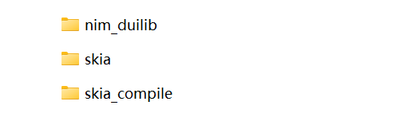
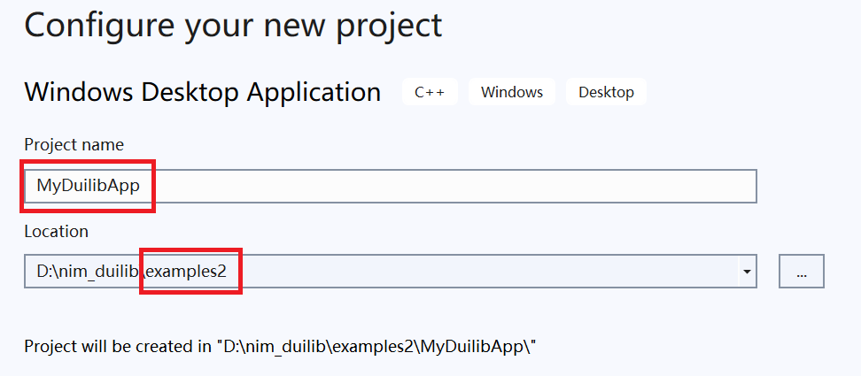
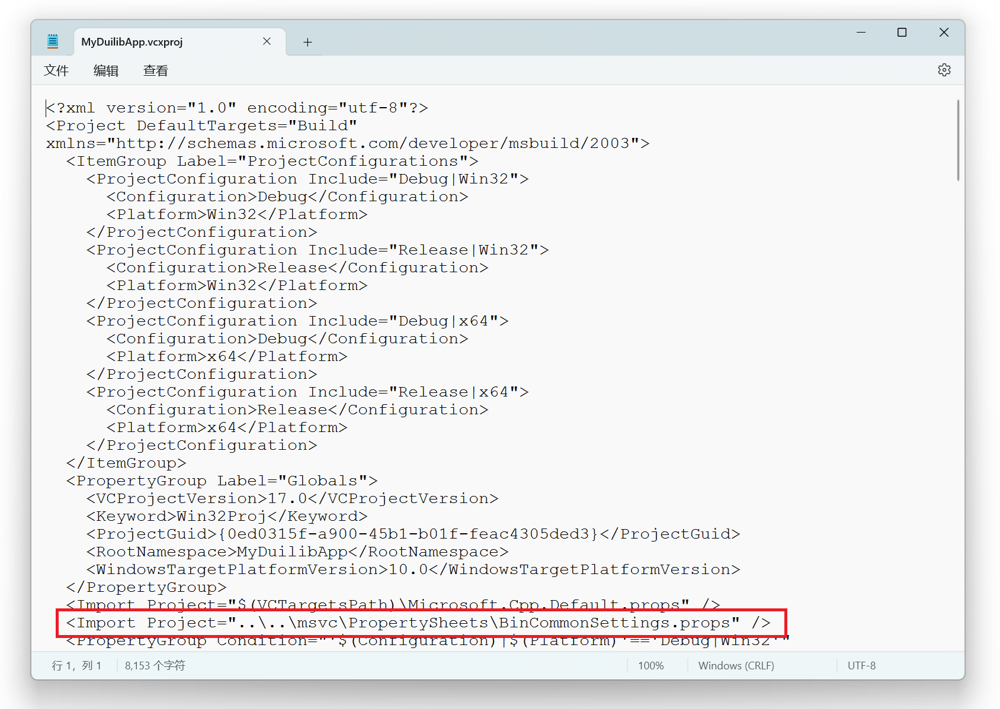
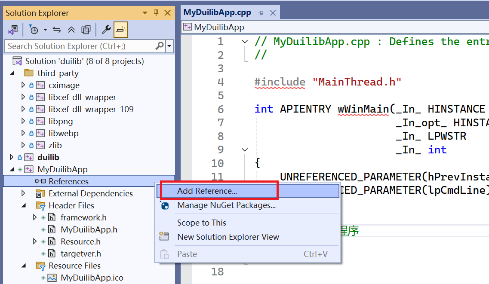
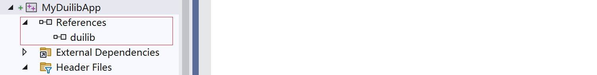

简体中文 | [English](Getting-Started.en.md)

# 快速上手（Windows 系统，以 VS 2022 为例）

> 使用 CMake 的用户（Windows/Linux/macOS/FreeBSD），请参考 [快速上手（CMake）](Getting-Started-CMake.md)。

此示例将引导你快速部署一个基于 nim_duilib 的基本应用。此示例与 `examples` 中的 `basic` 项目相似；如果你更喜欢直接看代码，可以打开 `build\examples.sln` 工程，参考示例代码而无需多花费时间。

## 获取项目代码并准备依赖

1. 获取项目代码

```bash
git clone https://github.com/rhett-lee/nim_duilib
```

2. 准备 Skia 绘制引擎等依赖（Skia 补丁归档随仓库提交在 `build/skia_patch/`，无需克隆外部仓库）

```bash
cd nim_duilib
python build/build.py deps
```

Windows 上如果没有 `python3` 命令，请使用 `python` 或 `py -3` 执行；Linux/macOS 上通常使用 `python3`。
如果不需要 CEF，可以执行 `python build/build.py deps --no-cef`，并改用 `build\examples_no_cef.sln` 编译示例。

依赖准备完成后，Skia 源码位于与 `nim_duilib` 同级的 `skia/` 目录，并在 `skia/out/<平台配置目录>/` 下生成 `skia.lib` 等库文件（例如 x64 的 Debug 配置对应 `skia/out/llvm.x64.debug/skia.lib`）。使用现成的 VS 解决方案时，也必须先执行这一步。

3. 在工作目录内，几个项目的源码目录的基本结构如下



## 编译现有示例

使用 Visual Studio 打开 `build\examples.sln`，选择 Debug|x64 或 Release|x64，按下 F7 即可编译所有示例程序。编译生成的可执行程序位于仓库根目录的 `bin` 目录中。

## 创建基础工程

使用 Visual Studio 打开 `build\examples.sln` 解决方案，新建一个 Windows 桌面应用，来一步一步完成第一个基于 duilib 界面库的程序。

1. 在解决方案中新建一个 Windows 桌面程序（VS2022，程序类型为：Windows Desktop Application）。
假定程序名为 `MyDuilibApp`，位置选择仓库根目录下的 `examples` 目录（创建后工程文件位于 `examples\MyDuilibApp\MyDuilibApp.vcxproj`），平台选择 x64。    



2. 关闭预编译头（推荐）。VS 的工程模板默认启用预编译头，而 nim_duilib 提供的属性文件没有配置预编译头，直接删除模板中的 `pch.h`/`pch.cpp` 会导致编译失败。
可在“项目属性 → C/C++ → 预编译头 → 预编译头”中选择“不使用预编译头”，然后删除 `pch.h`、`pch.cpp` 以及代码中的 `#include "pch.h"`；也可以保留这些文件并保持预编译头开启。

3. 清理生成的代码，只保留关键的 wWinMain 函数：
```cpp
#include "MainThread.h"

int APIENTRY wWinMain(_In_ HINSTANCE hInstance,
                     _In_opt_ HINSTANCE hPrevInstance,
                     _In_ LPWSTR    lpCmdLine,
                     _In_ int       nCmdShow)
{
    UNREFERENCED_PARAMETER(hPrevInstance);
    UNREFERENCED_PARAMETER(lpCmdLine);


    //正常退出程序
    return 0;
}
```

## 配置项目属性
- 使用 nim_duilib 提供的通用配置（`msvc\PropertySheets\BinCommonSettings.props`）    
（1）用文本编辑器打开刚刚创建的工程文件（`examples\MyDuilibApp\MyDuilibApp.vcxproj`）    
（2）找到 `<Import Project="$(VCTargetsPath)\Microsoft.Cpp.Default.props" />` 这一行的位置，在这行的后面插入一行，添加以下内容：    
         `<Import Project="..\..\msvc\PropertySheets\BinCommonSettings.props" />`    
（3）保存该工程文件的修改，如果已经在 VS 中打开，需要重新加载。    



- 项目右键 -> 添加 -> 引用，将 duilib 作为引用项目，这样就不需要手动引入库文件了。



添加成功后，可以看到引用成功的项目：    
  

## 创建一个简单窗口

创建一个窗口类 MainForm，继承 `ui::WindowImplBase` 类，并覆写 `GetSkinFolder`、`GetSkinFile` 等方法。

```cpp
//MainForm.h
#ifndef EXAMPLES_MAIN_FORM_H_
#define EXAMPLES_MAIN_FORM_H_

// duilib
#include "duilib/duilib.h"

/** 应用程序的主窗口实现
*/
class MainForm : public ui::WindowImplBase
{
    typedef ui::WindowImplBase BaseClass;
public:
    MainForm();
    virtual ~MainForm() override;

    /**  创建窗口时被调用，由子类实现用以获取窗口皮肤目录
    * @return 子类需实现并返回窗口皮肤目录
    */
    virtual DString GetSkinFolder() override;

    /**  创建窗口时被调用，由子类实现用以获取窗口皮肤 XML 描述文件
    * @return 子类需实现并返回窗口皮肤 XML 描述文件
    *         返回的内容，可以是XML文件内容（以字符'<'为开始的字符串），
    *         或者是文件路径（不是以'<'字符开始的字符串），文件要在GetSkinFolder()路径中能够找到
    */
    virtual DString GetSkinFile() override;

    /** 当窗口创建完成以后调用此函数，供子类中做一些初始化的工作
    */
    virtual void OnInitWindow() override;
};

#endif //EXAMPLES_MAIN_FORM_H_
```

```cpp
//MainForm.cpp
#include "MainForm.h"

MainForm::MainForm()
{
}

MainForm::~MainForm()
{
}

DString MainForm::GetSkinFolder()
{
    return _T("my_duilib_app");
}

DString MainForm::GetSkinFile()
{
    return _T("MyDuilibForm.xml");
}

void MainForm::OnInitWindow()
{
    BaseClass::OnInitWindow();
    //窗口初始化完成，可以进行本Form的初始化

}
```

## 创建窗口描述 XML 文件

在我们创建的窗口类中，指定了窗口描述文件目录是 `my_duilib_app`，指定窗口的描述文件为 `MyDuilibForm.xml`。
接下来在 `bin\resources\themes\default` 目录下创建 `my_duilib_app` 文件夹并新建一个 `MyDuilibForm.xml` 文件，写下如下内容。    
注意事项：XML 文件的编码格式是 UTF-8；该文件不需要加入 VS 工程，程序运行时直接从 `bin\resources` 目录读取。  
```xml
<?xml version="1.0" encoding="UTF-8"?>
<Window size="75%,75%" min_size="240,100"
        caption="0,0,0,36" use_system_caption="false" snap_layout_menu="true" sys_menu="true" sys_menu_rect="0,0,36,36"
        shadow_type="default" shadow_snap="true"
        size_box="4,4,4,4" icon="public/caption/logo.ico">
    <!-- 整个窗口中，所有控件都放在这个VBox容器中 -->
    <VBox bkcolor="bg_window_main">
        <!-- 标题栏区域 -->
        <HBox name="window_title_bar" width="stretch" height="36" bkcolor="bg_titlebar">
            <!-- 标题栏：窗口左上角显示区域 -->
            <Control mouse_enabled="false"/>
            <!-- 标题栏：右侧窗口控制区域，窗口最小化、最大化、还原、关闭按钮 -->
            <HBox margin="0,0,0,0" valign="center" width="auto" height="36">
                <Button class="btn_wnd_fullscreen_11" height="32" width="40" name="btn_window_fullscreen" margin="0,2,0,2"/>
                <Button class="btn_wnd_min_11" height="32" width="40" name="btn_window_min" margin="0,2,0,2"/>
                <Box height="stretch" width="40" margin="0,2,0,2">
                    <Button class="btn_wnd_max_11" height="32" width="stretch" name="btn_window_max"/>
                    <Button class="btn_wnd_restore_11" height="32" width="stretch" name="btn_window_restore" visible="false"/>
                </Box>
                <Button class="btn_wnd_close_11" height="stretch" width="40" name="btn_window_close" margin="0,0,0,2"/>
            </HBox>
        </HBox>
        <!-- 标题栏区域结束 -->

        <!-- 工作区域，除了标题栏外的内容都放在这个大的Box区域 -->
        <Box bkcolor="bg_container">
            <VBox margin="0,0,0,0" valign="center" halign="center">
                <Label name="tooltip" text="这是一个简单的 nim_duilib 窗口，带有标题栏和常规按钮。" height="100%" width="100%" text_align="hcenter,vcenter"/>
            </VBox>
        </Box>
    </VBox>
</Window>
```

说明：本示例没有放置主题切换按钮和语言切换按钮。窗口皮肤是在当前主题目录中查找的，切换主题后 `my_duilib_app` 文件夹需要同时存在于 `themes\color_light` 和 `themes\color_dark` 目录下；如需这两个按钮，请把皮肤文件复制到每个主题目录，并参考 `examples` 中的代码处理按钮事件。

## 引入线程库

在创建的项目中增加自定义的线程类 MainThread（界面主线程）    
创建两个文件（`MainThread.h` 和 `MainThread.cpp`），并添加到 VS 工程中，两个文件的内容分别如下：

MainThread.h    
```cpp
#ifndef EXAMPLES_MAIN_THREAD_H_
#define EXAMPLES_MAIN_THREAD_H_

// duilib
#include "duilib/duilib.h"

/** 主线程
*/
class MainThread : public ui::FrameworkThread
{
public:
    MainThread();
    virtual ~MainThread() override;

private:
    /** 运行前初始化，在进入消息循环前调用，如果初始化失败则不进入消息循环
    * @return 初始化成功返回true，初始化失败返回false
    */
    virtual bool OnInit() override;

    /** 退出时清理，在退出消息循环后调用
    */
    virtual void OnCleanup() override;
};

#endif // EXAMPLES_MAIN_THREAD_H_
```

MainThread.cpp    
```cpp
#include "MainThread.h"
#include "MainForm.h"

MainThread::MainThread() :
    FrameworkThread(_T("MainThread"), ui::kThreadUI)
{
}

MainThread::~MainThread()
{
}

bool MainThread::OnInit()
{
    //初始化全局资源，使用本地文件夹作为资源（资源目录为：可执行文件目录/resources/）
    ui::FilePath resourcePath = ui::GlobalManager::GetResourceRootPath();
    if (!ui::GlobalManager::Instance().Startup(ui::LocalFilesResParam(resourcePath))) {
        //资源加载失败（通常是 bin/resources 目录不存在），返回false后不会进入消息循环
        return false;
    }

    //创建并显示主窗口（居中显示，默认带有阴影）
    MainForm* window = new MainForm();
    window->CreateWnd(nullptr, ui::WindowCreateParam(_T("MyDuilibApp"), true));
    window->PostQuitMsgWhenClosed(true);
    window->ShowWindow(ui::kSW_SHOW_NORMAL);
    return true;
}

void MainThread::OnCleanup()
{
    ui::GlobalManager::Instance().Shutdown();
}
```

在 wWinMain 实例化主线程对象，并调用执行主线程循环，添加后 wWinMain 函数修改如下：

```cpp
#include "MainThread.h"

int APIENTRY wWinMain(_In_ HINSTANCE hInstance,
                     _In_opt_ HINSTANCE hPrevInstance,
                     _In_ LPWSTR    lpCmdLine,
                     _In_ int       nCmdShow)
{
    UNREFERENCED_PARAMETER(hPrevInstance);
    UNREFERENCED_PARAMETER(lpCmdLine);

    //创建主线程
    MainThread thread;

    //执行主线程消息循环
    thread.RunMessageLoop();

    //正常退出程序
    return 0;
}
```

## 编译运行

1. 在解决方案资源管理器中右键 `MyDuilibApp` 项目，选择“设为启动项目”。
2. 选择 Debug|x64 或 Release|x64，按 F5 编译并运行。

这样一个简单的带有最小化、最大化、还原和关闭按钮、全屏按钮，具有阴影效果和一行文字提示的窗口就创建出来了。

程序从可执行文件所在目录查找资源（即 `bin\resources`），因此不需要额外设置 VS 的调试工作目录。如果出现窗口空白或创建失败，请检查：
- `bin\resources` 目录是否存在（仓库中已包含该目录）；
- `bin\resources\themes\default\my_duilib_app\MyDuilibForm.xml` 是否存在，且文件编码为 UTF-8。

## 在程序中使用 libCEF
可以参考相关的文档[CEF.md](CEF.md)

## 统一构建入口与跨平台编译
Windows / Linux / macOS 使用同一个构建脚本 `build/build.py`（并非只适用于 Windows）：

```bash
python3 build/build.py doctor   # 环境自检（检查编译器、CMake、依赖等）
python3 build/build.py deps     # 只准备依赖（Skia / SDL3 / CEF）
python3 build/build.py          # 准备依赖并编译（默认 Release）
```

常用参数：`--config Debug|Release`、`--arch auto|x86|x64|arm64`、`--dll`、`--sdl`、`--no-cef`、`--jobs N`；完整参数说明见 [build/docs/build-reference.md](../build/docs/build-reference.md)。
- Linux 系统依赖安装：见 [build/docs/linux-dependencies.md](../build/docs/linux-dependencies.md)
- macOS 应用打包（App Bundle）：见 [build/docs/macos-app-bundle.md](../build/docs/macos-app-bundle.md)
- Windows 上没有 `python3` 命令时，可以使用 `python build/build.py` 或 `py -3 build/build.py`。
- 编译器版本要求：主工程（Linux/macOS/FreeBSD）需要 gcc 10+ 或 clang 12+；编译 Skia 需要
  clang 12+ 或 gcc 11+（Skia 的 `ml3`/`ml4` 目标使用 `-march=x86-64-v3` / `x86-64-v4`）。
  中科方德、统信 UOS 自带的编译器（以及中科方德自带的 CMake 3.18.4、统信 UOS 自带的低版本 CMake）
  均不满足要求，需要自行安装新版编译器与 CMake 3.24+，详见根 README 的「编译器与 CMake 版本要求」。

## 关于 Visual Studio 的工程配置
项目中关于 Visual Studio 的工程配置是使用属性文件，保存在以下目录：`nim_duilib\msvc\PropertySheets`
    
## 如何设置项目中使用的源代码文件编码为 UTF-8 格式
仓库根目录已经提供了 `.editorconfig` 文件，使用本仓库时无需再创建。如果需要在其他工程中配置，可参考以下步骤：
1. 在工程根目录创建格式配置文件，文件名为：`.editorconfig`
2. 文件内容如下（EditorConfig 规范不支持行尾注释，注释需要单独占一行）：
```
# Visual Studio generated .editorconfig file with C++ settings.
root = true

[*.{c,c++,cc,cpp,cppm,cxx,h,h++,hh,hpp,hxx,inl,ipp,ixx,tlh,tli}]

# Visual C++ Formatting settings

# 行尾格式，可选值为 lf（Unix 风格）、cr（Mac 风格）或 crlf（Windows 风格）
end_of_line = crlf
# 文件编码字符集为 UTF-8（可选值为 utf-8、utf-8-bom、latin1 等）
charset = utf-8
# 删除文件末尾空格
trim_trailing_whitespace = true
# 末尾插入新行
insert_final_newline = true
# 以空格代替 tab
indent_style = space
# 代替 tab 的空格数量
indent_size = 4
# 制表符的宽度
tab_width = 4
```
3. 该方法适用于 Visual Studio 2017 及以上版本。
